# CHƯƠNG 2: PHÂN TÍCH VÀ THIẾT KẾ HỆ THỐNG
# CHAPTER 2: SYSTEM ANALYSIS AND DESIGN
## HỆ THỐNG QUẢN LÝ VÀ KẾT NỐI GIA SƯ (TUTORING CRM SYSTEM)

---

### 1. BẢNG ĐỐI CHIẾU 1-1 GIỮA USE CASE VÀ SEQUENCE DIAGRAM

Để đảm bảo tính nhất quán tuyệt đối trong tài liệu thiết kế, mỗi chức năng Use Case chi tiết đều có một Biểu đồ Tuần tự (Sequence Diagram) tương ứng 1-1:

| STT | Phân hệ (Subsystem) | Mã Use Case | Tên Chức năng Chi tiết (Detailed Use Case) | Biểu đồ Sequence tương ứng (1-1) |
| :---: | :--- | :--- | :--- | :--- |
| 1 | **Phụ huynh** *(Parent)* | `UC-PAR-01` | Đăng ký tài khoản Phụ huynh *(Register Parent Account)* | **Sequence 6.1**: Đăng ký tài khoản Phụ huynh |
| 2 | | `UC-PAR-02` | Đăng nhập hệ thống Phụ huynh *(Log In to Parent Portal)* | **Sequence 6.2**: Đăng nhập Cổng Phụ huynh |
| 3 | | `UC-PAR-03` | Thêm mới hồ sơ con *(Add Child Profile)* | **Sequence 6.3**: Thêm mới hồ sơ con |
| 4 | | `UC-PAR-04` | Đăng yêu cầu tìm gia sư miễn phí *(Post Tutor Request)* | **Sequence 6.4**: Đăng yêu cầu tìm gia sư |
| 5 | | `UC-PAR-05` | Xem nhật ký buổi dạy & điểm danh *(View Session Diaries & Attendance)* | **Sequence 6.5**: Xem nhật ký buổi dạy |
| 6 | | `UC-PAR-06` | Đánh giá dạy thử và chốt hợp đồng *(Evaluate Trial Session & Finalize Contract)* | **Sequence 6.6**: Đánh giá dạy thử và chốt hợp đồng |
| 7 | **Gia sư** *(Tutor)* | `UC-TUT-01` | Đăng ký tài khoản Gia sư *(Register Tutor Account)* | **Sequence 6.7**: Đăng ký tài khoản Gia sư |
| 8 | | `UC-TUT-02` | Đăng nhập hệ thống Gia sư *(Log In to Tutor Portal)* | **Sequence 6.8**: Đăng nhập Cổng Gia sư |
| 9 | | `UC-TUT-03` | Tải ảnh hồ sơ năng lực KYC *(Upload KYC Profile & Certificates)* | **Sequence 6.9**: Tải ảnh hồ sơ năng lực KYC |
| 10 | | `UC-TUT-04` | Nhận lớp & nộp tiền cọc VietQR *(Claim Class & Pay Escrow Deposit)* | **Sequence 6.10**: Nhận lớp và nộp cọc VietQR |
| 11 | | `UC-TUT-05` | Điền nhật ký buổi học & tải ảnh *(Submit Session Diary & Photo Proof)* | **Sequence 6.11**: Điền nhật ký buổi học |
| 12 | | `UC-TUT-06` | Yêu cầu rút tiền hoàn cọc *(Request Escrow Refund)* | **Sequence 6.12**: Yêu cầu rút tiền hoàn cọc |
| 13 | **Quản trị viên** *(Admin)*| `UC-ADM-01` | Đăng ký tài khoản Quản trị viên mới *(Register Admin Account)* | **Sequence 6.13**: Đăng ký tài khoản Quản trị viên |
| 14 | | `UC-ADM-02` | Đăng nhập Cổng Quản trị Admin *(Log In to Admin Portal)* | **Sequence 6.14**: Đăng nhập Cổng Quản trị Admin |
| 15 | | `UC-ADM-03` | Khóa / mở khóa tài khoản người dùng *(Lock / Unlock User Accounts)* | **Sequence 6.15**: Khóa / mở khóa tài khoản |
| 16 | | `UC-ADM-04` | Phê duyệt hồ sơ năng lực gia sư *(Review & Verify Tutor Profiles)* | **Sequence 6.16**: Phê duyệt hồ sơ gia sư |
| 17 | | `UC-ADM-05` | Kích hoạt Smart Matching gợi ý Top 5 *(Trigger Smart Matching Algorithm)* | **Sequence 6.17**: Kích hoạt Smart Matching |
| 18 | | `UC-ADM-06` | Trọng tài giải quyết tranh chấp cọc *(Arbitrate Disputes & Escrow Refunds)* | **Sequence 6.18**: Phán quyết tranh chấp cọc |
| 19 | | `UC-ADM-07` | Xem và xuất báo cáo thống kê KPI *(Generate KPI Reports & Analytics)* | **Sequence 6.19**: Xem và xuất báo cáo thống kê |

---

### 2. TÁC NHÂN HỆ THỐNG (ACTORS)

| STT | Tác nhân (Actor) | Tên Tiếng Anh | Vai trò trong hệ thống |
| :---: | :--- | :--- | :--- |
| 1 | **Phụ huynh** | Parent (Client) | Quản lý hồ sơ con, tạo yêu cầu tìm gia sư, theo dõi lịch và xem nhật ký buổi dạy của con, đánh giá sau dạy thử. |
| 2 | **Gia sư** | Tutor | Nộp hồ sơ bằng cấp/CCCD để xác thực danh tính, tìm lớp, nộp cọc cam kết, ghi nhật ký buổi học và hoàn cọc. |
| 3 | **Quản trị viên** | Administrator (Admin / Staff) | Tạo tài khoản nhân viên, duyệt hồ sơ gia sư, điều phối lớp trên Kanban, phân xử tranh chấp và xem báo cáo KPI. |

---

### 3. BIỂU ĐỒ USE CASE TỔNG QUÁT (USE CASE DIAGRAM TỔNG QUÁT)

> *(Sơ đồ Use Case tổng quát thể hiện các nhóm chức năng lớn của 3 Actor. Đã có file ảnh `BieuDo_UseCase_TongQuat_CRMGiaSu.png` để chèn vào Word).*

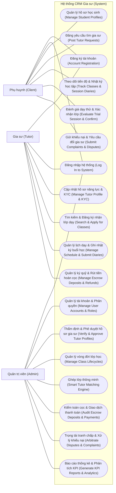

---

### 4. BIỂU ĐỒ VÀ ĐẶC TẢ CHI TIẾT TỪNG USE CASE CON

Dưới đây là chi tiết phân rã từng chức năng thành **Biểu đồ Use Case con** và **Bảng đặc tả chi tiết** theo đúng cấu trúc chuẩn của báo cáo tốt nghiệp:

---

#### 4.1. PHÂN HỆ PHỤ HUYNH (PARENT SUBSYSTEM)

##### 4.1.1. Chức năng Đăng ký tài khoản Phụ huynh (Register Parent Account)

**a) Biểu đồ Use Case con cho chức năng Đăng ký:**

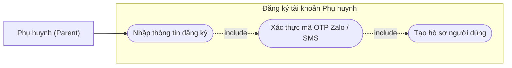

**b) Đặc tả chi tiết chức năng Đăng ký:**
* **Name:** Đăng ký tài khoản Phụ huynh
* **Actor:** Phụ huynh (Parent)
* **Description:** Cho phép người dùng là phụ huynh tạo tài khoản mới trên hệ thống bằng Số điện thoại và mã xác thực OTP gửi qua Zalo/SMS.
* **Normal Flow:**
  1. Phụ huynh truy cập trang Đăng ký tài khoản của Cổng Phụ huynh.
  2. Hệ thống hiển thị form đăng ký.
  3. Phụ huynh nhập các thông tin: Họ tên, Số điện thoại, Mật khẩu.
  4. Phụ huynh bấm nút "Đăng ký".
  5. Hệ thống kiểm tra: Các trường không được để trống, số điện thoại đúng 10 chữ số và chưa tồn tại trong hệ thống.
  6. Hệ thống sinh mã OTP 6 số và gửi về điện thoại của phụ huynh.
  7. Phụ huynh nhập mã OTP vào màn hình xác nhận.
  8. Hệ thống kiểm tra mã OTP chính xác và tạo tài khoản mới với vai trò `PARENT`.
  9. Hệ thống thông báo đăng ký thành công và chuyển sang màn hình Đăng nhập.
* **Alternative Flow:**
  1. *Số điện thoại đã tồn tại:* Hệ thống thông báo tài khoản đã có, gợi ý đăng nhập hoặc lấy lại mật khẩu.
  2. *Mã OTP sai hoặc hết hạn:* Hệ thống hiển thị thông báo lỗi và kích hoạt nút gửi lại mã.

---

##### 4.1.2. Chức năng Đăng nhập hệ thống Phụ huynh (Login Parent)

**a) Biểu đồ Use Case con cho chức năng Đăng nhập:**

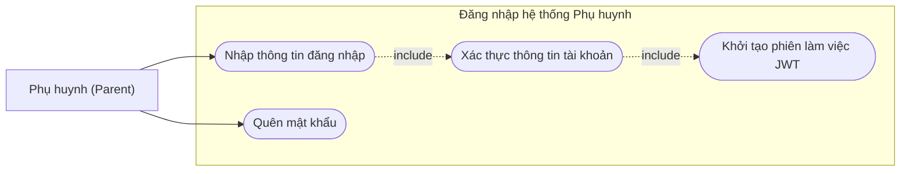

**b) Đặc tả chi tiết chức năng Đăng nhập:**
* **Name:** Đăng nhập hệ thống Phụ huynh
* **Actor:** Phụ huynh (Parent)
* **Description:** Xác thực thông tin tài khoản phụ huynh và cấp quyền truy cập vào Cổng Phụ huynh.
* **Normal Flow:**
  1. Phụ huynh truy cập trang Đăng nhập.
  2. Phụ huynh nhập Số điện thoại và Mật khẩu.
  3. Phụ huynh bấm nút "Đăng nhập".
  4. Hệ thống kiểm tra tài khoản tồn tại trong cơ sở dữ liệu.
  5. Hệ thống so khớp mật khẩu đã mã hóa và kiểm tra trạng thái hoạt động (không bị khóa).
  6. Hệ thống tạo phiên đăng nhập (JWT token), lưu cookie phiên làm việc.
  7. Hệ thống chuyển hướng phụ huynh vào trang Dashboard Cổng Phụ huynh.
* **Alternative Flow:**
  1. *Sai mật khẩu:* Hệ thống thông báo lỗi "Số điện thoại hoặc mật khẩu không chính xác".
  2. *Tài khoản bị khóa:* Hệ thống thông báo tài khoản tạm thời bị khóa do vi phạm.

---

##### 4.1.3. Nhóm chức năng Quản lý hồ sơ con (Manage Children Profiles)

**a) Biểu đồ Use Case con cho Quản lý hồ sơ con:**

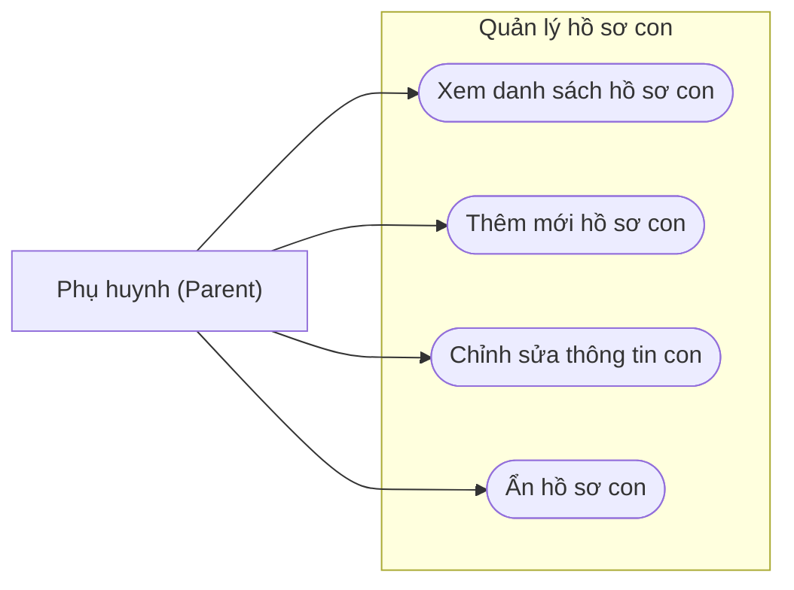

**b) Đặc tả chi tiết từng Use Case con trong nhóm Quản lý hồ sơ con:**

###### b.1) Đặc tả chi tiết: Xem danh sách hồ sơ con (UC-PAR-03.1)
* **Tên Use Case:** Xem danh sách hồ sơ con (View Children List)
* **Tác nhân (Actor):** Phụ huynh (Parent)
* **Mục đích (Description):** Cho phép phụ huynh xem toàn bộ danh sách hồ sơ các con đang theo học cùng trạng thái học tập (lớp đang học, gia sư phụ trách).
* **Tiền điều kiện (Pre-condition):** Phụ huynh đã đăng nhập thành công vào hệ thống.
* **Hậu điều kiện (Post-condition):** Danh sách hồ sơ các con được hiển thị đầy đủ trên màn hình.
* **Luồng sự kiện chính (Normal Flow):**
  1. Phụ huynh chọn mục "Hồ sơ các con" từ thanh điều hướng chính.
  2. Giao diện Cổng Phụ huynh gửi yêu cầu truy vấn danh sách học sinh theo `parentId`.
  3. Hệ thống kiểm tra xác thực phiên đăng nhập và truy vấn bảng `students` (chỉ lấy các hồ sơ có trạng thái `is_active = true`).
  4. Hệ thống hiển thị danh sách thẻ thông tin các con bao gồm: Họ tên, Giới tính, Khối lớp, Trường học, Học lực và số lớp học đang hoạt động.
* **Luồng sự kiện thay thế (Alternative Flow):**
  - *Chưa có hồ sơ con nào:* Hệ thống hiển thị giao diện trống (Empty State) kèm nút kêu gọi "Thêm hồ sơ con đầu tiên" để dẫn dắt phụ huynh khai báo.

###### b.2) Đặc tả chi tiết: Thêm mới hồ sơ con (UC-PAR-03.2)
* **Tên Use Case:** Thêm mới hồ sơ con (Create Child Profile)
* **Tác nhân (Actor):** Phụ huynh (Parent)
* **Mục đích (Description):** Khai báo thông tin học tập, tính cách và mục tiêu của con để phục vụ việc tạo yêu cầu tìm gia sư phù hợp.
* **Tiền điều kiện (Pre-condition):** Phụ huynh đã đăng nhập thành công.
* **Hậu điều kiện (Post-condition):** Một bản ghi hồ sơ học sinh mới được tạo và liên kết trực tiếp với tài khoản phụ huynh.
* **Luồng sự kiện chính (Normal Flow):**
  1. Phụ huynh tại trang "Hồ sơ các con" nhấn nút "Thêm con mới".
  2. Hệ thống hiển thị Form khai báo thông tin học sinh.
  3. Phụ huynh nhập các thông tin: Họ tên con, Giới tính, Ngày sinh, Trường học, Khối lớp hiện tại (từ Lớp 1 đến Lớp 12), Học lực (Giỏi, Khá, Trung bình, Yếu/Mất gốc), Tính cách (Ít nói, Hiếu động, Mất tập trung...) và Mục tiêu học tập (Luyện thi chuyển cấp, Củng cố kiến thức...).
  4. Phụ huynh nhấn nút "Lưu hồ sơ con".
  5. Hệ thống kiểm tra hợp lệ dữ liệu (Họ tên không rỗng, Khối lớp hợp lệ, Ngày sinh đúng quy định).
  6. Hệ thống thực hiện câu lệnh `INSERT INTO students` lưu thông tin vào cơ sở dữ liệu.
  7. Hệ thống thông báo: "Thêm hồ sơ con thành công!" và tự động làm mới danh sách hiển thị thẻ con vừa tạo.
* **Luồng sự kiện thay thế (Alternative Flow):**
  - *Dữ liệu nhập không hợp lệ:* Hệ thống highlight ô thông tin bị lỗi (ví dụ: ngày sinh không hợp lý) kèm thông báo lỗi cụ thể để phụ huynh sửa lại.

###### b.3) Đặc tả chi tiết: Chỉnh sửa thông tin con (UC-PAR-03.3)
* **Tên Use Case:** Chỉnh sửa thông tin con (Update Child Profile)
* **Tác nhân (Actor):** Phụ huynh (Parent)
* **Mục đích (Description):** Cập nhật lại khối lớp mới (lên lớp), điều chỉnh học lực, thay đổi trường học hoặc mục tiêu học tập của con theo thời gian.
* **Tiền điều kiện (Pre-condition):** Phụ huynh đã đăng nhập và đã có ít nhất một hồ sơ con trong danh sách.
* **Hậu điều kiện (Post-condition):** Dữ liệu hồ sơ con được cập nhật mới nhất trong cơ sở dữ liệu.
* **Luồng sự kiện chính (Normal Flow):**
  1. Phụ huynh bấm vào nút "Chỉnh sửa" (biểu tượng cây bút) trên thẻ hồ sơ của con cần sửa.
  2. Hệ thống hiển thị màn hình Modal điền sẵn các thông tin hiện tại của học sinh đó.
  3. Phụ huynh thay đổi các thông tin cần thiết (ví dụ: Nâng từ Lớp 9 lên Lớp 10, chuyển trường, cập nhật học lực).
  4. Phụ huynh nhấn nút "Lưu thay đổi".
  5. Hệ thống xác thực quyền sở hữu (hồ sơ con thuộc về đúng phụ huynh đang đăng nhập).
  6. Hệ thống cập nhật bản ghi trong cơ sở dữ liệu (`UPDATE students SET ... WHERE id = childId AND parent_id = parentId`).
  7. Hệ thống hiển thị thông báo "Cập nhật hồ sơ con thành công!".
* **Luồng sự kiện thay thế (Alternative Flow):**
  - *Lỗi mạng hoặc kết nối DB:* Hệ thống thông báo lỗi không lưu được dữ liệu và giữ nguyên dữ liệu trong form để phụ huynh thử lại.

###### b.4) Đặc tả chi tiết: Ẩn hồ sơ con (UC-PAR-03.4)
* **Tên Use Case:** Ẩn hồ sơ con (Archive / Deactivate Child Profile)
* **Tác nhân (Actor):** Phụ huynh (Parent)
* **Mục đích (Description):** Ẩn hồ sơ con khi con đã hoàn thành việc học hoặc không có nhu cầu thuê gia sư nữa, đồng thời đảm bảo bảo lưu toàn bộ lịch sử điểm danh, nhật ký học tập của các lớp học trước đó.
* **Tiền điều kiện (Pre-condition):** Phụ huynh đã đăng nhập; Hồ sơ con đang ở trạng thái hoạt động (`is_active = true`).
* **Hậu điều kiện (Post-condition):** Hồ sơ con được gắn cờ `is_active = false` (Soft Delete), không còn hiển thị ở màn hình chọn học sinh khi tạo lớp mới nhưng toàn bộ dữ liệu lịch sử nhật ký vẫn được bảo lưu an toàn.
* **Luồng sự kiện chính (Normal Flow):**
  1. Phụ huynh bấm vào nút "Tùy chọn" trên thẻ con -> Chọn "Ẩn hồ sơ này".
  2. Hệ thống hiển thị hộp thoại cảnh báo: "Bạn có chắc chắn muốn ẩn hồ sơ của [Tên con]? Toàn bộ lịch sử các lớp học cũ vẫn sẽ được lưu trữ an toàn."
  3. Phụ huynh nhấn "Xác nhận ẩn".
  4. Hệ thống kiểm tra ràng buộc: Nếu con đang có lớp học ở trạng thái `ACTIVE` (đang học chính thức) hoặc `TRIAL` (đang dạy thử), hệ thống từ chối ẩn và thông báo: "Không thể ẩn hồ sơ con đang có lớp học diễn ra. Vui lòng hoàn thành hoặc kết thúc lớp trước".
  5. Nếu không có lớp học nào đang chạy, hệ thống thực hiện cập nhật mềm: `UPDATE students SET is_active = false WHERE id = childId`.
  6. Hệ thống thông báo "Đã ẩn hồ sơ thành công" và loại bỏ thẻ hồ sơ con khỏi danh sách chính.
* **Luồng sự kiện thay thế (Alternative Flow):**
  - *Xem lại hồ sơ đã ẩn:* Phụ huynh có thể bấm bộ lọc "Hồ sơ đã lưu trữ" để xem lại hoặc bấm "Khôi phục hồ sơ" bất cứ lúc nào.

---

##### 4.1.4. Nhóm chức năng Quản lý yêu cầu tìm gia sư (Manage Tutor Requests)

**a) Biểu đồ Use Case con cho Quản lý yêu cầu tìm gia sư:**

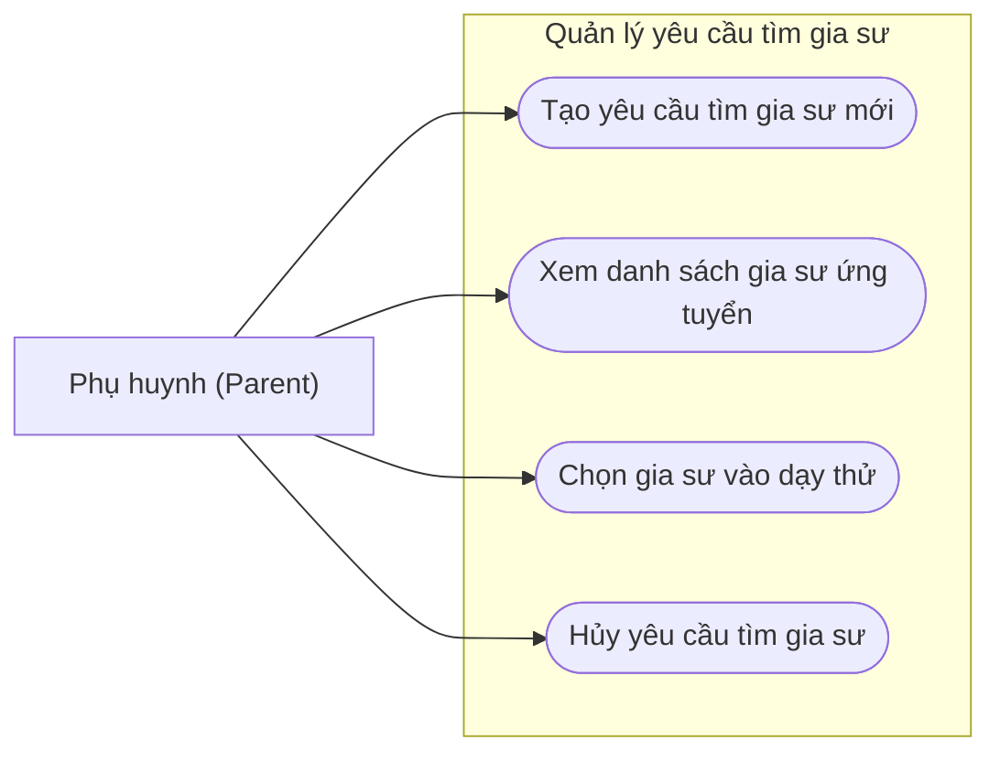

**b) Đặc tả chi tiết từng Use Case con trong nhóm Quản lý yêu cầu tìm gia sư:**

###### b.1) Đặc tả chi tiết: Tạo yêu cầu tìm gia sư mới (UC-PAR-04.1)
* **Tên Use Case:** Tạo yêu cầu tìm gia sư mới (Create Tutor Request)
* **Tác nhân (Actor):** Phụ huynh (Parent)
* **Mục đích (Description):** Đăng tin tìm gia sư hoàn toàn miễn phí, mô tả chi tiết con, môn học, lịch rảnh, tiêu chuẩn gia sư và mức học phí mong muốn.
* **Tiền điều kiện (Pre-condition):** Phụ huynh đã đăng nhập và đã có ít nhất một hồ sơ con.
* **Hậu điều kiện (Post-condition):** Yêu cầu được lưu ở trạng thái `OPEN` trên hệ thống và hiển thị trên Sàn lớp.
* **Luồng sự kiện chính (Normal Flow):**
  1. Phụ huynh nhấn nút "Đăng tin tìm gia sư" từ trang chủ hoặc mục yêu cầu.
  2. Phụ huynh chọn hồ sơ con cần học từ danh sách con đã khai báo.
  3. Chọn môn học cần gia sư kèm (Toán, Lý, Hóa, Tiếng Anh...), hình thức dạy (Tại nhà hoặc Online).
  4. Lựa chọn tiêu chuẩn gia sư mong muốn: Trình độ (Sinh viên sư phạm, Giáo viên tự do, Giảng viên), Giới tính, Khu vực trường ĐH.
  5. Chọn các ca rảnh trong tuần trên ma trận thứ/tiết học, nhập địa chỉ chi tiết và mức học phí dự kiến (hệ thống gợi ý mức sàn theo thị trường).
  6. Phụ huynh kiểm tra lại thông tin tóm tắt và nhấn "Xác nhận đăng tin".
  7. Hệ thống tự động sinh mã lớp dạng `CLS-YYYYMMDD-XXXX`, lưu vào bảng `classes` với trạng thái `OPEN`.
  8. Hệ thống thông báo: "Đăng yêu cầu thành công! Trung tâm sẽ điều phối gia sư phù hợp trong 24 giờ."
* **Luồng sự kiện thay thế (Alternative Flow):**
  - *Chưa có hồ sơ con:* Hệ thống chuyển hướng phụ huynh sang form thêm mới hồ sơ con trước khi tiếp tục tạo tin.

###### b.2) Đặc tả chi tiết: Xem danh sách gia sư ứng tuyển (UC-PAR-04.2)
* **Tên Use Case:** Xem danh sách gia sư ứng tuyển (View Tutor Applications)
* **Tác nhân (Actor):** Phụ huynh (Parent)
* **Mục đích (Description):** Giúp phụ huynh xem danh sách các gia sư đã được bộ phận điều phối đề xuất hoặc gia sư tự ứng tuyển vào lớp.
* **Tiền điều kiện (Pre-condition):** Lớp học đang ở trạng thái `OPEN` hoặc `MATCHING`.
* **Hậu điều kiện (Post-condition):** Phụ huynh xem được hồ sơ tóm tắt, kinh nghiệm, trường học và đánh giá của các ứng viên gia sư.
* **Luồng sự kiện chính (Normal Flow):**
  1. Phụ huynh vào mục "Yêu cầu của tôi" và chọn yêu cầu lớp học cần xem.
  2. Bấm vào tab "Danh sách ứng viên gia sư".
  3. Hệ thống truy vấn danh sách gia sư phù hợp (kèm điểm đối soát Smart Matching).
  4. Phụ huynh xem hồ sơ công khai của từng gia sư: Họ tên (ẩn SĐT), trường theo học, chuyên ngành, số năm kinh nghiệm, điểm tín nhiệm Karma và nhận xét từ các phụ huynh khác.
* **Luồng sự kiện thay thế (Alternative Flow):**
  - *Chưa có ứng viên:* Hệ thống hiển thị thông báo "Hệ thống đang đối soát và điều phối ứng viên chất lượng nhất cho gia đình, dự kiến có kết quả trong vài giờ".

###### b.3) Đặc tả chi tiết: Chọn gia sư vào dạy thử (UC-PAR-04.3)
* **Tên Use Case:** Chọn gia sư vào dạy thử (Select Tutor for Trial)
* **Tác nhân (Actor):** Phụ huynh (Parent)
* **Mục đích (Description):** Phụ huynh duyệt hồ sơ và chọn 01 gia sư ưng ý nhất để hệ thống sắp xếp lịch dạy thử (01 buổi với Giáo viên, 02 buổi với Sinh viên).
* **Tiền điều kiện (Pre-condition):** Có ít nhất 1 ứng viên gia sư đã vượt qua vòng sơ tuyển KYC.
* **Hậu điều kiện (Post-condition):** Trạng thái lớp chuyển sang `ASSIGNED_WAITING_TRIAL`, thông báo lịch hẹn dạy thử được gửi cho cả hai bên.
* **Luồng sự kiện chính (Normal Flow):**
  1. Tại màn hình xem danh sách ứng viên, phụ huynh bấm nút "Chọn gia sư này dạy thử".
  2. Hệ thống hiển thị hộp thoại xác nhận thời gian buổi dạy thử đầu tiên dựa trên lịch rảnh đã thỏa thuận.
  3. Phụ huynh bấm "Xác nhận chọn".
  4. Hệ thống cập nhật `tutor_id` cho lớp học, đổi trạng thái lớp sang `ASSIGNED_WAITING_TRIAL`.
  5. Hệ thống kích hoạt thông báo tự động (Web notification / Zalo ZNS) gửi tới Gia sư và Phụ huynh kèm lịch hẹn chi tiết.
* **Luồng sự kiện thay thế (Alternative Flow):**
  - *Gia sư hủy nhận lớp đột xuất:* Hệ thống tự động thông báo cho phụ huynh và đưa lớp quay lại sàn hoặc gợi ý ứng viên Top 2 tiếp theo.

###### b.4) Đặc tả chi tiết: Hủy yêu cầu tìm gia sư (UC-PAR-04.4)
* **Tên Use Case:** Hủy yêu cầu tìm gia sư (Cancel Tutor Request)
* **Tác nhân (Actor):** Phụ huynh (Parent)
* **Mục đích (Description):** Cho phép phụ huynh đóng/hủy tin tìm gia sư khi gia đình đổi kế hoạch học tập hoặc đã tự tìm được người kèm học.
* **Tiền điều kiện (Pre-condition):** Yêu cầu đang ở trạng thái `OPEN` hoặc `MATCHING` (chưa vào giai đoạn dạy thử có cọc).
* **Hậu điều kiện (Post-condition):** Trạng thái lớp chuyển sang `CANCELLED_BY_PARENT`, yêu cầu gỡ khỏi sàn tìm kiếm.
* **Luồng sự kiện chính (Normal Flow):**
  1. Phụ huynh mở chi tiết yêu cầu tìm gia sư.
  2. Bấm vào nút "Hủy yêu cầu này".
  3. Hệ thống hiển thị lý do hủy (Đã tìm được gia sư khác, Thay đổi lịch học, Khác...).
  4. Phụ huynh chọn lý do và nhấn "Xác nhận hủy".
  5. Hệ thống đổi trạng thái lớp sang `CANCELLED_BY_PARENT` và thông báo hủy thành công.
* **Luồng sự kiện thay thế (Alternative Flow):**
  - *Lớp đã trong giai đoạn dạy thử:* Hệ thống yêu cầu phụ huynh liên hệ trực tiếp Điều phối viên hoặc tạo yêu cầu dừng lớp để đảm bảo quyền lợi cọc cho gia sư.

---

##### 4.1.5. Nhóm chức năng Quản lý lớp học và nhật ký buổi dạy (Classes & Diaries)

**a) Biểu đồ Use Case con cho Lớp học và Nhật ký:**

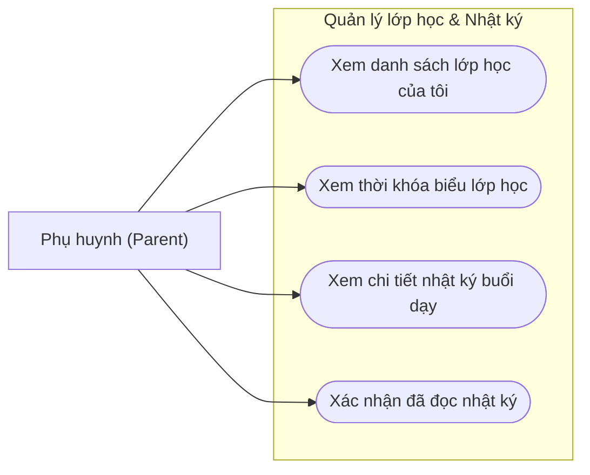

**b) Đặc tả chi tiết từng Use Case con trong nhóm Lớp học và Nhật ký:**

###### b.1) Đặc tả chi tiết: Xem danh sách lớp học của tôi (UC-PAR-05.1)
* **Tên Use Case:** Xem danh sách lớp học của tôi (View My Classes)
* **Tác nhân (Actor):** Phụ huynh (Parent)
* **Mục đích (Description):** Quản lý tập trung toàn bộ các lớp học của các con (lớp đang dạy thử, lớp đang học chính thức, lớp đã hoàn thành).
* **Tiền điều kiện (Pre-condition):** Phụ huynh đã đăng nhập thành công.
* **Hậu điều kiện (Post-condition):** Danh sách các lớp học cùng trạng thái hiện tại hiển thị đầy đủ.
* **Luồng sự kiện chính (Normal Flow):**
  1. Phụ huynh bấm vào mục "Lớp học của tôi" trên menu chính.
  2. Hệ thống truy vấn danh sách các lớp thuộc sở hữu của phụ huynh kèm thông tin gia sư phụ trách và tên con.
  3. Hệ thống phân chia theo các tab trạng thái: "Đang dạy thử", "Đang học chính thức", "Đã kết thúc".
  4. Phụ huynh xem tổng quan: Mã lớp, Tên môn, Con theo học, Gia sư đảm nhận, Số buổi đã hoàn thành.
* **Luồng sự kiện thay thế (Alternative Flow):**
  - *Không có lớp nào:* Hiển thị màn hình rỗng gợi ý phụ huynh tạo yêu cầu tìm gia sư mới.

###### b.2) Đặc tả chi tiết: Xem thời khóa biểu lớp học (UC-PAR-05.2)
* **Tên Use Case:** Xem thời khóa biểu lớp học (View Class Schedule)
* **Tác nhân (Actor):** Phụ huynh (Parent)
* **Mục đích (Description):** Theo dõi lịch học trong tuần của từng con, các buổi sắp diễn ra, buổi nghỉ có phép và buổi dạy bù.
* **Tiền điều kiện (Pre-condition):** Lớp học đã được xếp lịch học cố định.
* **Hậu điều kiện (Post-condition):** Lịch học được hiển thị dạng lịch tuần trực quan.
* **Luồng sự kiện chính (Normal Flow):**
  1. Phụ huynh chọn một lớp học cụ thể -> Chọn tab "Thời khóa biểu / Lịch dạy".
  2. Hệ thống tải dữ liệu lịch học từ bảng `session_schedules`.
  3. Hiển thị lịch dạng Calendar theo tuần/tháng với các màu sắc đánh dấu: Màu xanh (Buổi đã học xong), Màu vàng (Buổi sắp diễn ra), Màu xám/gạch chéo (Buổi gia sư báo nghỉ).
  4. Phụ huynh bấm vào từng buổi để xem chi tiết thời gian bắt đầu, kết thúc và ghi chú của gia sư.
* **Luồng sự kiện thay thế (Alternative Flow):**
  - *Có buổi dạy bù mới:* Hệ thống hiển thị badge thông báo đề xuất lịch bù để phụ huynh đối chiếu.

###### b.3) Đặc tả chi tiết: Xem chi tiết nhật ký buổi dạy (UC-PAR-05.3)
* **Tên Use Case:** Xem chi tiết nhật ký buổi dạy (View Session Diary)
* **Tác nhân (Actor):** Phụ huynh (Parent)
* **Mục đích (Description):** Phụ huynh theo dõi minh bạch tiến độ học tập: Điểm danh, kiến thức gia sư đã giảng dạy, điểm kiểm tra đầu giờ, nhận xét thái độ học và ảnh chụp bài tập/vở ghi sau mỗi buổi học.
* **Tiền điều kiện (Pre-condition):** Buổi học đã hoàn thành và gia sư đã điền nhật ký.
* **Hậu điều kiện (Post-condition):** Phụ huynh nắm rõ tình hình học tập thực tế của con.
* **Luồng sự kiện chính (Normal Flow):**
  1. Phụ huynh mở lớp học, chọn tab "Sổ liên lạc / Nhật ký buổi dạy".
  2. Chọn buổi học vừa hoàn tất trong danh sách các buổi.
  3. Hệ thống hiển thị chi tiết: Thời gian check-in/check-out của gia sư, tình trạng chuyên cần của con, bài học lý thuyết đã giảng, bài tập đã hoàn thành, điểm kiểm tra 15 phút, nhận xét của gia sư và các ảnh đính kèm (ảnh bài làm, phiếu điểm).
  4. Phụ huynh có thể phóng to ảnh để xem chi tiết nét chữ và bài sửa của gia sư.
* **Luồng sự kiện thay thế (Alternative Flow):**
  - *Gia sư chưa viết nhật ký sau 12h:* Hệ thống hiển thị thông báo "Chờ gia sư cập nhật nhật ký" và tự động gửi nhắc nhở cho gia sư.

###### b.4) Đặc tả chi tiết: Xác nhận đã đọc nhật ký (UC-PAR-05.4)
* **Tên Use Case:** Xác nhận đã đọc nhật ký (Acknowledge Diary)
* **Tác nhân (Actor):** Phụ huynh (Parent)
* **Mục đích (Description):** Phụ huynh xác nhận đã kiểm tra nội dung nhật ký và để lại phản hồi hoặc thả tim khích lệ gia sư.
* **Tiền điều kiện (Pre-condition):** Phụ huynh đang xem nhật ký buổi dạy của con.
* **Hậu điều kiện (Post-condition):** Hệ thống ghi nhận trạng thái đã xem `is_parent_acknowledged = true`, gia sư nhận được thông báo phản hồi.
* **Luồng sự kiện chính (Normal Flow):**
  1. Sau khi xem xong nhật ký buổi dạy, phụ huynh bấm nút "Xác nhận đã đọc".
  2. Phụ huynh có thể nhập một đoạn nhận xét/lời nhắn ngắn (ví dụ: "Cảm ơn thầy, hôm nay cháu rất hào hứng") và chọn biểu tượng đánh giá.
  3. Bấm "Gửi xác nhận".
  4. Hệ thống cập nhật bản ghi nhật ký: Đánh dấu thời gian phụ huynh đã xem và lưu phản hồi.
  5. Hệ thống gửi thông báo cho gia sư biết phụ huynh đã ghi nhận.
* **Luồng sự kiện thay thế (Alternative Flow):**
  - *Nếu thông tin nhật ký không đúng thực tế:* Phụ huynh nhấn nút "Báo cáo sai lệch nhật ký" để gửi yêu cầu đính chính tới điều phối viên.

---

##### 4.1.6. Nhóm chức năng Đánh giá và khiếu nại lớp học (Evaluate & Dispute)

**a) Biểu đồ Use Case con cho Đánh giá và Khiếu nại:**

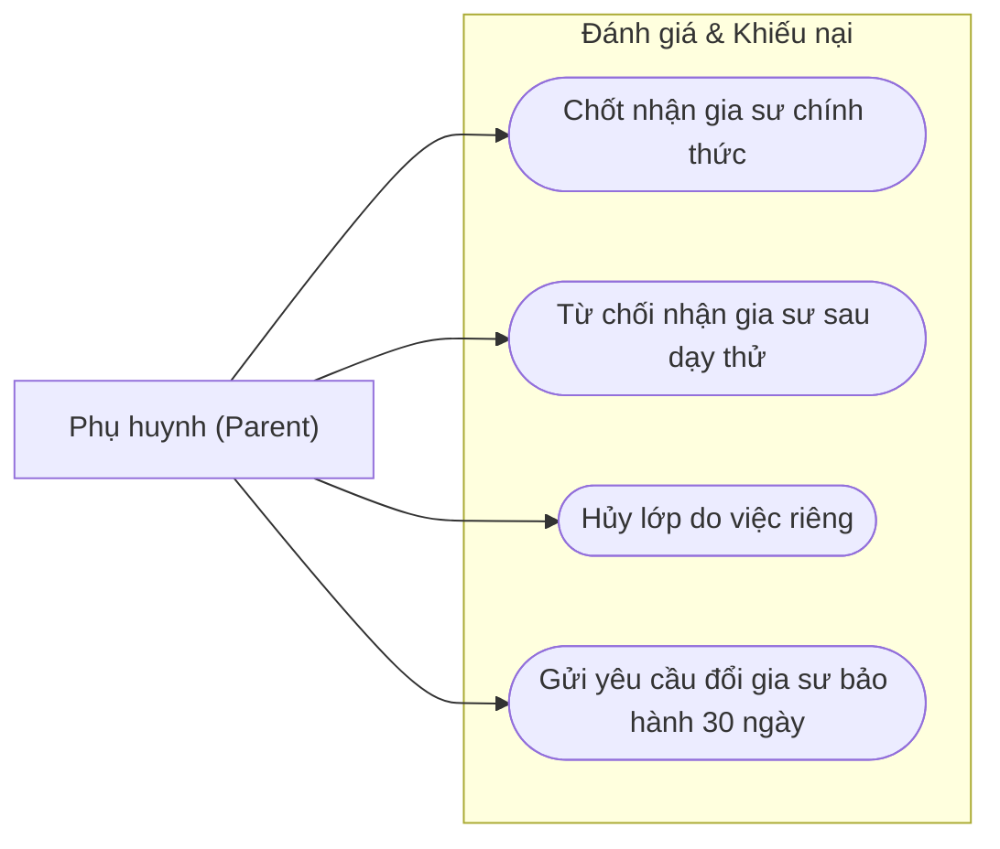

**b) Đặc tả chi tiết từng Use Case con trong nhóm Đánh giá và Khiếu nại:**

###### b.1) Đặc tả chi tiết: Chốt nhận gia sư chính thức (UC-PAR-06.1)
* **Tên Use Case:** Chốt nhận gia sư chính thức (Confirm Official Tutor)
* **Tác nhân (Actor):** Phụ huynh (Parent)
* **Mục đích (Description):** Sau khi kết thúc thời gian dạy thử (1 buổi với Giáo viên, 2 buổi với Sinh viên), phụ huynh đánh giá hài lòng và xác nhận chọn học chính thức lâu dài.
* **Tiền điều kiện (Pre-condition):** Đã hoàn thành đủ số buổi dạy thử quy định.
* **Hậu điều kiện (Post-condition):** Trạng thái lớp chuyển sang `ACTIVE` (Học chính thức), tiền cọc tạm giữ chuyển thành doanh thu phí trung tâm, gia sư được cộng điểm tín nhiệm.
* **Luồng sự kiện chính (Normal Flow):**
  1. Phụ huynh nhận được thông báo nghiệm thu buổi dạy thử.
  2. Phụ huynh bấm vào liên kết đánh giá, chấm điểm số sao (1-5 sao) về tác phong, kiến thức chuyên môn và phương pháp sư phạm của gia sư.
  3. Phụ huynh tick chọn tùy chọn: "Đồng ý nhận gia sư chính thức và tiếp tục học theo thời khóa biểu".
  4. Phụ huynh nhấn "Xác nhận chốt lớp".
  5. Hệ thống cập nhật trạng thái lớp sang `ACTIVE`.
  6. Hệ thống chuyển đổi khoản tiền cọc của gia sư đang tạm giữ (Escrow) thành doanh thu phí dịch vụ của trung tâm.
  7. Hệ thống tự động cộng +10 điểm Karma uy tín cho gia sư và gửi thông báo chúc mừng tới cả hai bên.
* **Luồng sự kiện thay thế (Alternative Flow):**
  - *Quá hạn 48h phụ huynh không phản hồi:* Hệ thống gửi tin nhắn nhắc nhở tự động, điều phối viên CRM sẽ gọi điện chăm sóc khách hàng.

###### b.2) Đặc tả chi tiết: Từ chối nhận gia sư sau dạy thử (UC-PAR-06.2)
* **Tên Use Case:** Từ chối nhận gia sư sau dạy thử (Reject Tutor After Trial)
* **Tác nhân (Actor):** Phụ huynh (Parent)
* **Mục đích (Description):** Phụ huynh cảm thấy gia sư chưa phù hợp về phương pháp hoặc kiến thức trong các buổi dạy thử và yêu cầu dừng hoặc đổi gia sư khác.
* **Tiền điều kiện (Pre-condition):** Đang trong hoặc ngay sau thời gian dạy thử.
* **Hậu điều kiện (Post-condition):** Lớp được giải phóng khỏi gia sư hiện tại, kích hoạt quy trình bảo hành/đổi gia sư mới.
* **Luồng sự kiện chính (Normal Flow):**
  1. Phụ huynh mở giao diện nghiệm thu dạy thử, chọn "Không đồng ý nhận chính thức".
  2. Hệ thống yêu cầu phụ huynh nêu rõ lý do: (Phương pháp chưa phù hợp, Đến muộn, Kiến thức không vững, Con không tiếp thu được...).
  3. Phụ huynh bấm "Gửi từ chối".
  4. Hệ thống cập nhật trạng thái lớp, tạo Ticket điều phối gia sư thay thế miễn phí trong 24 giờ.
  5. Hệ thống kích hoạt quy trình giải trình đối soát cọc cho gia sư.
* **Luồng sự kiện thay thế (Alternative Flow):**
  - *Phụ huynh muốn dừng hẳn không tìm gia sư nữa:* Hệ thống đóng lớp và ghi nhận khảo sát lý do.

###### b.3) Đặc tả chi tiết: Hủy lớp do việc riêng (UC-PAR-06.3)
* **Tên Use Case:** Hủy lớp do việc riêng (Cancel Class for Personal Reason)
* **Tác nhân (Actor):** Phụ huynh (Parent)
* **Mục đích (Description):** Phụ huynh chủ động dừng lớp học vì lý do đột xuất của gia đình (con chuyển trường, đi nước ngoài, gia đình bận việc riêng).
* **Tiền điều kiện (Pre-condition):** Lớp đang ở giai đoạn `ASSIGNED_WAITING_TRIAL` hoặc `ACTIVE`.
* **Hậu điều kiện (Post-condition):** Lớp chuyển sang trạng thái `CANCELLED_BY_PARENT`, bảo vệ quyền lợi tiền cọc 100% cho gia sư.
* **Luồng sự kiện chính (Normal Flow):**
  1. Phụ huynh vào trang chi tiết lớp học -> Chọn "Yêu cầu kết thúc lớp học".
  2. Chọn lý do: "Gia đình có việc riêng không thể tiếp tục học".
  3. Hệ thống hiển thị cam kết: Khi phụ huynh tự ý hủy lớp, gia sư sẽ được hoàn lại 100% tiền cọc và không bị trừ bất kỳ điểm tín nhiệm nào.
  4. Phụ huynh bấm "Xác nhận kết thúc lớp".
  5. Hệ thống đóng lớp học, kích hoạt lệnh hoàn 100% tiền cọc vào ví cọc của gia sư.
* **Luồng sự kiện thay thế (Alternative Flow):**
  - *Còn học phí chưa thanh toán cho các buổi gia sư đã dạy:* Hệ thống nhắc nhở phụ huynh hoàn tất thanh toán trực tiếp số buổi đã học cho gia sư.

###### b.4) Đặc tả chi tiết: Gửi yêu cầu đổi gia sư bảo hành 30 ngày (UC-PAR-06.4)
* **Tên Use Case:** Gửi yêu cầu đổi gia sư bảo hành 30 ngày (Warranty Request for Tutor Replacement)
* **Tác nhân (Actor):** Phụ huynh (Parent)
* **Mục đích (Description):** Thực thi chính sách bảo hành vàng của trung tâm: Trong vòng 30 ngày kể từ ngày học chính thức, phụ huynh có quyền đổi gia sư miễn phí nếu thấy kết quả học tập không tiến bộ.
* **Tiền điều kiện (Pre-condition):** Lớp học chính thức `ACTIVE` chưa quá 30 ngày.
* **Hậu điều kiện (Post-condition):** Một Ticket bảo hành khẩn cấp được đẩy lên bàn làm việc của Điều phối viên CRM.
* **Luồng sự kiện chính (Normal Flow):**
  1. Phụ huynh vào mục "Bảo hành lớp học" trên màn hình lớp đang học.
  2. Bấm "Yêu cầu đổi gia sư theo chính sách bảo hành 30 ngày".
  3. Phụ huynh điền lý do chi tiết và yêu cầu đặc biệt đối với gia sư mới (ví dụ: Cần gia sư nghiêm khắc hơn, cần giáo viên có kinh nghiệm luyện thi chuyên).
  4. Bấm "Gửi yêu cầu bảo hành".
  5. Hệ thống kiểm tra thời gian kích hoạt lớp ($\le 30$ ngày).
  6. Hệ thống tạo Ticket bảo hành có độ ưu tiên cao (`Priority: URGENT`) và gửi thông báo cho Điều phối viên phụ trách lớp.
  7. Hệ thống hiển thị thông báo: "Yêu cầu bảo hành đã được tiếp nhận. Điều phối viên sẽ liên hệ với gia đình trong vòng 2 giờ làm việc để ghép gia sư mới hoàn toàn miễn phí".
* **Luồng sự kiện thay thế (Alternative Flow):**
  - *Đã quá thời hạn bảo hành 30 ngày:* Hệ thống thông báo chính sách bảo hành miễn phí 30 ngày đã hết hạn và chuyển sang hướng dẫn tạo lớp học mới.

---

#### 4.2. PHÂN HỆ GIA SƯ (TUTOR SUBSYSTEM)

##### 4.2.1. Chức năng Đăng ký tài khoản Gia sư (Register Tutor Account)

**a) Biểu đồ Use Case con cho Đăng ký Gia sư:**

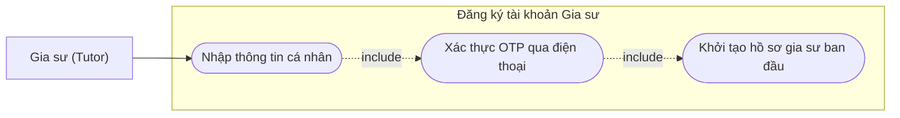

**b) Đặc tả chi tiết chức năng: Đăng ký tài khoản Gia sư (UC-TUT-01)**
* **Name:** Đăng ký tài khoản Gia sư (Register Tutor Account)
* **Actor:** Gia sư (Tutor)
* **Description:** Giáo viên hoặc sinh viên đăng ký tài khoản nhận lớp trên Tutor Portal.
* **Normal Flow:**
  1. Gia sư vào trang Đăng ký Tutor Portal.
  2. Nhập: Họ tên, Số điện thoại, Email, Mật khẩu, Phân loại (Giáo viên / Sinh viên).
  3. Bấm nút "Đăng ký nhận lớp".
  4. Hệ thống gửi mã OTP xác thực qua tin nhắn.
  5. Gia sư nhập mã OTP hợp lệ.
  6. Hệ thống tạo tài khoản mới với vai trò `TUTOR` và điều hướng sang bước nộp hồ sơ KYC.
* **Alternative Flow:** Số điện thoại đã được đăng ký: Báo lỗi tài khoản đã tồn tại.

---

##### 4.2.2. Chức năng Đăng nhập hệ thống Gia sư (Login Tutor)

**a) Biểu đồ Use Case con cho Đăng nhập Gia sư:**

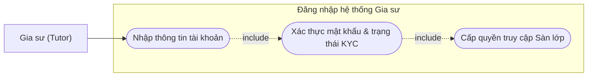

**b) Đặc tả chi tiết chức năng: Đăng nhập hệ thống Gia sư (UC-TUT-02)**
* **Name:** Đăng nhập hệ thống Gia sư (Login Tutor)
* **Actor:** Gia sư (Tutor)
* **Description:** Xác thực gia sư và cấp quyền truy cập vào Cổng thông tin Gia sư.
* **Normal Flow:**
  1. Gia sư vào trang Đăng nhập Tutor Portal.
  2. Nhập Số điện thoại/Email và Mật khẩu.
  3. Bấm "Đăng nhập".
  4. Hệ thống kiểm tra mật khẩu chính xác và trạng thái tài khoản không bị khóa.
  5. Hệ thống cấp JWT Token và chuyển gia sư vào màn hình Dashboard xem tình trạng hồ sơ và lớp mới.
* **Alternative Flow:** Tài khoản bị khóa do điểm Karma < 50: Báo lỗi tạm khóa quyền nhận lớp.

---

##### 4.2.3. Nhóm chức năng Quản lý hồ sơ năng lực KYC (Manage Tutor Profile & KYC)

**a) Biểu đồ Use Case con cho Quản lý hồ sơ năng lực:**

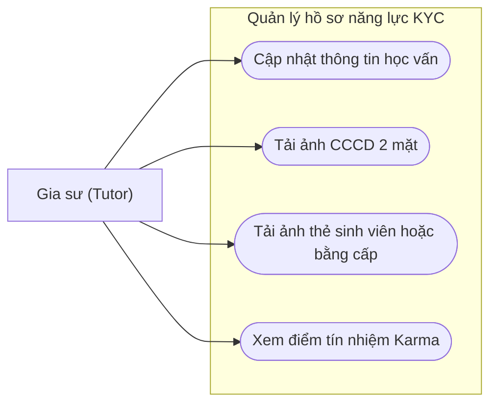

**b) Đặc tả chi tiết từng Use Case con trong nhóm Quản lý hồ sơ năng lực KYC:**

###### b.1) Đặc tả chi tiết: Cập nhật thông tin học vấn (UC-TUT-03.1)
* **Tên Use Case:** Cập nhật thông tin học vấn (Update Academic Profile)
* **Tác nhân (Actor):** Gia sư (Tutor)
* **Mục đích (Description):** Cho phép gia sư khai báo chi tiết trường đại học, chuyên ngành, năm tốt nghiệp, điểm thi đại học, các môn sở trường và bán kính nhận lớp (GPS).
* **Tiền điều kiện (Pre-condition):** Gia sư đã đăng nhập thành công vào Tutor Portal.
* **Hậu điều kiện (Post-condition):** Thông tin hồ sơ năng lực được lưu vào hệ thống, phục vụ thuật toán Smart Matching.
* **Luồng sự kiện chính (Normal Flow):**
  1. Gia sư vào mục "Hồ sơ cá nhân & Năng lực".
  2. Gia sư điền thông tin: Trường ĐH theo học, Chuyên ngành, Năm sinh, Điểm thi đại học, Khu vực có thể dạy (quận/huyện, bán kính tối đa), Mức học phí mong muốn theo giờ.
  3. Chọn danh sách các môn có thể dạy và khối lớp tự tin nhất.
  4. Bấm "Lưu thông tin học vấn".
  5. Hệ thống kiểm tra hợp lệ dữ liệu và lưu vào cơ sở dữ liệu `tutor_profiles`.
  6. Hệ thống hiển thị thông báo "Cập nhật thông tin học vấn thành công".
* **Luồng sự kiện thay thế (Alternative Flow):**
  - *Dữ liệu để trống trường bắt buộc:* Hệ thống hiển thị cảnh báo đỏ tại các trường chưa nhập.

###### b.2) Đặc tả chi tiết: Tải ảnh CCCD 2 mặt (UC-TUT-03.2)
* **Tên Use Case:** Tải ảnh CCCD 2 mặt (Upload Citizen ID Cards)
* **Tác nhân (Actor):** Gia sư (Tutor)
* **Mục đích (Description):** Tải ảnh chụp mặt trước và mặt sau Căn cước công dân gắn chip để Trung tâm xác minh danh tính và phòng ngừa rủi ro gian lận.
* **Tiền điều kiện (Pre-condition):** Gia sư đang ở bước hoàn thiện hồ sơ KYC.
* **Hậu điều kiện (Post-condition):** Ảnh CCCD được mã hóa và tải lên máy chủ Cloud Storage an toàn.
* **Luồng sự kiện chính (Normal Flow):**
  1. Gia sư tại mục "Xác thực danh tính (KYC)" bấm vào khung "Tải ảnh mặt trước CCCD" và "Tải ảnh mặt sau CCCD".
  2. Chọn tệp ảnh rõ nét chụp từ điện thoại hoặc máy tính.
  3. Hệ thống hiển thị ảnh xem trước (Preview) để gia sư kiểm tra độ rõ nét của số CCCD và ảnh chân dung.
  4. Gia sư bấm "Xác nhận tải ảnh CCCD".
  5. Hệ thống kiểm tra định dạng tệp (.jpg, .jpeg, .png, dung lượng $\le 10$MB).
  6. Hệ thống lưu đường dẫn ảnh bảo mật vào hồ sơ gia sư.
* **Luồng sự kiện thay thế (Alternative Flow):**
  - *Tệp ảnh bị mờ hoặc quá mờ:* Hệ thống nhắc nhở gia sư chụp lại ảnh đủ ánh sáng, không mất góc.

###### b.3) Đặc tả chi tiết: Tải ảnh thẻ sinh viên hoặc bằng cấp (UC-TUT-03.3)
* **Tên Use Case:** Tải ảnh thẻ sinh viên hoặc bằng cấp (Upload Student Card / Degree)
* **Tác nhân (Actor):** Gia sư (Tutor)
* **Mục đích (Description):** Cung cấp bằng chứng minh bạch về trình độ học vấn (Thẻ sinh viên còn hạn hoặc Bằng cử nhân sư phạm/bằng ĐH) để được duyệt nhận lớp.
* **Tiền điều kiện (Pre-condition):** Đã hoàn tất tải ảnh CCCD.
* **Hậu điều kiện (Post-condition):** Toàn bộ bộ hồ sơ KYC chuyển sang trạng thái chờ Quản trị viên duyệt `KYC_PENDING`.
* **Luồng sự kiện chính (Normal Flow):**
  1. Gia sư chọn phân loại: Nếu là Sinh viên -> Tải ảnh Thẻ sinh viên 2 mặt; Nếu là Giáo viên -> Tải ảnh Bằng tốt nghiệp ĐH hoặc Chứng chỉ nghiệp vụ sư phạm.
  2. Gia sư bấm "Gửi toàn bộ hồ sơ xét duyệt KYC".
  3. Hệ thống kiểm tra đủ 3 tệp ảnh bắt buộc (CCCD trước, sau, Bằng cấp/Thẻ SV).
  4. Hệ thống cập nhật trạng thái gia sư sang `KYC_PENDING` và đẩy hồ sơ vào hàng đợi kiểm duyệt của Admin.
  5. Hệ thống gửi thông báo: "Hồ sơ của bạn đã được gửi thành công. Ban Quản trị sẽ xét duyệt trong vòng 2-4 giờ làm việc".
* **Luồng sự kiện thay thế (Alternative Flow):**
  - *Chưa đủ hồ sơ:* Nút gửi duyệt bị vô hiệu hóa kèm nhắc nhở bổ sung tài liệu còn thiếu.

###### b.4) Đặc tả chi tiết: Xem điểm tín nhiệm Karma (UC-TUT-03.4)
* **Tên Use Case:** Xem điểm tín nhiệm Karma (View Karma Credit Score)
* **Tác nhân (Actor):** Gia sư (Tutor)
* **Mục đích (Description):** Theo dõi chỉ số uy tín tích lũy của bản thân, lịch sử cộng/trừ điểm Karma và các quyền lợi ưu tiên khi nhận lớp.
* **Tiền điều kiện (Pre-condition):** Gia sư đã đăng nhập hệ thống.
* **Hậu điều kiện (Post-condition):** Hiển thị thang điểm tín nhiệm trực quan (từ 0 đến 100 điểm) và bảng lịch sử giao dịch điểm.
* **Luồng sự kiện chính (Normal Flow):**
  1. Gia sư bấm vào biểu tượng "Điểm uy tín Karma" trên góc màn hình Dashboard.
  2. Hệ thống hiển thị:
     - Điểm Karma hiện tại (ví dụ: 85/100 - Hạng Vàng).
     - Trạng thái nhận lớp: Được phép nhận lớp ngay không giới hạn (nếu $\ge 70$), Cảnh báo (50-69), Tạm khóa quyền nhận lớp ($< 50$).
     - Lịch sử biến động: +20 điểm (Duyệt KYC thành công), +10 điểm (Hoàn thành lớp dạy thử tốt), -30 điểm (Bỏ lớp đột xuất).
* **Luồng sự kiện thay thế (Alternative Flow):**
  - *Điểm dưới 50:* Hệ thống hiển thị hướng dẫn làm bài kiểm tra đạo đức nghề nghiệp hoặc nộp đơn khiếu nại để xin phục hồi điểm.

---

##### 4.2.4. Nhóm chức năng Quản lý nhận lớp và nộp tiền cọc (Claim & Deposit)

**a) Biểu đồ Use Case con cho Nhận lớp và nộp tiền cọc:**

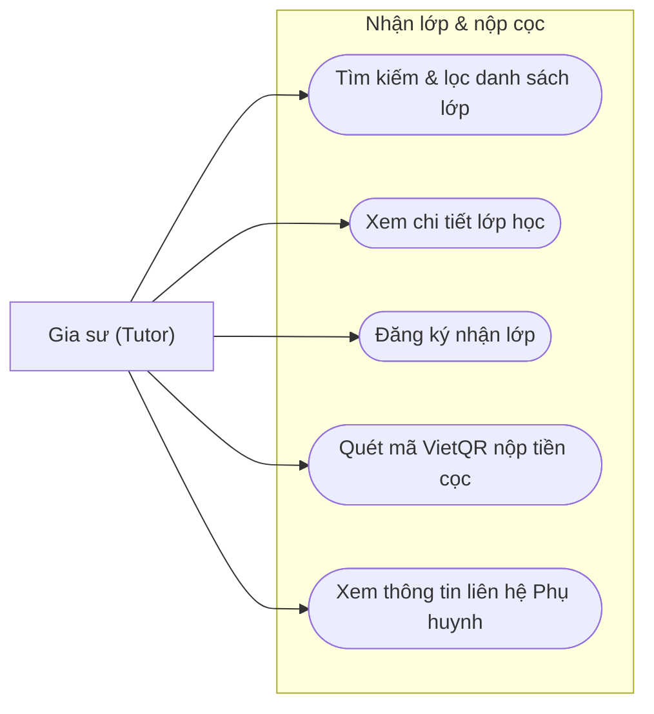

**b) Đặc tả chi tiết từng Use Case con trong nhóm Nhận lớp và nộp cọc:**

###### b.1) Đặc tả chi tiết: Tìm kiếm & lọc danh sách lớp (UC-TUT-04.1)
* **Tên Use Case:** Tìm kiếm & lọc danh sách lớp (Search & Filter Classes)
* **Tác nhân (Actor):** Gia sư (Tutor)
* **Mục đích (Description):** Tìm kiếm các lớp học phù hợp với môn sở trường, thời gian rảnh và vị trí địa lý của bản thân trên Sàn lớp.
* **Tiền điều kiện (Pre-condition):** Gia sư truy cập trang Sàn lớp (Tutor Exchange).
* **Hậu điều kiện (Post-condition):** Danh sách các lớp học trạng thái `OPEN` được lọc theo tiêu chí hiển thị trên màn hình.
* **Luồng sự kiện chính (Normal Flow):**
  1. Gia sư vào mục "Sàn lớp mới".
  2. Gia sư chọn các bộ lọc: Môn học (Toán, Văn, Anh...), Khối lớp (Cấp 1, Cấp 2, Cấp 3), Khu vực quận/huyện, Hình thức (Tại nhà / Online), Mức học phí tối thiểu.
  3. Bấm "Áp dụng bộ lọc".
  4. Hệ thống truy vấn các lớp có trạng thái `OPEN` thỏa mãn tiêu chuẩn.
  5. Hiển thị danh sách lớp dạng Card: Mã lớp, Môn học, Khối lớp, Số buổi/tuần, Tiền học phí, Mức tiền cọc quy định và Khoảng cách ước tính (km).
* **Luồng sự kiện thay thế (Alternative Flow):**
  - *Không có lớp phù hợp:* Hiển thị thông báo "Hiện chưa có lớp phù hợp, bạn có thể bật tính năng thông báo tự động khi có lớp mới".

###### b.2) Đặc tả chi tiết: Xem chi tiết lớp học (UC-TUT-04.2)
* **Tên Use Case:** Xem chi tiết lớp học (View Class Details)
* **Tác nhân (Actor):** Gia sư (Tutor)
* **Mục đích (Description):** Xem chi tiết yêu cầu giảng dạy, lịch học trong tuần, học lực hiện tại của học sinh và địa chỉ tổng quan (chưa hiện SĐT).
* **Tiền điều kiện (Pre-condition):** Gia sư bấm vào một thẻ lớp học trên sàn.
* **Hậu điều kiện (Post-condition):** Màn hình chi tiết yêu cầu lớp học được hiển thị.
* **Luồng sự kiện chính (Normal Flow):**
  1. Gia sư bấm vào thẻ lớp học quan tâm.
  2. Hệ thống hiển thị:
     - Yêu cầu học sinh: Khối lớp, Học lực (Yếu, Khá...), Tính cách, Mục tiêu học.
     - Lịch dạy yêu cầu: Chi tiết các buổi tối trong tuần (ví dụ: Thứ 3 - Thứ 6: 18h00 - 20h00).
     - Địa chỉ học: Tên đường, Phường, Quận (chưa hiện số nhà cụ thể và số điện thoại).
     - Học phí: 200.000 VNĐ / buổi (Thanh toán cuối tháng).
     - Mức phí nhận lớp / tiền cọc cam kết: 500.000 VNĐ.
* **Luồng sự kiện thay thế (Alternative Flow):**
  - *Lớp đã có người khác giữ chỗ:* Hệ thống hiển thị nhãn "Đang có gia sư giữ chỗ nộp cọc" và làm mờ nút nhận lớp.

###### b.3) Đặc tả chi tiết: Đăng ký nhận lớp (UC-TUT-04.3)
* **Tên Use Case:** Đăng ký nhận lớp (Claim Class Slot)
* **Tác nhân (Actor):** Gia sư (Tutor)
* **Mục đích (Description):** Khóa giữ chỗ lớp học trong vòng 10 phút để gia sư tiến hành nộp tiền cọc cam kết.
* **Tiền điều kiện (Pre-condition):** Gia sư đã được duyệt hồ sơ KYC (`KYC_VERIFIED`), điểm Karma $\ge 70$, lớp đang ở trạng thái `OPEN`.
* **Hậu điều kiện (Post-condition):** Lớp chuyển sang trạng thái tạm khóa giữ chỗ `RESERVED`, bộ đếm lùi 10 phút được kích hoạt.
* **Luồng sự kiện chính (Normal Flow):**
  1. Tại màn hình chi tiết lớp, gia sư bấm nút "Nhận lớp này ngay".
  2. Hệ thống kiểm tra điều kiện nhận lớp:
     - Trạng thái tài khoản: Đã duyệt KYC.
     - Điểm Karma: $\ge 70$.
     - Không có lớp nào khác đang bị phạt hoặc tranh chấp.
  3. Hệ thống khóa lớp học tạm thời trong 10 phút, ngăn các gia sư khác nhận cùng lúc.
  4. Hệ thống chuyển ngay sang màn hình nộp cọc bảo chứng.
* **Luồng sự kiện thay thế (Alternative Flow):**
  - *Gia sư chưa duyệt KYC:* Hệ thống thông báo: "Bạn cần hoàn thiện hồ sơ KYC và được xét duyệt để mở khóa quyền nhận lớp".
  - *Điểm Karma dưới 70:* Báo lỗi không đủ điều kiện tín nhiệm.

###### b.4) Đặc tả chi tiết: Quét mã VietQR nộp tiền cọc (UC-TUT-04.4)
* **Tên Use Case:** Quét mã VietQR nộp tiền cọc (Pay Deposit via Dynamic VietQR)
* **Tác nhân (Actor):** Gia sư (Tutor)
* **Mục đích (Description):** Chuyển khoản nộp tiền cọc cam kết nhận lớp thông qua mã VietQR động được tạo tự động với cú pháp nạp tiền chuẩn xác.
* **Tiền điều kiện (Pre-condition):** Gia sư đang trong thời gian giữ chỗ 10 phút của lớp học.
* **Hậu điều kiện (Post-condition):** Tiền cọc được nạp vào tài khoản Escrow tạm giữ của hệ thống, trạng thái lớp chuyển sang `ASSIGNED_WAITING_TRIAL`.
* **Luồng sự kiện chính (Normal Flow):**
  1. Hệ thống hiển thị mã VietQR động tích hợp thông tin: Tên ngân hàng, Số tài khoản trung tâm, Số tiền cọc chính xác (ví dụ: 500.000 VNĐ), Nội dung chuyển khoản duy nhất (ví dụ: `DATN CLS20261021 TUT08`).
  2. Gia sư mở App Ngân hàng trên điện thoại cá nhân và quét mã VietQR.
  3. Gia sư bấm "Xác nhận chuyển khoản" trên ứng dụng ngân hàng.
  4. Cổng thanh toán Ngân hàng ghi nhận biến động số dư và gửi Webhook thông báo thành công về máy chủ CRM.
  5. Hệ thống xác thực số tiền và mã nội dung khớp với lớp học.
  6. Hệ thống đổi trạng thái lớp sang `ASSIGNED_WAITING_TRIAL` và gửi thông báo xác nhận đã nộp cọc thành công.
* **Luồng sự kiện thay thế (Alternative Flow):**
  - *Hết thời gian 10 phút chưa chuyển:* Hệ thống tự động hủy phiên giữ chỗ và đưa lớp quay lại Sàn công khai cho các gia sư khác.

###### b.5) Đặc tả chi tiết: Xem thông tin liên hệ Phụ huynh (UC-TUT-04.5)
* **Tên Use Case:** Xem thông tin liên hệ Phụ huynh (View Parent Contact Information)
* **Tác nhân (Actor):** Gia sư (Tutor)
* **Mục đích (Description):** Mở khóa toàn bộ thông tin liên hệ gồm Số điện thoại và Địa chỉ nhà chính xác của phụ huynh để gia sư gọi điện trao đổi và thống nhất buổi dạy thử.
* **Tiền điều kiện (Pre-condition):** Gia sư đã nộp cọc thành công cho lớp học đó.
* **Hậu điều kiện (Post-condition):** Gia sư có đầy đủ thông tin để liên hệ làm việc với phụ huynh.
* **Luồng sự kiện chính (Normal Flow):**
  1. Ngay sau khi thanh toán cọc thành công, giao diện tự động làm mới màn hình "Lớp học đã nhận".
  2. Hệ thống hiển thị:
     - Số điện thoại liên hệ trực tiếp của Phụ huynh.
     - Địa chỉ chi tiết (Số nhà, tên ngõ, tên đường).
     - Ghi chú dặn dò của phụ huynh (nếu có).
  3. Hệ thống hiển thị nút "Gọi ngay cho Phụ huynh" và hướng dẫn mẫu chào hỏi phụ huynh chuyên nghiệp.
* **Luồng sự kiện thay thế (Alternative Flow):**
  - *Không gọi được cho phụ huynh sau 3 cuộc:* Gia sư có nút "Báo cáo không liên hệ được phụ huynh" để Điều phối viên hỗ trợ kết nối.

---

##### 4.2.5. Nhóm chức năng Quản lý lịch dạy và nhật ký buổi học (Schedule & Diaries)

**a) Biểu đồ Use Case con cho Lịch dạy và Nhật ký:**

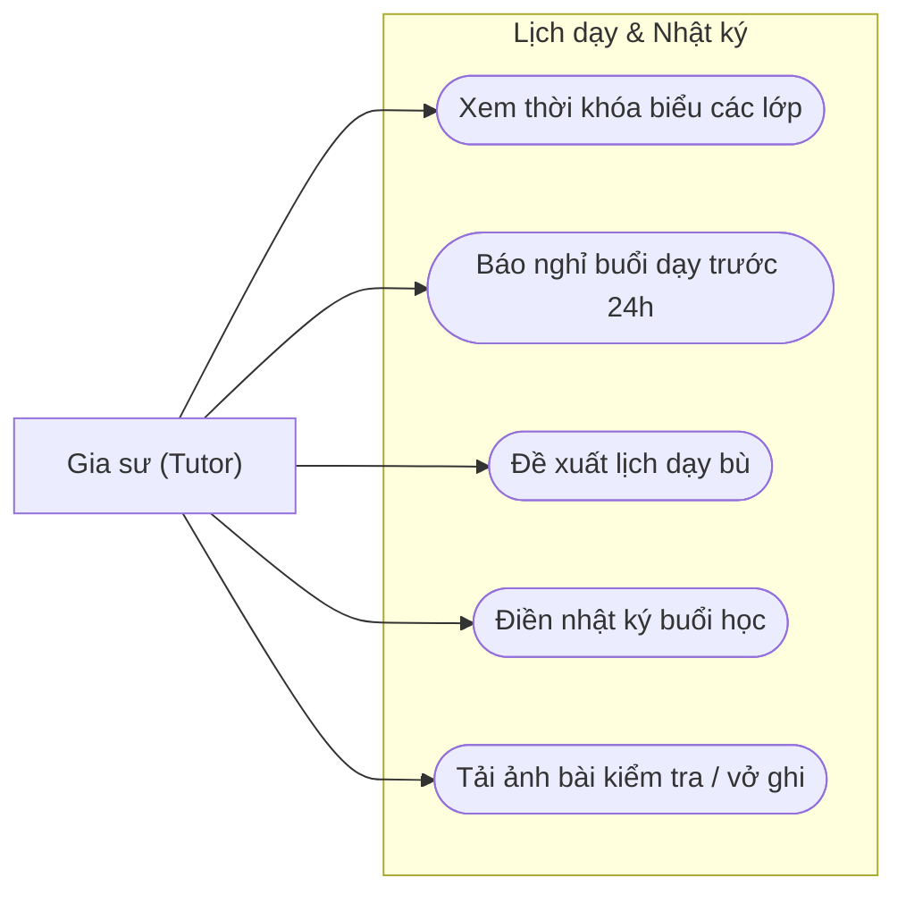

**b) Đặc tả chi tiết từng Use Case con trong nhóm Lịch dạy và Nhật ký:**

###### b.1) Đặc tả chi tiết: Xem thời khóa biểu các lớp (UC-TUT-05.1)
* **Tên Use Case:** Xem thời khóa biểu các lớp (View Teaching Schedule)
* **Tác nhân (Actor):** Gia sư (Tutor)
* **Mục đích (Description):** Theo dõi lịch giảng dạy tổng hợp của tất cả các lớp đang phụ trách theo dạng lịch tuần/tháng để sắp xếp thời gian hợp lý.
* **Tiền điều kiện (Pre-condition):** Gia sư đã đăng nhập Tutor Portal.
* **Hậu điều kiện (Post-condition):** Toàn bộ lịch dạy các lớp hiển thị trực quan theo mốc thời gian.
* **Luồng sự kiện chính (Normal Flow):**
  1. Gia sư chọn mục "Lịch dạy của tôi".
  2. Hệ thống truy vấn lịch các buổi học trong tuần từ bảng `session_schedules`.
  3. Hiển thị lịch dạng Calendar: Từng ca học được đánh dấu màu sắc theo lớp, hiển thị giờ dạy, tên học sinh và địa chỉ nhà.
* **Luồng sự kiện thay thế (Alternative Flow):**
  - *Trùng lịch:* Hệ thống đánh dấu cảnh báo màu đỏ nếu gia sư nhận 2 lớp sát giờ nhau.

###### b.2) Đặc tả chi tiết: Báo nghỉ buổi dạy trước 24h (UC-TUT-05.2)
* **Tên Use Case:** Báo nghỉ buổi dạy trước 24h (Request Leave Before 24h)
* **Tác nhân (Actor):** Gia sư (Tutor)
* **Mục đích (Description):** Gia sư chủ động thông báo xin nghỉ buổi dạy có lý do chính đáng trước ít nhất 24 giờ để không bị trừ điểm uy tín Karma.
* **Tiền điều kiện (Pre-condition):** Thời gian bắt đầu buổi dạy còn cách ít nhất 24 giờ.
* **Hậu điều kiện (Post-condition):** Buổi dạy được chuyển sang trạng thái `POSTPONED`, thông báo gửi tới Phụ huynh.
* **Luồng sự kiện chính (Normal Flow):**
  1. Gia sư chọn buổi dạy cần xin nghỉ trên thời khóa biểu.
  2. Bấm "Báo nghỉ buổi học".
  3. Nhập lý do xin nghỉ (Bận lịch thi tại trường, Ốm, Việc đột xuất...).
  4. Bấm "Xác nhận gửi thông báo".
  5. Hệ thống kiểm tra điều kiện thời gian ($\ge 24$h so với giờ học).
  6. Hệ thống cập nhật trạng thái buổi học thành `POSTPONED` và gửi tin nhắn tự động cho Phụ huynh.
* **Luồng sự kiện thay thế (Alternative Flow):**
  - *Báo nghỉ gấp dưới 24h:* Hệ thống hiển thị cảnh báo: "Báo nghỉ gấp dưới 24h có thể ảnh hưởng đến trải nghiệm học của học sinh và bị trừ 5 điểm Karma nếu phụ huynh khiếu nại".

###### b.3) Đặc tả chi tiết: Đề xuất lịch dạy bù (UC-TUT-05.3)
* **Tên Use Case:** Đề xuất lịch dạy bù (Propose Make-up Session)
* **Tác nhân (Actor):** Gia sư (Tutor)
* **Mục đích (Description):** Gia sư chọn một ngày giờ rảnh mới để dạy bù cho buổi học đã báo hoãn trước đó.
* **Tiền điều kiện (Pre-condition):** Có buổi học đang ở trạng thái hoãn `POSTPONED`.
* **Hậu điều kiện (Post-condition):** Lịch dạy bù được cập nhật vào thời khóa biểu sau khi thống nhất với gia đình.
* **Luồng sự kiện chính (Normal Flow):**
  1. Tại buổi học đã hoãn, gia sư bấm nút "Xếp lịch dạy bù".
  2. Chọn ngày học mới và khung giờ dạy bù.
  3. Bấm "Gửi đề xuất lịch bù".
  4. Hệ thống lưu lịch bù dự kiến và gửi thông báo đề xuất cho phụ huynh xác nhận.
* **Luồng sự kiện thay thế (Alternative Flow):**
  - *Phụ huynh không đồng ý giờ bù:* Gia sư liên hệ phụ huynh để chọn lại mốc thời gian khác thuận tiện cho cả hai.

###### b.4) Đặc tả chi tiết: Điền nhật ký buổi học & tải ảnh (UC-TUT-05.4)
* **Tên Use Case:** Điền nhật ký buổi học & tải ảnh (Submit Session Diary & Photos)
* **Tác nhân (Actor):** Gia sư (Tutor)
* **Mục đích (Description):** Báo cáo kết quả buổi học: Chuyên cần, nội dung lý thuyết đã dạy, kết quả bài kiểm tra và tải ảnh chụp bài tập/vở ghi để phụ huynh giám sát.
* **Tiền điều kiện (Pre-condition):** Buổi dạy đã kết thúc hoặc đang diễn ra.
* **Hậu điều kiện (Post-condition):** Bản ghi nhật ký được lưu vào bảng `session_diaries`, kích hoạt thông báo Realtime cho Phụ huynh.
* **Luồng sự kiện chính (Normal Flow):**
  1. Gia sư vào buổi dạy vừa hoàn thành, bấm nút "Điền nhật ký buổi học".
  2. Điểm danh: Đúng giờ / Đi muộn / Nghỉ.
  3. Nhập tóm tắt kiến thức đã giảng (ví dụ: Phương trình lượng giác cơ bản - Dạng 1 & 2).
  4. Nhập điểm bài kiểm tra đầu giờ (Thang điểm 10).
  5. Nhận xét mức độ tiếp thu và thái độ học tập của học sinh.
  6. Chụp và tải lên ảnh bài kiểm tra hoặc vở ghi bài của học sinh.
  7. Bấm "Gửi nhật ký buổi dạy".
  8. Hệ thống lưu trữ dữ liệu và gửi thông báo đẩy tới điện thoại của Phụ huynh.
* **Luồng sự kiện thay thế (Alternative Flow):**
  - *Tải thiếu ảnh minh chứng:* Hệ thống hiển thị lời nhắc khuyến nghị tải ảnh để phụ huynh dễ dàng đánh giá 5 sao.

---

##### 4.2.6. Nhóm chức năng Quản lý tiền cọc và hoàn cọc (Escrow & Refunds)

**a) Biểu đồ Use Case con cho Quản lý tiền cọc và hoàn cọc:**

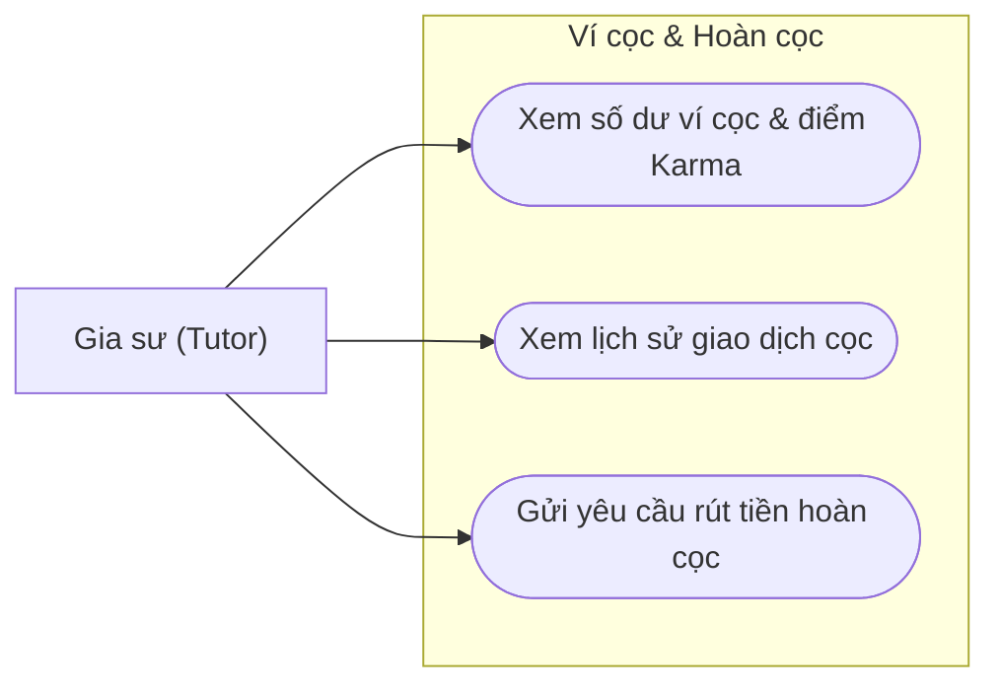

**b) Đặc tả chi tiết từng Use Case con trong nhóm Ví cọc và Hoàn cọc:**

###### b.1) Đặc tả chi tiết: Xem số dư ví cọc & điểm Karma (UC-TUT-06.1)
* **Tên Use Case:** Xem số dư ví cọc & điểm Karma (View Escrow Balance & Karma)
* **Tác nhân (Actor):** Gia sư (Tutor)
* **Mục đích (Description):** Quản lý chi tiết số dư tài khoản cọc hiện có: Tiền cọc đang tạm giữ trong các lớp học (Escrow Locked), Tiền cọc khả dụng có thể rút (Available Balance).
* **Tiền điều kiện (Pre-condition):** Gia sư đã đăng nhập vào hệ thống.
* **Hậu điều kiện (Post-condition):** Hiển thị trực quan hai ví số dư và điểm tín nhiệm Karma.
* **Luồng sự kiện chính (Normal Flow):**
  1. Gia sư vào mục "Ví cọc & Tài chính".
  2. Hệ thống truy vấn số dư từ bảng `escrow_balances`.
  3. Hiển thị hai chỉ số:
     - Số dư khả dụng (Số tiền được hoàn trả từ các lớp phụ huynh hủy hoặc trung tâm trả cọc): Có thể bấm rút về ngân hàng.
     - Số dư đang tạm giữ (Các lớp đang trong thời gian dạy thử): Tự động giải phóng khi phụ huynh chốt lớp hoặc có kết luận hoàn cọc.
* **Luồng sự kiện thay thế (Alternative Flow):**
  - *Số dư bằng 0:* Hiển thị số dư 0 VNĐ kèm lịch sử các giao dịch trước đây.

###### b.2) Đặc tả chi tiết: Xem lịch sử giao dịch cọc (UC-TUT-06.2)
* **Tên Use Case:** Xem lịch sử giao dịch cọc (View Escrow Transactions History)
* **Tác nhân (Actor):** Gia sư (Tutor)
* **Mục đích (Description):** Đối soát minh bạch từng giao dịch nộp tiền cọc, chuyển cọc thành phí, hoàn cọc lớp bị hủy hoặc rút tiền về tài khoản ngân hàng.
* **Tiền điều kiện (Pre-condition):** Gia sư mở trang Ví cọc.
* **Hậu điều kiện (Post-condition):** Danh sách bảng kê giao dịch kèm mã tham chiếu và ngày giờ hiển thị chi tiết.
* **Luồng sự kiện chính (Normal Flow):**
  1. Gia sư chọn tab "Lịch sử biến động số dư".
  2. Hệ thống tải danh sách giao dịch từ bảng `escrow_transactions`.
  3. Gia sư xem chi tiết từng dòng: Ngày giờ, Mã lớp liên quan, Loại biến động (+ Nộp cọc VietQR, - Phí trung tâm khi lớp thành công, + Hoàn cọc 100% do phụ huynh hủy, - Rút tiền về ngân hàng), Trạng thái (Thành công / Đang xử lý).
* **Luồng sự kiện thay thế (Alternative Flow):**
  - *Có thắc mắc về số liệu:* Gia sư bấm vào giao dịch và chọn "Khiếu nại giao dịch này" để gửi hỗ trợ tới Kế toán CRM.

###### b.3) Đặc tả chi tiết: Gửi yêu cầu rút tiền hoàn cọc (UC-TUT-06.3)
* **Tên Use Case:** Gửi yêu cầu rút tiền hoàn cọc (Request Escrow Refund)
* **Tác nhân (Actor):** Gia sư (Tutor)
* **Mục đích (Description):** Cho phép gia sư làm lệnh rút tiền từ số dư cọc khả dụng về tài khoản ngân hàng chính chủ của mình.
* **Tiền điều kiện (Pre-condition):** Số dư cọc khả dụng $\ge 100.000$ VNĐ.
* **Hậu điều kiện (Post-condition):** Một lệnh rút tiền được khởi tạo ở trạng thái `REFUND_PENDING` và gửi tới bộ phận Kế toán xử lý trong 24 giờ làm việc.
* **Luồng sự kiện chính (Normal Flow):**
  1. Gia sư bấm nút "Rút tiền về tài khoản ngân hàng".
  2. Hệ thống hiển thị form rút tiền:
     - Nhập số tiền cần rút (mặc định gợi ý toàn bộ số dư khả dụng).
     - Chọn Tên Ngân hàng thụ hưởng.
     - Nhập Số tài khoản ngân hàng và Tên chủ tài khoản (phải trùng khớp họ tên hồ sơ).
  3. Gia sư bấm "Xác nhận gửi lệnh rút".
  4. Hệ thống kiểm tra số dư khả dụng đủ điều kiện, khấu trừ tạm thời số dư khả dụng và ghi nhận giao dịch trạng thái `PENDING`.
  5. Hệ thống gửi thông báo: "Lệnh rút tiền đã được tiếp nhận. Tiền sẽ được chuyển về tài khoản ngân hàng của bạn trong vòng 24 giờ làm việc".
* **Luồng sự kiện thay thế (Alternative Flow):**
  - *Số dư khả dụng không đủ:* Hệ thống cảnh báo đỏ và ngăn không cho tạo lệnh.

---

#### 4.3. PHÂN HỆ QUẢN TRỊ VIÊN (ADMINISTRATOR SUBSYSTEM)

##### 4.3.1. Chức năng Đăng ký tài khoản Quản trị viên mới (Register Admin Account)

**a) Biểu đồ Use Case con cho Đăng ký Quản trị viên:**

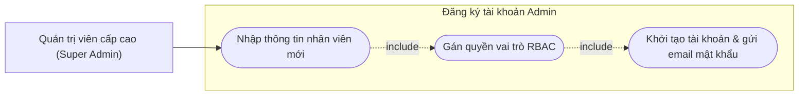

**b) Đặc tả chi tiết chức năng: Đăng ký tài khoản Quản trị viên mới (UC-ADM-01)**
* **Name:** Đăng ký tài khoản Quản trị viên mới (Register Admin Account)
* **Actor:** Quản trị viên cấp cao (Super Admin)
* **Description:** Super Admin tạo tài khoản quản trị nội bộ cho nhân viên mới và phân quyền vai trò.
* **Normal Flow:**
  1. Super Admin vào mục "Quản trị hệ thống" -> Chọn "Tạo tài khoản Quản trị viên".
  2. Nhập: Tên nhân viên, Email nội bộ, Số điện thoại, Mật khẩu ban đầu.
  3. Chọn vai trò: *Điều phối viên (Coordinator)*, *Kế toán (Accountant)* hoặc *CSKH (Support)*.
  4. Bấm "Tạo tài khoản Admin".
  5. Hệ thống mã hóa mật khẩu (Bcrypt) và lưu tài khoản vào cơ sở dữ liệu.
  6. Hệ thống gửi email thông báo thông tin đăng nhập cho nhân viên mới.
* **Alternative Flow:** Email đã tồn tại: Hệ thống báo lỗi email đã được sử dụng.

---

##### 4.3.2. Chức năng Đăng nhập Cổng Quản trị Admin (Login Admin)

**a) Biểu đồ Use Case con cho Đăng nhập Quản trị viên:**

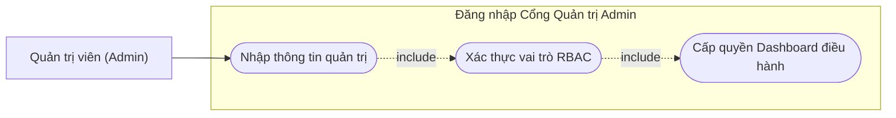

**b) Đặc tả chi tiết chức năng: Đăng nhập Cổng Quản trị Admin (UC-ADM-02)**
* **Name:** Đăng nhập Cổng Quản trị Admin (Login Admin)
* **Actor:** Quản trị viên (Admin / Staff)
* **Description:** Xác thực tài khoản nhân viên quản trị để vào hệ thống điều hành.
* **Normal Flow:**
  1. Admin truy cập cổng Admin CRM.
  2. Nhập Email/Tên đăng nhập và Mật khẩu.
  3. Bấm "Đăng nhập".
  4. Hệ thống xác thực danh tính và phân quyền vai trò.
  5. Chuyển vào Dashboard quản trị CRM.
* **Alternative Flow:** Sai mật khẩu: Báo lỗi thông tin đăng nhập không chính xác.

---

##### 4.3.3. Nhóm chức năng Quản lý tài khoản người dùng (User Accounts)

**a) Biểu đồ Use Case con cho Quản lý tài khoản người dùng:**

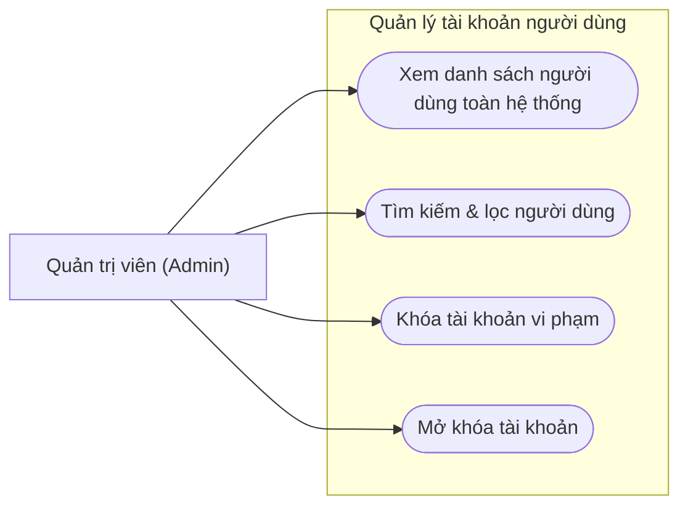

**b) Đặc tả chi tiết từng Use Case con trong nhóm Quản lý người dùng:**

###### b.1) Đặc tả chi tiết: Xem danh sách người dùng toàn hệ thống (UC-ADM-03.1)
* **Tên Use Case:** Xem danh sách người dùng toàn hệ thống (View All Users List)
* **Tác nhân (Actor):** Quản trị viên (Admin)
* **Mục đích (Description):** Hiển thị danh sách tổng hợp tất cả tài khoản phụ huynh, gia sư và nhân viên trong hệ thống với các chỉ số hoạt động.
* **Tiền điều kiện (Pre-condition):** Admin đã đăng nhập hệ thống và có quyền xem danh sách người dùng.
* **Hậu điều kiện (Post-condition):** Danh sách người dùng được phân trang và hiển thị đầy đủ trên màn hình quản trị.
* **Luồng sự kiện chính (Normal Flow):**
  1. Admin chọn menu "Quản lý Người dùng" -> "Danh sách tài khoản".
  2. Hệ thống truy vấn cơ sở dữ liệu bảng `users` kết hợp bảng `tutor_profiles` và `parent_profiles`.
  3. Hiển thị bảng dữ liệu: ID, Họ tên, Số điện thoại, Email, Vai trò (`PARENT`, `TUTOR`, `COORDINATOR`), Trạng thái (`ACTIVE`, `BLOCKED`), Ngày tạo tài khoản.
* **Luồng sự kiện thay thế (Alternative Flow):**
  - *Không có dữ liệu:* Hiển thị bảng trống kèm thông báo.

###### b.2) Đặc tả chi tiết: Tìm kiếm & lọc người dùng (UC-ADM-03.2)
* **Tên Use Case:** Tìm kiếm & lọc người dùng (Search & Filter Users)
* **Tác nhân (Actor):** Quản trị viên (Admin)
* **Mục đích (Description):** Tra cứu nhanh thông tin người dùng theo số điện thoại, họ tên, vai trò hoặc trạng thái tài khoản.
* **Tiền điều kiện (Pre-condition):** Admin đang ở màn hình danh sách người dùng.
* **Hậu điều kiện (Post-condition):** Bảng kết quả hiển thị danh sách người dùng thỏa mãn điều kiện tìm kiếm.
* **Luồng sự kiện chính (Normal Flow):**
  1. Admin nhập từ khóa tìm kiếm (Số điện thoại hoặc Tên người dùng) vào ô tìm kiếm.
  2. Chọn bộ lọc: Vai trò (Phụ huynh / Gia sư / Admin) và Trạng thái (Đang hoạt động / Bị khóa).
  3. Nhấn "Tìm kiếm" hoặc nhấn Enter.
  4. Hệ thống thực hiện truy vấn với điều kiện `ILIKE` và trả về kết quả ngay tức thì.
* **Luồng sự kiện thay thế (Alternative Flow):**
  - *Không tìm thấy kết quả:* Hiển thị thông báo "Không tìm thấy người dùng phù hợp với từ khóa đã nhập".

###### b.3) Đặc tả chi tiết: Khóa tài khoản vi phạm (UC-ADM-03.3)
* **Tên Use Case:** Khóa tài khoản vi phạm (Lock Violating Account)
* **Tác nhân (Actor):** Quản trị viên (Admin)
* **Mục đích (Description):** Tạm thời vô hiệu hóa quyền truy cập hệ thống của người dùng khi có hành vi vi phạm chính sách (bùng lớp, quấy rối, gian lận cọc).
* **Tiền điều kiện (Pre-condition):** Tài khoản người dùng đang ở trạng thái hoạt động `is_blocked = false`.
* **Hậu điều kiện (Post-condition):** Trạng thái tài khoản chuyển thành `is_blocked = true`, phiên đăng nhập bị thu hồi ngay lập tức.
* **Luồng sự kiện chính (Normal Flow):**
  1. Admin bấm vào nút "Khóa tài khoản" tại dòng người dùng tương ứng.
  2. Hệ thống hiển thị hộp thoại xác nhận yêu cầu nhập lý do khóa tài khoản (ví dụ: "Bùng lớp học không có lý do", "Gian lận điểm danh").
  3. Admin nhập lý do và bấm "Xác nhận khóa".
  4. Hệ thống cập nhật trường `is_blocked = true` và `block_reason` vào bảng `users`.
  5. Hệ thống thu hồi Token JWT của người dùng trên Redis để đăng xuất người dùng khỏi mọi thiết bị.
  6. Hệ thống hiển thị thông báo "Đã khóa tài khoản người dùng thành công".
* **Luồng sự kiện thay thế (Alternative Flow):**
  - *Admin cố tình khóa tài khoản Super Admin:* Hệ thống chặn hành động và cảnh báo quyền hạn.

###### b.4) Đặc tả chi tiết: Mở khóa tài khoản (UC-ADM-03.4)
* **Tên Use Case:** Mở khóa tài khoản (Unlock User Account)
* **Tác nhân (Actor):** Quản trị viên (Admin)
* **Mục đích (Description):** Khôi phục lại quyền đăng nhập và hoạt động cho người dùng sau khi đã giải quyết xong khiếu nại hoặc hết thời hạn phạt.
* **Tiền điều kiện (Pre-condition):** Tài khoản người dùng đang bị khóa `is_blocked = true`.
* **Hậu điều kiện (Post-condition):** Trạng thái tài khoản đổi sang `is_blocked = false`, người dùng có thể đăng nhập bình thường.
* **Luồng sự kiện chính (Normal Flow):**
  1. Admin tìm kiếm tài khoản đang bị khóa và bấm nút "Mở khóa".
  2. Hộp thoại xác nhận hiển thị lý do đã bị khóa trước đó.
  3. Admin bấm "Xác nhận mở khóa".
  4. Hệ thống cập nhật `is_blocked = false` và xóa trường lý do khóa.
  5. Hệ thống gửi thông báo/email cho người dùng: "Tài khoản của bạn đã được mở khóa hoạt động trở lại".
* **Luồng sự kiện thay thế (Alternative Flow):**
  - *Lỗi cơ sở dữ liệu:* Báo lỗi thao tác thất bại, vui lòng thử lại sau.

---

##### 4.3.4. Nhóm chức năng Quản lý duyệt hồ sơ gia sư (Review Tutor Profiles)

**a) Biểu đồ Use Case con cho Duyệt hồ sơ gia sư:**

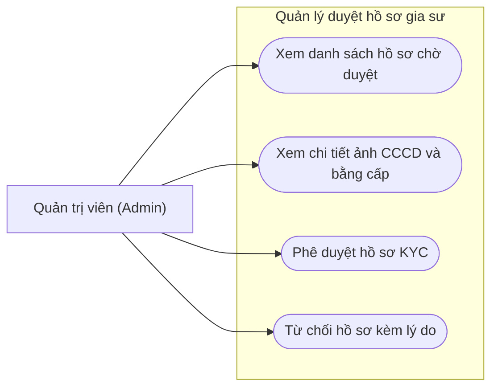

**b) Đặc tả chi tiết từng Use Case con trong nhóm Duyệt hồ sơ gia sư:**

###### b.1) Đặc tả chi tiết: Xem danh sách hồ sơ chờ duyệt (UC-ADM-04.1)
* **Tên Use Case:** Xem danh sách hồ sơ chờ duyệt (View Pending KYC List)
* **Tác nhân (Actor):** Điều phối viên (Coordinator)
* **Mục đích (Description):** Theo dõi hàng đợi các hồ sơ gia sư mới gửi yêu cầu xét duyệt danh tính để xử lý kịp thời theo SLA cam kết.
* **Tiền điều kiện (Pre-condition):** Có gia sư nộp hồ sơ KYC ở trạng thái `KYC_PENDING`.
* **Hậu điều kiện (Post-condition):** Danh sách hàng đợi hồ sơ KYC hiển thị theo thứ tự thời gian nộp (cũ nhất xếp trước).
* **Luồng sự kiện chính (Normal Flow):**
  1. Điều phối viên chọn menu "Kiểm duyệt & KYC" -> "Hồ sơ chờ duyệt".
  2. Hệ thống lọc danh sách gia sư có trạng thái `kyc_status = 'PENDING'`.
  3. Bảng hiển thị: Mã gia sư, Họ tên, Trường ĐH, Chuyên ngành, Ngày nộp hồ sơ, Thời gian chờ.
* **Luồng sự kiện thay thế (Alternative Flow):**
  - *Hàng đợi rỗng:* Hiển thị thông báo "Tất cả hồ sơ KYC đã được xử lý xong!".

###### b.2) Đặc tả chi tiết: Xem chi tiết ảnh CCCD và bằng cấp (UC-ADM-04.2)
* **Tên Use Case:** Xem chi tiết ảnh CCCD và bằng cấp (Inspect KYC Documents)
* **Tác nhân (Actor):** Điều phối viên (Coordinator)
* **Mục đích (Description):** Soi phóng to ảnh CCCD 2 mặt, Thẻ sinh viên hoặc Bằng cử nhân để đối chiếu độ thật và tính chính xác của thông tin khai báo.
* **Tiền điều kiện (Pre-condition):** Điều phối viên bấm vào một hồ sơ trong hàng đợi chờ duyệt.
* **Hậu điều kiện (Post-condition):** Toàn bộ ảnh chứng từ và thông tin hồ sơ hiển thị ở chế độ đối soát song song.
* **Luồng sự kiện chính (Normal Flow):**
  1. Điều phối viên mở chi tiết hồ sơ gia sư.
  2. Màn hình chia làm 2 cột: Cột trái là thông tin tự khai (Họ tên, Ngày sinh, Số CCCD, Tên trường), Cột phải là các ảnh chụp chứng từ có thanh công cụ phóng to/thu nhỏ/xoay ảnh.
  3. Điều phối viên kiểm tra độ sắc nét, kiểm tra phôi thẻ SV / bằng cấp và đối chiếu số CCCD.
* **Luồng sự kiện thay thế (Alternative Flow):**
  - *Ảnh bị lỗi không tải được:* Hệ thống hiển thị nút "Tải lại ảnh" hoặc báo lỗi tệp hỏng.

###### b.3) Đặc tả chi tiết: Phê duyệt hồ sơ KYC (UC-ADM-04.3)
* **Tên Use Case:** Phê duyệt hồ sơ KYC (Approve Tutor KYC)
* **Tác nhân (Actor):** Điều phối viên (Coordinator)
* **Mục đích (Description):** Chấp thuận hồ sơ xác thực của gia sư, cấp tích xanh uy tín và mở khóa quyền nộp cọc nhận lớp.
* **Tiền điều kiện (Pre-condition):** Ảnh chứng từ hợp lệ, thông tin trùng khớp 100%.
* **Hậu điều kiện (Post-condition):** Gia sư chuyển sang trạng thái `KYC_VERIFIED`, được cộng +20 điểm tín nhiệm Karma khởi đầu.
* **Luồng sự kiện chính (Normal Flow):**
  1. Sau khi đối soát thông tin chính xác, Điều phối viên bấm nút "Phê duyệt hồ sơ".
  2. Hệ thống hiển thị hộp thoại xác nhận.
  3. Điều phối viên bấm "Xác nhận duyệt".
  4. Hệ thống cập nhật `kyc_status = 'VERIFIED'` cho gia sư.
  5. Hệ thống cộng +20 điểm Karma vào tài khoản tín nhiệm của gia sư.
  6. Hệ thống tự động gửi thông báo chúc mừng qua Web Portal và Zalo ZNS tới gia sư.
* **Luồng sự kiện thay thế (Alternative Flow):**
  - *Gia sư là sinh viên trường Top đầu:* Hệ thống tự động gán thêm huy hiệu "Sinh viên trường trọng điểm".

###### b.4) Đặc tả chi tiết: Từ chối hồ sơ kèm lý do (UC-ADM-04.4)
* **Tên Use Case:** Từ chối hồ sơ kèm lý do (Reject Tutor KYC with Reason)
* **Tác nhân (Actor):** Điều phối viên (Coordinator)
* **Mục đích (Description):** Từ chối hồ sơ chưa đạt chuẩn (ảnh mờ, thông tin sai lệch, bằng cấp hết hạn) kèm lý do chi tiết để gia sư chụp lại ảnh mới.
* **Tiền điều kiện (Pre-condition):** Hồ sơ chứng từ không đạt chuẩn thẩm định.
* **Hậu điều kiện (Post-condition):** Gia sư chuyển sang trạng thái `KYC_REJECTED`, nhận được thông báo yêu cầu bổ sung giấy tờ.
* **Luồng sự kiện chính (Normal Flow):**
  1. Điều phối viên bấm nút "Từ chối hồ sơ".
  2. Chọn lý do định sẵn: "Ảnh CCCD bị mờ/mất góc", "Thẻ sinh viên đã hết hạn", "Thông tin họ tên không trùng khớp với số CCCD", hoặc nhập lý do chi tiết khác.
  3. Bấm "Gửi thông báo từ chối".
  4. Hệ thống cập nhật `kyc_status = 'REJECTED'` kèm trường `reject_reason`.
  5. Hệ thống gửi thông báo hướng dẫn gia sư đăng nhập lại để cập nhật ảnh tài liệu thay thế.
* **Luồng sự kiện thay thế (Alternative Flow):**
  - *Phát hiện giấy tờ giả mạo:* Điều phối viên tích chọn "Gian lận nghiêm trọng" -> Hệ thống tự động khóa vĩnh viễn tài khoản và đưa số điện thoại vào Blacklist.

---

##### 4.3.5. Nhóm chức năng Quản lý lớp học và ghép lớp (Classes & Smart Matching)

**a) Biểu đồ Use Case con cho Quản lý lớp học và ghép lớp:**

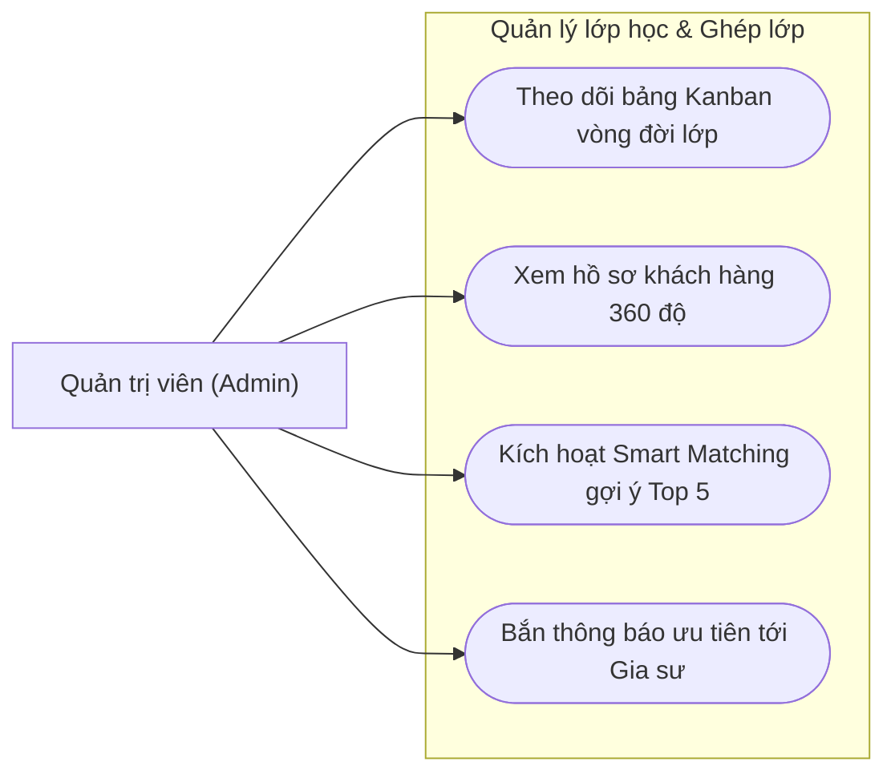

**b) Đặc tả chi tiết từng Use Case con trong nhóm Quản lý lớp học và ghép lớp:**

###### b.1) Đặc tả chi tiết: Theo dõi bảng Kanban vòng đời lớp (UC-ADM-05.1)
* **Tên Use Case:** Theo dõi bảng Kanban vòng đời lớp (Monitor Class Lifecycle Kanban)
* **Tác nhân (Actor):** Điều phối viên (Coordinator)
* **Mục đích (Description):** Trực quan hóa toàn bộ tiến trình của tất cả các lớp học trên hệ thống qua 7 cột trạng thái Kanban: Tiếp nhận $\rightarrow$ Ghép lớp $\rightarrow$ Chờ dạy thử $\rightarrow$ Đang dạy thử $\rightarrow$ Học chính thức $\rightarrow$ Hoàn thành $\rightarrow$ Khiếu nại/Hủy.
* **Tiền điều kiện (Pre-condition):** Điều phối viên đã đăng nhập hệ thống Admin.
* **Hậu điều kiện (Post-condition):** Màn hình bảng Kanban hiển thị sinh động, cho phép kéo thả hoặc click vào thẻ lớp để xử lý.
* **Luồng sự kiện chính (Normal Flow):**
  1. Điều phối viên mở mục "Điều phối Lớp học" -> "Bảng Kanban Vòng đời".
  2. Hệ thống tải toàn bộ các lớp học và phân bố vào các cột trạng thái tương ứng.
  3. Mỗi thẻ lớp hiển thị: Mã lớp, Môn học, Tên học sinh, Học phí, Gia sư phụ trách (nếu có), Badge thời gian chờ (Cảnh báo đỏ nếu lớp chờ quá 24h chưa có người nhận).
  4. Điều phối viên có thể bấm vào thẻ lớp để xem chi tiết hoặc chuyển bước xử lý.
* **Luồng sự kiện thay thế (Alternative Flow):**
  - *Lọc theo nhân viên phụ trách:* Điều phối viên có thể lọc chỉ xem các lớp do mình quản lý.

###### b.2) Đặc tả chi tiết: Xem hồ sơ khách hàng 360 độ (UC-ADM-05.2)
* **Tên Use Case:** Xem hồ sơ khách hàng 360 độ (View Customer 360 Profile)
* **Tác nhân (Actor):** Điều phối viên (Coordinator)
* **Mục đích (Description):** Nắm bắt toàn bộ lịch sử tương tác, các lớp đã từng mở, gia sư cũ từng dạy, các ghi chú CSKH và mức độ hài lòng của phụ huynh.
* **Tiền điều kiện (Pre-condition):** Điều phối viên bấm vào thông tin phụ huynh của một lớp học.
* **Hậu điều kiện (Post-condition):** Hiển thị màn hình hồ sơ tổng quan 360 độ của khách hàng.
* **Luồng sự kiện chính (Normal Flow):**
  1. Điều phối viên mở chi tiết lớp -> Bấm vào tên Phụ huynh.
  2. Hệ thống hiển thị:
     - Thông tin liên hệ và địa chỉ nhà chính.
     - Danh sách tất cả các con và lịch sử học tập.
     - Lịch sử các lớp trước đây (tỷ lệ chốt thành công, lý do hủy nếu có).
     - Timeline nhật ký cuộc gọi CSKH của các điều phối viên trước đó.
  3. Điều phối viên ghi chú thêm thông tin tư vấn vào timeline.
* **Luồng sự kiện thay thế (Alternative Flow):**
  - *Khách hàng VIP:* Hệ thống hiển thị huy hiệu Khách hàng thân thiết kèm chính sách ưu đãi.

###### b.3) Đặc tả chi tiết: Kích hoạt Smart Matching gợi ý Top 5 (UC-ADM-05.3)
* **Tên Use Case:** Kích hoạt Smart Matching gợi ý Top 5 (Execute Smart Matching Top 5)
* **Tác nhân (Actor):** Điều phối viên (Coordinator)
* **Mục đích (Description):** Chạy thuật toán chấm điểm thông minh đa trọng số để tìm kiếm 05 ứng viên gia sư phù hợp nhất cho lớp học đang cần ghép.
* **Tiền điều kiện (Pre-condition):** Lớp học đang ở trạng thái `OPEN` hoặc cần đổi gia sư bảo hành.
* **Hậu điều kiện (Post-condition):** Hệ thống trả về danh sách 5 gia sư có điểm tương thích cao nhất kèm phân tích lý do.
* **Luồng sự kiện chính (Normal Flow):**
  1. Tại thẻ lớp học trên bảng Kanban, Điều phối viên bấm nút "Chạy Smart Matching".
  2. Hệ thống tính toán điểm tương thích tổng hợp theo công thức đa tiêu chí:
     $$Score = W_{Mon} \cdot 30\% + W_{KhoangCach} \cdot 25\% + W_{LichRanh} \cdot 25\% + W_{Karma} \cdot 20\%$$
  3. Hệ thống trả về bảng danh sách Top 5 ứng viên điểm cao nhất (ví dụ: 95%, 91%, 88%...).
  4. Hiển thị chi tiết từng ứng viên: Khoảng cách di chuyển (km), độ trùng khớp ca rảnh, điểm đánh giá số sao trung bình.
* **Luồng sự kiện thay thế (Alternative Flow):**
  - *Không có gia sư nào trong bán kính 7km:* Hệ thống hiển thị gợi ý: "Mở rộng bán kính tìm kiếm lên 12km hoặc đề xuất hình thức học Online".

###### b.4) Đặc tả chi tiết: Bắn thông báo ưu tiên tới Gia sư (UC-ADM-05.4)
* **Tên Use Case:** Bắn thông báo ưu tiên tới Gia sư (Broadcast Priority Notifications)
* **Tác nhân (Actor):** Điều phối viên (Coordinator)
* **Mục đích (Description):** Gửi thông báo ưu tiên (Web Push / Zalo) trực tiếp tới các ứng viên trong Top 5 để mời nhận lớp nhanh trước khi đưa lên sàn công khai.
* **Tiền điều kiện (Pre-condition):** Đã có kết quả danh sách Top 5 từ thuật toán Smart Matching.
* **Hậu điều kiện (Post-condition):** Thông báo mời nhận lớp được gửi tới thiết bị của các gia sư được chọn.
* **Luồng sự kiện chính (Normal Flow):**
  1. Điều phối viên tick chọn các gia sư trong danh sách Top 5 (có thể chọn cả 5 hoặc chọn lọc 2-3 người).
  2. Bấm nút "Bắn thông báo mời nhận lớp".
  3. Hệ thống sinh tin nhắn mời nhận lớp chứa thông tin: Tóm tắt môn học, khu vực dạy, học phí và nút tắt "Nhận lớp ngay".
  4. Hệ thống gửi thông báo qua Firebase Cloud Messaging (Web Push) và Zalo ZNS.
  5. Hệ thống ghi nhận trạng thái: "Đã gửi thông báo ưu tiên tới 5 gia sư".
* **Luồng sự kiện thay thế (Alternative Flow):**
  - *Sau 2 giờ không ai nhận:* Lớp học sẽ tự động được mở công khai lên Sàn lớp chung cho toàn bộ cộng đồng gia sư.

---

##### 4.3.6. Nhóm chức năng Quản lý khiếu nại và tranh chấp (Disputes & Complaints)

**a) Biểu đồ Use Case con cho Quản lý tranh chấp:**

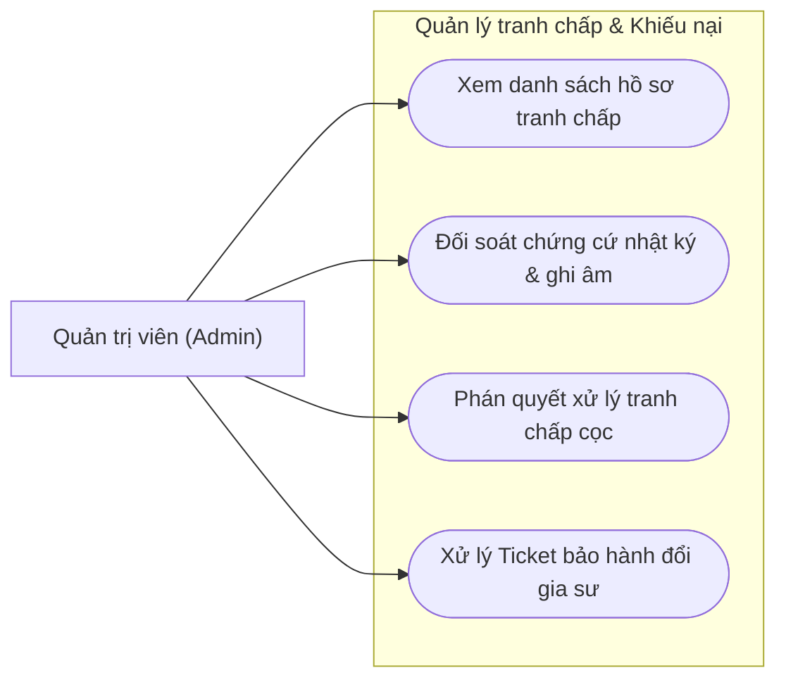

**b) Đặc tả chi tiết từng Use Case con trong nhóm Quản lý tranh chấp & Khiếu nại:**

###### b.1) Đặc tả chi tiết: Xem danh sách hồ sơ tranh chấp (UC-ADM-06.1)
* **Tên Use Case:** Xem danh sách hồ sơ tranh chấp (View Dispute Tickets List)
* **Tác nhân (Actor):** Quản trị viên / Trọng tài viên đối soát (Admin)
* **Mục đích (Description):** Tiếp nhận và quản lý các hồ sơ phát sinh mâu thuẫn giữa phụ huynh và gia sư liên quan đến chất lượng dạy thử, bùng lớp hoặc yêu cầu hoàn cọc.
* **Tiền điều kiện (Pre-condition):** Có khiếu nại phát sinh từ phụ huynh hoặc gia sư.
* **Hậu điều kiện (Post-condition):** Danh sách các ca tranh chấp hiển thị rõ mức độ nghiêm trọng và thời hạn giải quyết còn lại.
* **Luồng sự kiện chính (Normal Flow):**
  1. Admin mở mục "Trọng tài & Tranh chấp".
  2. Hệ thống tải danh sách các hồ sơ tranh chấp đang mở (`status = 'DISPUTE_OPEN'`).
  3. Bảng hiển thị: Mã tranh chấp, Mã lớp, Người khiếu nại, Tóm tắt mâu thuẫn, Số tiền cọc liên quan, SLA thời hạn xử lý (24h).
* **Luồng sự kiện thay thế (Alternative Flow):**
  - *Không có tranh chấp:* Hiển thị màn hình trạng thái an toàn.

###### b.2) Đặc tả chi tiết: Đối soát chứng cứ nhật ký & ghi âm (UC-ADM-06.2)
* **Tên Use Case:** Đối soát chứng cứ nhật ký & ghi âm (Verify Evidence & Audio Logs)
* **Tác nhân (Actor):** Quản trị viên (Admin)
* **Mục đích (Description):** Kiểm tra đối chiếu khách quan các bằng chứng số: Nhật ký các buổi dạy thử, ảnh bài kiểm tra, vị trí check-in GPS và biên bản trao đổi giữa hai bên.
* **Tiền điều kiện (Pre-condition):** Admin mở một hồ sơ tranh chấp cụ thể.
* **Hậu điều kiện (Post-condition):** Nắm rõ cơ sở thực tế để đưa ra phán quyết công bằng.
* **Luồng sự kiện chính (Normal Flow):**
  1. Admin mở chi tiết ca tranh chấp.
  2. Hệ thống tập hợp toàn bộ dữ liệu liên quan:
     - Bản đánh giá phản ánh của Phụ huynh kèm lý do từ chối.
     - Đơn giải trình đối soát của Gia sư.
     - Lịch sử check-in giờ dạy và nhật ký các buổi dạy đã lưu trên hệ thống.
  3. Admin bấm nghe file ghi âm cuộc gọi tư vấn ban đầu (nếu có).
  4. Admin thực hiện cuộc gọi xác minh độc lập với cả hai bên để chốt lại nguyên nhân cốt lõi.
* **Luồng sự kiện thay thế (Alternative Flow):**
  - *Một bên không nghe máy sau 3 lần liên hệ:* Ghi nhận trạng thái bất hợp tác để làm căn cứ phán quyết.

###### b.3) Đặc tả chi tiết: Phán quyết xử lý tranh chấp cọc (UC-ADM-06.3)
* **Tên Use Case:** Phán quyết xử lý tranh chấp cọc (Arbitrate & Execute Escrow Decision)
* **Tác nhân (Actor):** Quản trị viên (Admin)
* **Mục đích (Description):** Ra quyết định phân xử chính thức về số tiền cọc đang tạm giữ: Hoàn 100% tiền cọc cho gia sư, hoặc Tịch thu cọc sung quỹ phạt do vi phạm đạo đức nghề nghiệp.
* **Tiền điều kiện (Pre-condition):** Đã hoàn thành quá trình đối soát chứng cứ.
* **Hậu điều kiện (Post-condition):** Lệnh chuyển đổi dòng tiền cọc được thực thi tự động, điểm uy tín của bên vi phạm bị trừ theo khung chế tài.
* **Luồng sự kiện chính (Normal Flow):**
  1. Tại màn hình giải quyết tranh chấp, Admin chọn một trong các kết luận phán quyết:
     - **Trường hợp 1 (Lỗi do Phụ huynh tự hủy hoặc thay đổi lịch):** Phán quyết *Hoàn 100% cọc cho Gia sư* $\rightarrow$ Tiền cọc được mở khóa về ví khả dụng của gia sư, bảo lưu 100% điểm Karma.
     - **Trường hợp 2 (Gia sư dạy không đúng kiến thức, bùng giờ, gian lận):** Phán quyết *Tịch thu cọc* $\rightarrow$ Tiền cọc chuyển về quỹ bồi thường, hệ thống tự động trừ -30 điểm Karma của gia sư.
     - **Trường hợp 3 (Bất khả kháng):** Phán quyết *Hoàn cọc hỗ trợ 50% - 100%*.
  2. Admin nhập tóm tắt biên bản phân xử.
  3. Bấm "Thực thi phán quyết".
  4. Hệ thống cập nhật bản ghi tài chính và đóng Ticket tranh chấp.
* **Luồng sự kiện thay thế (Alternative Flow):**
  - *Trường hợp vi phạm nghiêm trọng (lừa đảo, đe dọa):* Admin bấm kèm lệnh "Khóa tài khoản vĩnh viễn".

###### b.4) Đặc tả chi tiết: Xử lý Ticket bảo hành đổi gia sư (UC-ADM-06.4)
* **Tên Use Case:** Xử lý Ticket bảo hành đổi gia sư (Process Warranty Replacement Ticket)
* **Tác nhân (Actor):** Điều phối viên (Coordinator)
* **Mục đích (Description):** Kích hoạt quy trình ghép gia sư mới cho phụ huynh theo chính sách Bảo hành 30 ngày hoàn toàn miễn phí.
* **Tiền điều kiện (Pre-condition):** Có Ticket bảo hành đổi gia sư được tạo từ phụ huynh hoặc từ kết luận tranh chấp.
* **Hậu điều kiện (Post-condition):** Lớp học cũ được thay thế bằng gia sư mới đạt chuẩn, đảm bảo cam kết chất lượng với khách hàng.
* **Luồng sự kiện chính (Normal Flow):**
  1. Điều phối viên mở danh sách "Ticket bảo hành cần xử lý gấp".
  2. Xem yêu cầu cụ thể của phụ huynh về gia sư mới cần thay đổi.
  3. Bấm "Tạo phiên ghép gia sư bảo hành".
  4. Hệ thống sao chép thông tin lớp và tự động kích hoạt Smart Matching ưu tiên các giáo viên có điểm Karma $\ge 90$.
  5. Điều phối viên liên hệ mời gia sư chất lượng cao nhận lớp bảo hành.
  6. Sau khi gia sư mới đồng ý, hệ thống bàn giao lớp và thông báo cho phụ huynh ngày học mới.
  7. Điều phối viên bấm "Đóng Ticket bảo hành thành công".
* **Luồng sự kiện thay thế (Alternative Flow):**
  - *Không tìm được gia sư thay thế trong 48h:* Trung tâm hoàn lại toàn bộ các cam kết tài chính và gửi thư xin lỗi khách hàng.

---

##### 4.3.7. Nhóm chức năng Quản lý báo cáo thống kê (Reports & Analytics)

**a) Biểu đồ Use Case con cho Báo cáo thống kê:**

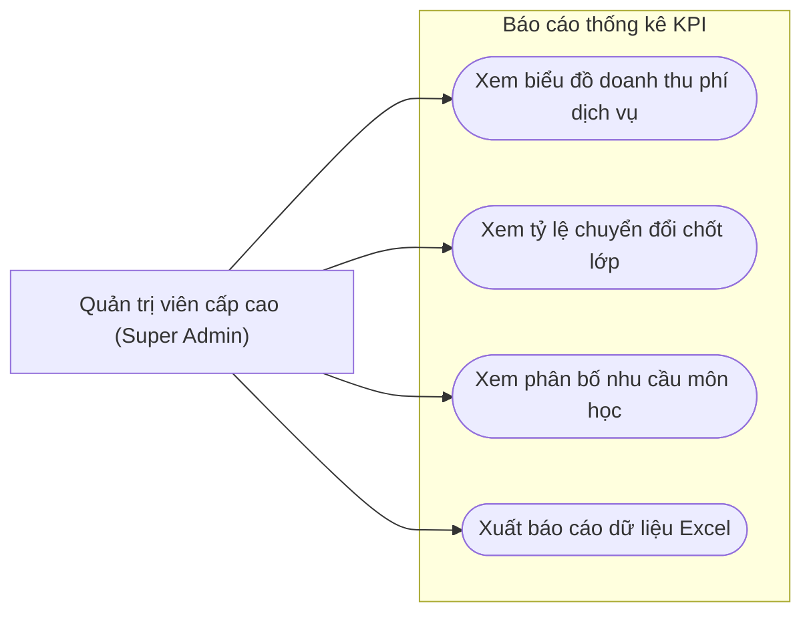

**b) Đặc tả chi tiết từng Use Case con trong nhóm Báo cáo thống kê:**

###### b.1) Đặc tả chi tiết: Xem biểu đồ doanh thu phí dịch vụ (UC-ADM-07.1)
* **Tên Use Case:** Xem biểu đồ doanh thu phí dịch vụ (View Revenue Chart)
* **Tác nhân (Actor):** Quản trị viên cấp cao (Super Admin)
* **Mục đích (Description):** Theo dõi tổng doanh thu phí dịch vụ môi giới phát sinh từ các lớp đã chốt thành công theo từng ngày, tuần, tháng, quý.
* **Tiền điều kiện (Pre-condition):** Super Admin đã đăng nhập vào hệ thống.
* **Hậu điều kiện (Post-condition):** Biểu đồ cột/đường trực quan hiển thị doanh thu thực thu và tăng trưởng so với kỳ trước.
* **Luồng sự kiện chính (Normal Flow):**
  1. Super Admin vào mục "Báo cáo Thống kê" -> "Doanh thu phí dịch vụ".
  2. Chọn mốc thời gian: "Tháng này", "Quý này" hoặc tùy chọn khoảng từ ngày - đến ngày.
  3. Hệ thống tính toán tổng tiền cọc đã chuyển thành doanh thu phí từ bảng `escrow_transactions`.
  4. Hiển thị biểu đồ trực quan kèm chỉ số tổng doanh thu, doanh thu trung bình trên mỗi lớp và tỷ lệ tăng trưởng.
* **Luồng sự kiện thay thế (Alternative Flow):**
  - *Kỳ báo cáo không có doanh thu:* Biểu đồ hiển thị mức 0 kèm ghi chú.

###### b.2) Đặc tả chi tiết: Xem tỷ lệ chuyển đổi chốt lớp (UC-ADM-07.2)
* **Tên Use Case:** Xem tỷ lệ chuyển đổi chốt lớp (View Conversion Funnel)
* **Tác nhân (Actor):** Quản trị viên cấp cao (Super Admin)
* **Mục đích (Description):** Giám sát hiệu quả hoạt động của phễu điều phối qua các giai đoạn: Yêu cầu mở $\rightarrow$ Ghép được gia sư $\rightarrow$ Dạy thử thành công $\rightarrow$ Chốt lớp chính thức.
* **Tiền điều kiện (Pre-condition):** Super Admin mở mục Báo cáo Hiệu suất.
* **Hậu điều kiện (Post-condition):** Biểu đồ phễu (Funnel Chart) hiển thị tỷ lệ chuyển đổi từng chặng.
* **Luồng sự kiện chính (Normal Flow):**
  1. Super Admin chọn tab "Tỷ lệ chuyển đổi & KPI điều phối".
  2. Hệ thống tổng hợp tỷ lệ phần trăm giữa các bước trong vòng đời lớp.
  3. Hiển thị:
     - Tỷ lệ ghép lớp thành công (Matching Rate): ví dụ 85%.
     - Tỷ lệ vượt qua dạy thử (Trial Success Rate): ví dụ 92%.
     - Tỷ lệ chốt hợp đồng chính thức (Official Conversion): ví dụ 78%.
     - Tỷ lệ hủy lớp / hoàn cọc: ví dụ 12%.
* **Luồng sự kiện thay thế (Alternative Flow):**
  - *Tỷ lệ dạy thử thất bại tăng đột biến:* Hệ thống hiển thị cảnh báo để rà soát lại khâu sơ tuyển KYC gia sư.

###### b.3) Đặc tả chi tiết: Xem phân bố nhu cầu môn học (UC-ADM-07.3)
* **Tên Use Case:** Xem phân bố nhu cầu môn học (View Subject Demand Distribution)
* **Tác nhân (Actor):** Super Admin / Điều phối viên
* **Mục đích (Description):** Phân tích cơ cấu nhu cầu học tập của thị trường theo môn học (Toán, Lý, Hóa, Ngoại ngữ...) và khu vực địa lý để lên kế hoạch tuyển dụng gia sư đón đầu.
* **Tiền điều kiện (Pre-condition):** Super Admin mở mục Báo cáo Thị trường.
* **Hậu điều kiện (Post-condition):** Biểu đồ tròn (Pie Chart) và bản đồ nhiệt nhu cầu hiển thị chi tiết.
* **Luồng sự kiện chính (Normal Flow):**
  1. Super Admin chọn mục "Phân tích Nhu cầu Môn học & Khu vực".
  2. Hệ thống tổng hợp số lượng yêu cầu tìm gia sư theo nhóm môn và quận huyện.
  3. Hiển thị biểu đồ cơ cấu: Toán (35%), Tiếng Anh (30%), Ngữ văn (15%), Các môn khác (20%).
  4. Hiển thị Top các quận có nhu cầu thuê gia sư cao nhất (ví dụ: Cầu Giấy, Đống Đa, Thanh Xuân).
* **Luồng sự kiện thay thế (Alternative Flow):**
  - *Xem theo khối lớp:* Cho phép lọc xem riêng nhu cầu luyện thi vào 10 hoặc ôn thi THPT Quốc gia.

###### b.4) Đặc tả chi tiết: Xuất báo cáo dữ liệu Excel (UC-ADM-07.4)
* **Tên Use Case:** Xuất báo cáo dữ liệu Excel (Export Report to Excel)
* **Tác nhân (Actor):** Super Admin / Kế toán
* **Mục đích (Description):** Xuất toàn bộ bảng kê số liệu chi tiết ra định dạng file Excel (.xlsx) để phục vụ công tác kế toán thuế, lưu trữ hồ sơ và báo cáo Ban Giám đốc.
* **Tiền điều kiện (Pre-condition):** Người dùng có quyền kế toán hoặc Super Admin.
* **Hậu điều kiện (Post-condition):** Tệp tin Excel chuẩn hóa được tạo và tải về máy tính thành công.
* **Luồng sự kiện chính (Normal Flow):**
  1. Tại màn hình báo cáo bất kỳ, người dùng chọn loại dữ liệu cần xuất (Báo cáo doanh thu / Báo cáo lớp học / Báo cáo người dùng).
  2. Bấm nút "Xuất file Excel".
  3. Hệ thống tạo truy vấn lấy toàn bộ dữ liệu theo bộ lọc hiện tại.
  4. Hệ thống sinh tệp Excel định dạng `.xlsx` với các cột tiêu đề được format chuẩn, có tính tổng cộng.
  5. Trình duyệt tự động tải tệp tin về máy tính người dùng với tên tệp dạng `BaoCao_CRM_GiaSu_YYYYMMDD.xlsx`.
* **Luồng sự kiện thay thế (Alternative Flow):**
  - *Dữ liệu quá 50.000 dòng:* Hệ thống nén tệp zip trước khi gửi tải về để tối ưu tốc độ.

---

### 5. HỆ THỐNG BIỂU ĐỒ TUẦN TỰ (SEQUENCE DIAGRAMS CHI TIẾT & ĐẶC TẢ)

Dưới đây là hệ thống các biểu đồ tuần tự được thiết kế chi tiết tương ứng với các Use Case đã được phân tích ở Mục 4. Mỗi biểu đồ đều bao gồm **sơ đồ tương tác đối tượng (Mermaid Sequence Diagram)** và **bảng đặc tả luồng thông điệp chi tiết** phân tích rõ vai trò của Actor, Giao diện (UI), Tầng điều khiển (Controller), Tầng nghiệp vụ (Service), Cơ sở dữ liệu (PostgreSQL) và các cổng dịch vụ bên thứ ba.

---

#### 5.1. PHÂN HỆ PHỤ HUYNH (PARENT SUBSYSTEM)

##### 5.1.1. Biểu đồ tuần tự: Đăng ký tài khoản Phụ huynh (UC-PAR-01)

**a) Sơ đồ tuần tự:**

```mermaid
sequenceDiagram
    autonumber
    actor Parent as Phụ huynh (Parent)
    participant UI as Giao diện Đăng ký (Client UI)
    participant AuthCtrl as Auth Controller
    participant AuthService as Auth Service
    participant SMS as Cổng SMS/Zalo OTP
    participant DB as PostgreSQL Database

    Parent->>UI: 1. Nhập Họ tên, SĐT, Mật khẩu -> Bấm "Đăng ký"
    UI->>AuthCtrl: 2. POST /api/v1/auth/register-parent { name, phone, password }
    AuthCtrl->>AuthService: 3. registerParent(payload)
    AuthService->>DB: 4. SELECT id FROM users WHERE phone = phone
    DB-->>AuthService: 5. Null (SĐT chưa tồn tại)
    AuthService->>SMS: 6. Gửi mã OTP 6 số về SĐT (Hạn 120s)
    SMS-->>AuthService: 7. Gửi thành công
    AuthService-->>UI: 8. 200 OK (Chuyển sang form nhập OTP)
    Parent->>UI: 9. Nhập mã OTP 6 số -> Bấm "Xác nhận kích hoạt"
    UI->>AuthCtrl: 10. POST /api/v1/auth/verify-otp { phone, otp }
    AuthCtrl->>AuthService: 11. verifyOtpAndCreateUser(phone, otp)
    AuthService->>AuthService: 12. Kiểm tra mã OTP khớp và còn hiệu lực
    AuthService->>AuthService: 13. Mã hóa mật khẩu (Bcrypt Hash, cost: 10)
    AuthService->>DB: 14. INSERT INTO users (role: 'PARENT', phone, password_hash)
    DB-->>AuthService: 15. Tạo bản ghi User thành công
    AuthService->>DB: 16. INSERT INTO parent_profiles (user_id, full_name)
    DB-->>AuthService: 17. Khởi tạo hồ sơ phụ huynh thành công
    AuthService-->>AuthCtrl: 18. Thành công
    AuthCtrl-->>UI: 19. 201 Created
    UI-->>Parent: 20. Thông báo: "Đăng ký thành công! Vui lòng đăng nhập"
```

**b) Đặc tả luồng xử lý tuần tự:**
* **Mục đích:** Mô tả chi tiết quá trình phụ huynh đăng ký tài khoản mới bằng số điện thoại và xác thực mã OTP gửi về máy.
* **Đối tượng tham gia:** `Phụ huynh (Parent)`, `Giao diện Đăng ký (Client UI)`, `Auth Controller`, `Auth Service`, `Cổng SMS/Zalo OTP`, `PostgreSQL Database`.
* **Luồng xử lý chi tiết:**
  - *Bước 1 - 3:* Phụ huynh nhập thông tin trên form; UI gửi request đăng ký tới Auth Controller; Controller chuyển giao xử lý cho Auth Service.
  - *Bước 4 - 5:* Service kiểm tra trong DB xem số điện thoại đã có ai đăng ký chưa.
  - *Bước 6 - 8:* Nếu chưa có, Service gọi Cổng SMS/Zalo sinh mã OTP 6 số gửi về máy phụ huynh và yêu cầu UI mở màn hình nhập OTP.
  - *Bước 9 - 13:* Phụ huynh nhập mã OTP; Service xác thực mã khớp và còn hạn $\le 120$s; thực hiện băm mật khẩu bằng Bcrypt.
  - *Bước 14 - 17:* Service thực hiện Transaction ghi đồng thời bản ghi tài khoản vào bảng `users` và hồ sơ vào bảng `parent_profiles`.
  - *Bước 18 - 20:* Trả về mã HTTP `201 Created`, thông báo thành công và điều hướng sang màn hình Đăng nhập.
* **Xử lý ngoại lệ:** Nếu số điện thoại đã tồn tại ở Bước 5, Service trả về lỗi `409 Conflict`, UI hiển thị thông báo "Số điện thoại đã được đăng ký". Nếu mã OTP nhập sai quá 3 lần, hệ thống khóa gửi mã trong 15 phút.

---

##### 5.1.2. Biểu đồ tuần tự: Đăng nhập Cổng Phụ huynh (UC-PAR-02)

**a) Sơ đồ tuần tự:**

```mermaid
sequenceDiagram
    autonumber
    actor Parent as Phụ huynh (Parent)
    participant UI as Giao diện Đăng nhập (Client UI)
    participant AuthCtrl as Auth Controller
    participant AuthService as Auth Service
    participant DB as PostgreSQL Database
    participant Redis as Redis Cache (Token Store)

    Parent->>UI: 1. Nhập Số điện thoại và Mật khẩu -> Bấm "Đăng nhập"
    UI->>AuthCtrl: 2. POST /api/v1/auth/login { phone, password }
    AuthCtrl->>AuthService: 3. login(phone, password)
    AuthService->>DB: 4. SELECT * FROM users WHERE phone = phone AND role = 'PARENT'
    DB-->>AuthService: 5. Trả về thông tin user, hash mật khẩu, is_blocked
    AuthService->>AuthService: 6. Kiểm tra tài khoản không bị khóa (is_blocked == false)
    AuthService->>AuthService: 7. So khớp mật khẩu với Bcrypt Hash
    AuthService->>AuthService: 8. Sinh cặp Access Token (15p) & Refresh Token (7 ngày)
    AuthService->>Redis: 9. SET session:parentId { refreshToken, loginTime }
    Redis-->>AuthService: 10. OK
    AuthService-->>AuthCtrl: 11. Trả về User Profile + Token
    AuthCtrl-->>UI: 12. 200 OK + Set HTTP-Only Cookie
    UI-->>Parent: 13. Đăng nhập thành công -> Điều hướng về Dashboard Phụ huynh
```

**b) Đặc tả luồng xử lý tuần tự:**
* **Mục đích:** Xác thực danh tính phụ huynh bằng số điện thoại và mật khẩu, cấp phiên làm việc chuẩn JWT an toàn.
* **Đối tượng tham gia:** `Phụ huynh`, `Client UI`, `Auth Controller`, `Auth Service`, `PostgreSQL DB`, `Redis Token Store`.
* **Luồng xử lý chi tiết:**
  - *Bước 1 - 3:* Phụ huynh gửi thông tin đăng nhập từ giao diện Cổng phụ huynh.
  - *Bước 4 - 5:* Hệ thống truy vấn tài khoản phụ huynh theo số điện thoại trong bảng `users`.
  - *Bước 6 - 7:* Service kiểm tra cờ `is_blocked`. Nếu tài khoản bình thường, tiếp tục dùng thuật toán `bcrypt.compare` để so khớp mật khẩu.
  - *Bước 8 - 10:* Service sinh mã JWT Access Token và Refresh Token, lưu session vào Redis Cache để quản lý phiên làm việc.
  - *Bước 11 - 13:* Controller trả về thông tin người dùng kèm HTTP-only cookie, UI chuyển hướng phụ huynh vào trang tổng quan Dashboard.
* **Xử lý ngoại lệ:** Nếu sai mật khẩu hoặc không tìm thấy tài khoản, trả về `401 Unauthorized` kèm thông báo "Số điện thoại hoặc mật khẩu không chính xác". Nếu tài khoản bị khóa, trả về `403 Forbidden` kèm lý do khóa.

---

##### 5.1.3. Biểu đồ tuần tự: Xem danh sách hồ sơ con (UC-PAR-03.1)

**a) Sơ đồ tuần tự:**

```mermaid
sequenceDiagram
    autonumber
    actor Parent as Phụ huynh (Parent)
    participant UI as Cổng Phụ huynh (Client UI)
    participant ChildCtrl as Children Controller
    participant ChildService as Children Service
    participant DB as PostgreSQL Database

    Parent->>UI: 1. Bấm vào mục "Hồ sơ các con"
    UI->>ChildCtrl: 2. GET /api/v1/client/children (Header: Bearer Token)
    ChildCtrl->>ChildService: 3. getChildrenList(parentId)
    ChildService->>DB: 4. SELECT s.*, COUNT(c.id) as active_classes FROM students s LEFT JOIN classes c ON c.student_id = s.id AND c.status = 'ACTIVE' WHERE s.parent_id = parentId AND s.is_active = true GROUP BY s.id
    DB-->>ChildService: 5. Trả về danh sách học sinh
    ChildService-->>ChildCtrl: 6. Danh sách hồ sơ các con
    ChildCtrl-->>UI: 7. 200 OK { childrenList }
    UI-->>Parent: 8. Hiển thị danh sách thẻ con (Họ tên, Khối lớp, Trường, Học lực, Số lớp đang học)
```

**b) Đặc tả luồng xử lý tuần tự:**
* **Mục đích:** Tải và hiển thị danh sách toàn bộ con của phụ huynh kèm số lớp học đang hoạt động.
* **Đối tượng tham gia:** `Phụ huynh`, `Client UI`, `Children Controller`, `Children Service`, `PostgreSQL Database`.
* **Luồng xử lý chi tiết:**
  - *Bước 1 - 3:* Phụ huynh vào menu "Hồ sơ các con"; UI gửi yêu cầu kèm JWT Token; Controller giải mã lấy `parentId` và gọi Service.
  - *Bước 4 - 6:* Service thực hiện truy vấn bảng `students` (chỉ lấy các bản ghi chưa bị ẩn `is_active = true`), đồng thời `LEFT JOIN` với bảng `classes` để đếm số lớp học đang hoạt động của từng con.
  - *Bước 7 - 8:* UI nhận mảng dữ liệu và render thành các Card thông tin học sinh sinh động.
* **Xử lý ngoại lệ:** Nếu danh sách rỗng (`length == 0`), UI tự động render màn hình Empty State với hình minh họa và nút "Thêm hồ sơ con đầu tiên".

---

##### 5.1.4. Biểu đồ tuần tự: Thêm mới hồ sơ con (UC-PAR-03.2)

**a) Sơ đồ tuần tự:**

```mermaid
sequenceDiagram
    autonumber
    actor Parent as Phụ huynh (Parent)
    participant UI as Cổng Phụ huynh (Client UI)
    participant ChildCtrl as Children Controller
    participant ChildService as Children Service
    participant DB as PostgreSQL Database

    Parent->>UI: 1. Vào "Hồ sơ các con" -> Bấm "Thêm con mới"
    Parent->>UI: 2. Nhập: Họ tên con, Ngày sinh, Khối lớp, Trường học, Học lực, Tính cách
    Parent->>UI: 3. Bấm "Lưu hồ sơ con"
    UI->>ChildCtrl: 4. POST /api/v1/client/children { childData }
    ChildCtrl->>ChildService: 5. createChildProfile(parentId, childData)
    ChildService->>ChildService: 6. Validate: Tên không rỗng, Lớp 1-12, Ngày sinh hợp lệ
    ChildService->>DB: 7. INSERT INTO students (parent_id, full_name, dob, grade, school, academic_level, personality, is_active) VALUES (...)
    DB-->>ChildService: 8. Bản ghi học sinh mới kèm student_id
    ChildService-->>ChildCtrl: 9. Tạo thành công
    ChildCtrl-->>UI: 10. 201 Created { studentId, fullName }
    UI-->>Parent: 11. Thông báo: "Thêm hồ sơ con thành công!" -> Cập nhật danh sách
```

**b) Đặc tả luồng xử lý tuần tự:**
* **Mục đích:** Lưu thông tin hồ sơ học tập của con vào hệ thống để phụ huynh có thể gắn con vào các yêu cầu tìm gia sư sau này.
* **Đối tượng tham gia:** `Phụ huynh`, `Client UI`, `Children Controller`, `Children Service`, `PostgreSQL Database`.
* **Luồng xử lý chi tiết:**
  - *Bước 1 - 3:* Phụ huynh mở form thêm con, điền thông tin học sinh và nhấn "Lưu".
  - *Bước 4 - 6:* UI gửi payload tới Controller; Service tiến hành kiểm tra tính hợp lệ nghiệp vụ của các trường dữ liệu (Khối lớp từ 1 đến 12, ngày sinh không lớn hơn ngày hiện tại).
  - *Bước 7 - 9:* Service thực hiện câu lệnh chèn dữ liệu vào bảng `students` với cờ `is_active = true`.
  - *Bước 10 - 11:* UI nhận mã `201 Created`, đóng modal và tự động tải lại danh sách hiển thị học sinh mới.
* **Xử lý ngoại lệ:** Nếu dữ liệu bị lỗi format, Service trả về `400 Bad Request` kèm chi tiết trường lỗi để UI highlight ô nhập liệu cho phụ huynh.

---

##### 5.1.5. Biểu đồ tuần tự: Chỉnh sửa thông tin hồ sơ con (UC-PAR-03.3)

**a) Sơ đồ tuần tự:**

```mermaid
sequenceDiagram
    autonumber
    actor Parent as Phụ huynh (Parent)
    participant UI as Cổng Phụ huynh (Client UI)
    participant ChildCtrl as Children Controller
    participant ChildService as Children Service
    participant DB as PostgreSQL Database

    Parent->>UI: 1. Bấm biểu tượng "Chỉnh sửa" trên thẻ con
    UI->>UI: 2. Mở Modal hiển thị sẵn thông tin con hiện tại
    Parent->>UI: 3. Điều chỉnh thông tin (Khối lớp, Trường học, Học lực...) -> Bấm "Lưu thay đổi"
    UI->>ChildCtrl: 4. PUT /api/v1/client/children/:childId { updatedData }
    ChildCtrl->>ChildService: 5. updateChildProfile(parentId, childId, updatedData)
    ChildService->>DB: 6. SELECT id FROM students WHERE id = childId AND parent_id = parentId
    DB-->>ChildService: 7. Xác nhận quyền sở hữu hợp lệ
    ChildService->>DB: 8. UPDATE students SET grade = ..., school = ..., academic_level = ..., updated_at = NOW() WHERE id = childId
    DB-->>ChildService: 9. Cập nhật thành công
    ChildService-->>ChildCtrl: 10. Thành công
    ChildCtrl-->>UI: 11. 200 OK
    UI-->>Parent: 12. Thông báo: "Cập nhật hồ sơ con thành công!" -> Cập nhật thẻ con
```

**b) Đặc tả luồng xử lý tuần tự:**
* **Mục đích:** Cập nhật thông tin học lực, trường lớp mới của con theo thời gian.
* **Đối tượng tham gia:** `Phụ huynh`, `Client UI`, `Children Controller`, `Children Service`, `PostgreSQL Database`.
* **Luồng xử lý chi tiết:**
  - *Bước 1 - 3:* Phụ huynh chọn sửa hồ sơ con, chỉnh sửa thông tin trên form đã đổ sẵn dữ liệu và bấm "Lưu thay đổi".
  - *Bước 4 - 7:* Controller nhận request; Service kiểm tra bắt buộc `parent_id` trong DB phải khớp với ID phụ huynh đang đăng nhập (ngăn chặn tấn công IDOR sửa dữ liệu con nhà người khác).
  - *Bước 8 - 12:* Sau khi xác minh quyền sở hữu, Service thực thi lệnh cập nhật bản ghi trong DB và UI làm mới lại thẻ hiển thị.
* **Xử lý ngoại lệ:** Nếu `childId` không thuộc về phụ huynh, trả về lỗi `403 Forbidden` và từ chối cập nhật.

---

##### 5.1.6. Biểu đồ tuần tự: Ẩn hồ sơ con bảo lưu lịch sử (UC-PAR-03.4)

**a) Sơ đồ tuần tự:**

```mermaid
sequenceDiagram
    autonumber
    actor Parent as Phụ huynh (Parent)
    participant UI as Cổng Phụ huynh (Client UI)
    participant ChildCtrl as Children Controller
    participant ChildService as Children Service
    participant DB as PostgreSQL Database

    Parent->>UI: 1. Bấm "Ẩn hồ sơ này" trên thẻ con
    UI->>UI: 2. Hiển thị hộp thoại cảnh báo: "Lịch sử học tập cũ vẫn sẽ được bảo lưu"
    Parent->>UI: 3. Bấm "Xác nhận ẩn"
    UI->>ChildCtrl: 4. PATCH /api/v1/client/children/:childId/deactivate
    ChildCtrl->>ChildService: 5. deactivateChildProfile(parentId, childId)
    ChildService->>DB: 6. SELECT COUNT(*) FROM classes WHERE student_id = childId AND status IN ('ACTIVE', 'TRIAL')
    DB-->>ChildService: 7. Count = 0 (Không có lớp nào đang chạy)
    ChildService->>DB: 8. UPDATE students SET is_active = false WHERE id = childId AND parent_id = parentId
    DB-->>ChildService: 9. Xóa mềm thành công
    ChildService-->>ChildCtrl: 10. Thành công
    ChildCtrl-->>UI: 11. 200 OK
    UI-->>Parent: 12. Thông báo: "Đã ẩn hồ sơ con thành công" -> Loại bỏ thẻ khỏi danh sách
```

**b) Đặc tả luồng xử lý tuần tự:**
* **Mục đích:** Vô hiệu hóa hiển thị hồ sơ con (xóa mềm Soft Delete) mà vẫn bảo lưu nguyên vẹn toàn bộ dữ liệu lịch sử điểm danh và nhật ký học tập trước đó.
* **Đối tượng tham gia:** `Phụ huynh`, `Client UI`, `Children Controller`, `Children Service`, `PostgreSQL Database`.
* **Luồng xử lý chi tiết:**
  - *Bước 1 - 3:* Phụ huynh chọn ẩn con và xác nhận cảnh báo trên giao diện.
  - *Bước 4 - 7:* Service kiểm tra ràng buộc toàn vẹn dữ liệu: Truy vấn bảng `classes` xem học sinh này có đang theo học lớp nào ở trạng thái `ACTIVE` hoặc `TRIAL` không.
  - *Bước 8 - 12:* Khi không có lớp học nào đang diễn ra, Service gán cờ `is_active = false` trong DB, bảo vệ toàn vẹn lịch sử các lớp cũ và thông báo hoàn tất cho phụ huynh.
* **Xử lý ngoại lệ:** Nếu học sinh đang có lớp học đang chạy (`Count > 0`), Service trả về `400 Bad Request` kèm thông báo: "Không thể ẩn hồ sơ con đang có lớp học diễn ra. Vui lòng kết thúc lớp học trước".

---

##### 5.1.7. Biểu đồ tuần tự: Đăng yêu cầu tìm gia sư miễn phí (UC-PAR-04.1)

**a) Sơ đồ tuần tự:**

```mermaid
sequenceDiagram
    autonumber
    actor Parent as Phụ huynh (Parent)
    participant UI as Cổng Phụ huynh (Client UI)
    participant JobCtrl as Job Controller
    participant JobService as Job Service
    participant DB as PostgreSQL Database
    participant Push as Notification Service

    Parent->>UI: 1. Điền Form tìm gia sư (Chọn con, Môn, Lớp, Học phí, Địa chỉ, Ca rảnh)
    Parent->>UI: 2. Bấm "Xác nhận đăng tin miễn phí"
    UI->>JobCtrl: 3. POST /api/v1/client/jobs { jobData }
    JobCtrl->>JobService: 4. createTutorRequest(parentId, jobData)
    JobService->>JobService: 5. Sinh mã lớp tự động dạng CLS-YYYYMMDD-XXXX
    JobService->>DB: 6. INSERT INTO classes (class_code, parent_id, student_id, subject, grade, fee, address, status) VALUES (..., 'OPEN')
    DB-->>JobService: 7. Lưu lớp học thành công
    JobService-)Push: 8. Bắn thông báo đẩy lớp mới lên Sàn lớp Gia sư
    JobService-->>JobCtrl: 9. Trả về thông tin lớp vừa tạo
    JobCtrl-->>UI: 10. 201 Created { classCode }
    UI-->>Parent: 11. Thông báo: "Đăng tin thành công! Lớp học đã hiển thị trên sàn"
```

**b) Đặc tả luồng xử lý tuần tự:**
* **Mục đích:** Khởi tạo yêu cầu tìm gia sư mới từ phụ huynh, đẩy lên Sàn lớp chung cho gia sư nhận lớp.
* **Đối tượng tham gia:** `Phụ huynh`, `Client UI`, `Job Controller`, `Job Service`, `PostgreSQL Database`, `Notification Service`.
* **Luồng xử lý chi tiết:**
  - *Bước 1 - 3:* Phụ huynh chọn con cần học, môn học, nhập tiêu chuẩn gia sư và lịch rảnh; bấm "Đăng tin".
  - *Bước 4 - 7:* Service sinh mã lớp duy nhất (dạng `CLS-YYYYMMDD-XXXX`), chèn bản ghi vào bảng `classes` với trạng thái ban đầu là `OPEN`.
  - *Bước 8 - 11:* Hệ thống kích hoạt sự kiện phát thông báo bất đồng bộ (Async Event) lên Sàn lớp và trả về phản hồi thành công cho phụ huynh.
* **Xử lý ngoại lệ:** Nếu phụ huynh chưa khai báo hồ sơ con nào, hệ thống tự động điều hướng sang màn hình thêm mới con trước khi tiếp tục.

---

##### 5.1.8. Biểu đồ tuần tự: Xem ứng viên & Chọn gia sư vào dạy thử (UC-PAR-04.2 & 04.3)

**a) Sơ đồ tuần tự:**

```mermaid
sequenceDiagram
    autonumber
    actor Parent as Phụ huynh (Parent)
    participant UI as Cổng Phụ huynh (Client UI)
    participant JobCtrl as Job Controller
    participant JobService as Job Service
    participant DB as PostgreSQL Database
    participant Push as Notification Service

    Parent->>UI: 1. Mở yêu cầu -> Xem tab "Gia sư ứng tuyển"
    UI->>JobCtrl: 2. GET /api/v1/client/jobs/:id/applicants
    JobCtrl->>DB: 3. Truy vấn danh sách gia sư ứng tuyển kèm điểm Karma & Match Score
    DB-->>UI: 4. Hiển thị hồ sơ các ứng viên (Trường học, Chuyên ngành, Đánh giá)
    Parent->>UI: 5. Chọn ứng viên ưng ý -> Bấm "Chọn gia sư này dạy thử"
    UI->>JobCtrl: 6. POST /api/v1/client/jobs/:id/select-tutor { tutorId, trialDate }
    JobCtrl->>JobService: 7. selectTutorForTrial(classId, tutorId, trialDate)
    JobService->>DB: 8. UPDATE classes SET tutor_id = tutorId, status = 'ASSIGNED_WAITING_TRIAL', trial_start_date = trialDate WHERE id = classId
    DB-->>JobService: 9. Cập nhật thành công
    JobService-)Push: 10. Gửi thông báo lịch hẹn dạy thử tới Gia sư qua App & Zalo
    JobService-->>JobCtrl: 11. Thành công
    JobCtrl-->>UI: 12. 200 OK
    UI-->>Parent: 13. Thông báo: "Đã chốt gia sư dạy thử thành công! Lịch hẹn đã gửi tới gia sư"
```

**b) Đặc tả luồng xử lý tuần tự:**
* **Mục đích:** Phụ huynh đối soát danh sách ứng viên gia sư và lựa chọn 01 gia sư bước vào giai đoạn dạy thử nghiệm thu.
* **Đối tượng tham gia:** `Phụ huynh`, `Client UI`, `Job Controller`, `Job Service`, `PostgreSQL Database`, `Notification Service`.
* **Luồng xử lý chi tiết:**
  - *Bước 1 - 4:* Phụ huynh xem hồ sơ năng lực của các ứng viên gia sư đã được sơ tuyển hoặc ứng tuyển.
  - *Bước 5 - 7:* Phụ huynh bấm chọn gia sư và xác nhận ngày dạy thử buổi đầu tiên.
  - *Bước 8 - 9:* Service cập nhật trạng thái lớp sang `ASSIGNED_WAITING_TRIAL` và gắn khóa ngoại `tutor_id`.
  - *Bước 10 - 13:* Hệ thống gửi thông báo nhắc lịch dạy cho gia sư và cập nhật trạng thái lớp trên Cổng phụ huynh.

---

##### 5.1.9. Biểu đồ tuần tự: Xem chi tiết nhật ký & Xác nhận đã đọc (UC-PAR-05.3 & 05.4)

**a) Sơ đồ tuần tự:**

```mermaid
sequenceDiagram
    autonumber
    actor Parent as Phụ huynh (Parent)
    participant UI as Cổng Phụ huynh (Client UI)
    participant DiaryCtrl as Session Diary Controller
    participant DiaryService as Session Diary Service
    participant DB as PostgreSQL Database

    Parent->>UI: 1. Mở "Lớp học của tôi" -> Chọn buổi học cần xem
    UI->>DiaryCtrl: 2. GET /api/v1/client/classes/:id/diaries/:sessionId
    DiaryCtrl->>DiaryService: 3. getSessionDiary(sessionId)
    DiaryService->>DB: 4. SELECT * FROM class_diaries WHERE id = sessionId
    DB-->>DiaryService: 5. Trả về: Điểm danh, Kiến thức, Điểm số, Nhận xét, Ảnh bài tập
    DiaryService-->>DiaryCtrl: 6. Dữ liệu chi tiết nhật ký
    DiaryCtrl-->>UI: 7. 200 OK
    UI-->>Parent: 8. Hiển thị chi tiết nội dung buổi học & ảnh bài tập
    Parent->>UI: 9. Nhập lời nhắn/phản hồi -> Bấm "Xác nhận đã đọc nhật ký"
    UI->>DiaryCtrl: 10. POST /api/v1/client/classes/:id/diaries/:sessionId/acknowledge { feedback }
    DiaryCtrl->>DiaryService: 11. acknowledgeDiary(sessionId, parentId, feedback)
    DiaryService->>DB: 12. UPDATE class_diaries SET is_parent_acknowledged = true, parent_feedback = feedback, acknowledged_at = NOW() WHERE id = sessionId
    DB-->>DiaryService: 13. Cập nhật thành công
    DiaryService-->>DiaryCtrl: 14. Thành công
    DiaryCtrl-->>UI: 15. 200 OK
    UI-->>Parent: 16. Thông báo: "Đã xác nhận sổ liên lạc buổi dạy!"
```

**b) Đặc tả luồng xử lý tuần tự:**
* **Mục đích:** Giúp phụ huynh giám sát minh bạch nội dung từng buổi học của con và tương tác gửi phản hồi ghi nhận cho gia sư.
* **Đối tượng tham gia:** `Phụ huynh`, `Client UI`, `Session Diary Controller`, `Session Diary Service`, `PostgreSQL Database`.
* **Luồng xử lý chi tiết:**
  - *Bước 1 - 8:* Phụ huynh chọn xem một buổi học; hệ thống tải dữ liệu nhật ký và ảnh chụp bài kiểm tra/vở ghi đã lưu từ máy chủ Cloud Storage.
  - *Bước 9 - 13:* Phụ huynh đọc xong, nhập phản hồi ngắn (hoặc bấm thả tim) và bấm xác nhận; Service cập nhật cờ `is_parent_acknowledged = true` và thời gian xem `acknowledged_at`.
  - *Bước 14 - 16:* UI ghi nhận phản hồi và hiển thị huy hiệu "Phụ huynh đã xem" trên nhật ký buổi học.

---

##### 5.1.10. Biểu đồ tuần tự: Chốt nhận gia sư chính thức sau dạy thử (UC-PAR-06.1)

**a) Sơ đồ tuần tự:**

```mermaid
sequenceDiagram
    autonumber
    actor Parent as Phụ huynh (Parent)
    participant UI as Cổng Phụ huynh (Client UI)
    participant EvalCtrl as Evaluation Controller
    participant EvalService as Evaluation Service
    participant Escrow as Escrow Service
    participant DB as PostgreSQL Database
    participant Push as Notification Service

    Parent->>UI: 1. Mở trang Nghiệm thu dạy thử -> Chấm 5 sao & Bấm "Đồng ý nhận gia sư"
    UI->>EvalCtrl: 2. POST /api/v1/client/classes/:id/trial-decision { decision: 'ACCEPT', rating: 5, comments }
    EvalCtrl->>EvalService: 3. processTrialDecision(classId, payload)
    EvalService->>DB: 4. UPDATE classes SET status = 'ACTIVE' WHERE id = classId
    EvalService->>Escrow: 5. Chuyển tiền cọc của gia sư từ Ví tạm giữ sang Doanh thu trung tâm
    Escrow->>DB: 6. INSERT INTO escrow_transactions (type: 'COMMISSION_REVENUE', amount: 500000)
    EvalService->>DB: 7. UPDATE tutor_profiles SET karma_score = karma_score + 10 WHERE id = tutorId
    EvalService-)Push: 8. Bắn thông báo chúc mừng tới Gia sư và Phụ huynh
    EvalService-->>EvalCtrl: 9. Thành công
    EvalCtrl-->>UI: 10. 200 OK
    UI-->>Parent: 11. Thông báo: "Chúc mừng! Lớp học chính thức bắt đầu theo thời khóa biểu"
```

**b) Đặc tả luồng xử lý tuần tự:**
* **Mục đích:** Hoàn tất giai đoạn dạy thử nghiệm thu, kích hoạt lớp học chính thức lâu dài và xử lý dòng tiền cọc dịch vụ.
* **Đối tượng tham gia:** `Phụ huynh`, `Client UI`, `Evaluation Controller`, `Evaluation Service`, `Escrow Service`, `PostgreSQL Database`, `Notification Service`.
* **Luồng xử lý chi tiết:**
  - *Bước 1 - 3:* Phụ huynh đánh giá số sao hài lòng và xác nhận chọn gia sư dạy chính thức.
  - *Bước 4:* Service cập nhật trạng thái lớp sang `ACTIVE`.
  - *Bước 5 - 6:* Escrow Service giải phóng khoản tiền cọc đang tạm giữ (500.000 VNĐ) thành doanh thu phí môi giới thực tế của trung tâm.
  - *Bước 7 - 11:* Hệ thống tự động cộng +10 điểm Karma cho gia sư vì dạy thử thành công, gửi thông báo chúc mừng tới hai bên và cập nhật giao diện.

---

##### 5.1.11. Biểu đồ tuần tự: Hủy lớp do việc riêng & Hoàn cọc 100% cho Gia sư (UC-PAR-06.3)

**a) Sơ đồ tuần tự:**

```mermaid
sequenceDiagram
    autonumber
    actor Parent as Phụ huynh (Parent)
    participant UI as Cổng Phụ huynh (Client UI)
    participant ClassCtrl as Class Controller
    participant ClassService as Class Service
    participant Escrow as Escrow Service
    participant DB as PostgreSQL Database
    participant Push as Notification Service

    Parent->>UI: 1. Mở lớp học -> Chọn "Hủy lớp do việc riêng gia đình"
    UI->>UI: 2. Hiển thị cam kết: "Gia sư được hoàn 100% tiền cọc và không bị trừ điểm uy tín"
    Parent->>UI: 3. Bấm "Xác nhận kết thúc lớp"
    UI->>ClassCtrl: 4. POST /api/v1/client/classes/:id/cancel-by-parent { reason }
    ClassCtrl->>ClassService: 5. cancelClassByParent(classId, reason)
    ClassService->>DB: 6. UPDATE classes SET status = 'CANCELLED_BY_PARENT', cancel_reason = reason WHERE id = classId
    ClassService->>Escrow: 7. Kích hoạt lệnh hoàn 100% tiền cọc vào ví khả dụng của Gia sư
    Escrow->>DB: 8. UPDATE escrow_balances SET available_balance = available_balance + 500000, locked_balance = locked_balance - 500000 WHERE tutor_id = tutorId
    Escrow->>DB: 9. INSERT INTO escrow_transactions (type: 'REFUND_PARENT_CANCEL', amount: 500000)
    ClassService-)Push: 10. Bắn thông báo hoàn cọc 100% tới Gia sư
    ClassService-->>ClassCtrl: 11. Thành công
    ClassCtrl-->>UI: 12. 200 OK
    UI-->>Parent: 13. Thông báo: "Lớp học đã được đóng thành công"
```

**b) Đặc tả luồng xử lý tuần tự:**
* **Mục đích:** Đảm bảo quyền lợi tài chính tuyệt đối cho gia sư khi phụ huynh tự ý hủy lớp vì lý do việc riêng của gia đình.
* **Đối tượng tham gia:** `Phụ huynh`, `Client UI`, `Class Controller`, `Class Service`, `Escrow Service`, `PostgreSQL Database`, `Notification Service`.
* **Luồng xử lý chi tiết:**
  - *Bước 1 - 3:* Phụ huynh chọn hủy lớp và xem thông báo cam kết bảo vệ cọc của trung tâm.
  - *Bước 4 - 6:* Service đổi trạng thái lớp sang `CANCELLED_BY_PARENT` và lưu lý do.
  - *Bước 7 - 9:* Escrow Service giải phóng 100% số tiền cọc (500.000 VNĐ) từ số dư tạm giữ sang số dư khả dụng trong ví cọc của gia sư; đồng thời ghi vết giao dịch `REFUND_PARENT_CANCEL`.
  - *Bước 10 - 13:* Gia sư nhận được thông báo cọc đã được hoàn về ví an toàn, điểm Karma được bảo lưu nguyên vẹn.

---

#### 5.2. PHÂN HỆ GIA SƯ (TUTOR SUBSYSTEM)

##### 5.2.1. Biểu đồ tuần tự: Đăng ký tài khoản Gia sư & Xác thực OTP (UC-TUT-01)

**a) Sơ đồ tuần tự:**

```mermaid
sequenceDiagram
    autonumber
    actor Tutor as Gia sư (Tutor)
    participant UI as Giao diện Đăng ký (Tutor UI)
    participant AuthCtrl as Auth Controller
    participant AuthService as Auth Service
    participant SMS as Cổng SMS OTP
    participant DB as PostgreSQL Database

    Tutor->>UI: 1. Nhập Họ tên, SĐT, Email, Mật khẩu, Phân loại (GV/SV) -> Bấm "Đăng ký nhận lớp"
    UI->>AuthCtrl: 2. POST /api/v1/auth/register-tutor { payload }
    AuthCtrl->>AuthService: 3. registerTutor(payload)
    AuthService->>DB: 4. SELECT id FROM users WHERE phone = phone OR email = email
    DB-->>AuthService: 5. Hợp lệ (Chưa tồn tại)
    AuthService->>SMS: 6. Gửi mã xác thực OTP về SĐT
    SMS-->>AuthService: 7. Gửi thành công
    AuthService-->>UI: 8. 200 OK (Mở form nhập mã OTP)
    Tutor->>UI: 9. Nhập mã OTP -> Bấm "Xác nhận"
    UI->>AuthCtrl: 10. POST /api/v1/auth/verify-otp { phone, otp }
    AuthCtrl->>AuthService: 11. verifyOtp(phone, otp)
    AuthService->>AuthService: 12. Xác thực OTP hợp lệ & Băm mật khẩu (Bcrypt)
    AuthService->>DB: 13. INSERT INTO users (role: 'TUTOR', phone, email, password_hash)
    DB-->>AuthService: 14. Tạo user thành công
    AuthService->>DB: 15. INSERT INTO tutor_profiles (user_id, tutor_type, kyc_status, karma_score) VALUES (userId, type, 'UNVERIFIED', 50)
    DB-->>AuthService: 16. Khởi tạo hồ sơ gia sư ban đầu
    AuthService-->>AuthCtrl: 17. Thành công
    AuthCtrl-->>UI: 18. 201 Created
    UI-->>Tutor: 19. Thông báo: "Đăng ký thành công! Vui lòng nộp hồ sơ KYC để nhận lớp"
```

**b) Đặc tả luồng xử lý tuần tự:**
* **Mục đích:** Đăng ký tài khoản dành cho gia sư (giáo viên hoặc sinh viên), xác thực số điện thoại qua OTP và khởi tạo điểm tín nhiệm Karma ban đầu (50 điểm).
* **Đối tượng tham gia:** `Gia sư`, `Tutor UI`, `Auth Controller`, `Auth Service`, `Cổng SMS OTP`, `PostgreSQL Database`.
* **Luồng xử lý chi tiết:**
  - *Bước 1 - 3:* Gia sư điền thông tin cá nhân và chọn phân loại (Giáo viên / Sinh viên); UI gửi request tới Auth Controller.
  - *Bước 4 - 8:* Service kiểm tra tính duy nhất của SĐT và Email trong DB, kích hoạt cổng SMS gửi mã OTP 6 số.
  - *Bước 9 - 12:* Gia sư nhập mã OTP; Service kiểm tra mã xác thực chính xác.
  - *Bước 13 - 16:* Service thực hiện Transaction tạo tài khoản bảng `users` với role `TUTOR` và khởi tạo bản ghi trong bảng `tutor_profiles` với trạng thái `UNVERIFIED` và điểm Karma khởi tạo là 50 điểm.
  - *Bước 17 - 19:* UI thông báo thành công và chuyển hướng gia sư tới màn hình tải hồ sơ KYC.
* **Xử lý ngoại lệ:** Nếu SĐT đã đăng ký, trả về `409 Conflict`. Nếu OTP hết hạn (quá 2 phút), hệ thống kích hoạt nút "Gửi lại OTP".

---

##### 5.2.2. Biểu đồ tuần tự: Đăng nhập Cổng Gia sư (UC-TUT-02)

**a) Sơ đồ tuần tự:**

```mermaid
sequenceDiagram
    autonumber
    actor Tutor as Gia sư (Tutor)
    participant UI as Giao diện Đăng nhập (Tutor UI)
    participant AuthCtrl as Auth Controller
    participant AuthService as Auth Service
    participant DB as PostgreSQL Database
    participant Redis as Redis Cache (Token Store)

    Tutor->>UI: 1. Nhập Số điện thoại/Email và Mật khẩu -> Bấm "Đăng nhập"
    UI->>AuthCtrl: 2. POST /api/v1/auth/login { identifier, password }
    AuthCtrl->>AuthService: 3. login(identifier, password)
    AuthService->>DB: 4. SELECT u.*, tp.kyc_status, tp.karma_score FROM users u JOIN tutor_profiles tp ON tp.user_id = u.id WHERE u.phone = identifier OR u.email = identifier
    DB-->>AuthService: 5. Dữ liệu tài khoản & trạng thái hồ sơ KYC
    AuthService->>AuthService: 6. Kiểm tra tài khoản không bị khóa (is_blocked == false)
    AuthService->>AuthService: 7. So khớp mật khẩu với Bcrypt Hash
    AuthService->>AuthService: 8. Sinh cặp Access Token (15p) & Refresh Token (7 ngày)
    AuthService->>Redis: 9. SET session:tutorId { refreshToken, role: 'TUTOR' }
    Redis-->>AuthService: 10. OK
    AuthService-->>AuthCtrl: 11. Trả về Profile + Token + kycStatus
    AuthCtrl-->>UI: 12. 200 OK + Set HTTP-Only Cookie
    UI-->>Tutor: 13. Đăng nhập thành công -> Điều hướng về Dashboard Gia sư
```

**b) Đặc tả luồng xử lý tuần tự:**
* **Mục đích:** Xác thực danh tính gia sư, kiểm tra trạng thái phê duyệt KYC và cấp phiên làm việc JWT.
* **Đối tượng tham gia:** `Gia sư`, `Tutor UI`, `Auth Controller`, `Auth Service`, `PostgreSQL Database`, `Redis Token Store`.
* **Luồng xử lý chi tiết:**
  - *Bước 1 - 3:* Gia sư nhập thông tin đăng nhập; UI gửi thông tin tới Auth Controller.
  - *Bước 4 - 5:* Service truy vấn `users` kết hợp `tutor_profiles` để lấy thông tin mật khẩu, trạng thái tài khoản và trạng thái xác thực KYC.
  - *Bước 6 - 7:* Service kiểm tra tài khoản không bị khóa và so khớp mật khẩu bằng Bcrypt.
  - *Bước 8 - 10:* Khởi tạo cặp Access Token và Refresh Token, lưu phiên làm việc vào Redis.
  - *Bước 11 - 13:* Controller trả về thông tin hồ sơ kèm trạng thái KYC để UI điều hướng đúng giao diện Dashboard (nếu chưa KYC sẽ hiện banner nhắc nhở nộp hồ sơ).
* **Xử lý ngoại lệ:** Nếu điểm Karma $< 50$, hệ thống hiển thị cảnh báo tài khoản bị hạn chế nhận lớp do uy tín thấp.

---

##### 5.2.3. Biểu đồ tuần tự: Tải ảnh hồ sơ năng lực KYC (UC-TUT-03)

**a) Sơ đồ tuần tự:**

```mermaid
sequenceDiagram
    autonumber
    actor Tutor as Gia sư (Tutor)
    participant UI as Cổng Gia sư (Tutor UI)
    participant KycCtrl as KYC Controller
    participant KycService as KYC Service
    participant Storage as Cloud Storage
    participant DB as PostgreSQL Database
    participant AdminAlert as Internal Alert (Redis Queue)

    Tutor->>UI: 1. Nhập thông tin học vấn, trường ĐH, điểm thi
    Tutor->>UI: 2. Chọn ảnh CCCD 2 mặt & Thẻ sinh viên hoặc Bằng cử nhân
    UI->>Storage: 3. Tải các tệp ảnh lên Cloud Storage
    Storage-->>UI: 4. Trả về danh sách Image URLs bảo mật
    Tutor->>UI: 5. Bấm "Gửi toàn bộ hồ sơ xét duyệt"
    UI->>KycCtrl: 6. POST /api/v1/tutor/kyc { educationInfo, imageUrls }
    KycCtrl->>KycService: 7. submitKycDocuments(tutorId, payload)
    KycService->>DB: 8. UPDATE tutor_profiles SET kyc_status = 'PENDING', id_card_front = ..., id_card_back = ..., degree_card = ..., university = ..., major = ..., submitted_at = NOW() WHERE user_id = tutorId
    DB-->>KycService: 9. Cập nhật thành công
    KycService-)AdminAlert: 10. Đẩy hồ sơ vào hàng đợi kiểm duyệt của Admin (LPUSH kyc:pending:queue)
    KycService-->>KycCtrl: 11. Thành công
    KycCtrl-->>UI: 12. 200 OK
    UI-->>Tutor: 13. Thông báo: "Hồ sơ đã được gửi thành công, Ban Quản trị sẽ xét duyệt trong vòng 2-4 giờ"
```

**b) Đặc tả luồng xử lý tuần tự:**
* **Mục đích:** Tải ảnh chụp chứng từ xác minh danh tính và bằng cấp sư phạm lên hệ thống để gửi Ban Quản trị kiểm duyệt.
* **Đối tượng tham gia:** `Gia sư`, `Tutor UI`, `KYC Controller`, `KYC Service`, `Cloud Storage`, `PostgreSQL Database`, `Redis Queue`.
* **Luồng xử lý chi tiết:**
  - *Bước 1 - 4:* Gia sư khai báo thông tin học vấn và chọn ảnh giấy tờ; UI thực hiện tải trực tiếp các tệp ảnh lên Cloud Storage và nhận lại URL ảnh an toàn.
  - *Bước 5 - 7:* Gia sư bấm gửi duyệt; UI gửi request chứa URL ảnh và thông tin khai báo tới KYC Controller.
  - *Bước 8 - 9:* Service cập nhật trạng thái hồ sơ gia sư sang `PENDING` và lưu toàn bộ đường dẫn ảnh vào bảng `tutor_profiles`.
  - *Bước 10 - 13:* Service đẩy sự kiện vào hàng đợi kiểm duyệt của Admin (Redis Queue) và thông báo tiếp nhận thành công cho gia sư.
* **Xử lý ngoại lệ:** Nếu ảnh tải lên có dung lượng vượt quá 10MB hoặc sai định dạng, UI sẽ chặn ngay ở phía client và yêu cầu chọn tệp hợp lệ.

---

##### 5.2.4. Biểu đồ tuần tự: Nhận lớp và nộp tiền cọc qua VietQR (UC-TUT-04)

**a) Sơ đồ tuần tự:**

```mermaid
sequenceDiagram
    autonumber
    actor Tutor as Gia sư (Tutor)
    participant UI as Cổng Gia sư (Tutor UI)
    participant DepositCtrl as Deposit Controller
    participant DepositService as Deposit Service
    participant VietQR as VietQR Payment Gateway
    participant BankApp as App Ngân hàng của Gia sư
    participant DB as PostgreSQL Database
    participant WSS as WebSocket Server

    Tutor->>UI: 1. Xem chi tiết lớp trên Sàn -> Bấm "Nhận lớp này ngay"
    UI->>DepositCtrl: 2. POST /api/v1/tutor/classes/:id/claim
    DepositCtrl->>DepositService: 3. claimAndGenerateQr(tutorId, classId)
    DepositService->>DB: 4. Kiểm tra điều kiện: kyc_status == 'VERIFIED', karma_score >= 70, class_status == 'OPEN'
    DB-->>DepositService: 5. Hợp lệ
    DepositService->>DB: 6. UPDATE classes SET status = 'RESERVED', reserved_by = tutorId, reserved_until = NOW() + INTERVAL '10 minutes'
    DepositService->>VietQR: 7. Tạo mã VietQR động { amount: 500000, memo: 'COC CLS20261021 TUT08' }
    VietQR-->>DepositService: 8. Trả về mã QR Base64 Image
    DepositService-->>DepositCtrl: 9. Dữ liệu nộp cọc kèm thời gian đếm lùi
    DepositCtrl-->>UI: 10. 200 OK
    UI-->>Tutor: 11. Mở Modal hiển thị mã VietQR động với đồng hồ đếm lùi 10 phút

    Tutor->>BankApp: 12. Quét mã QR trên App Ngân hàng và xác nhận chuyển 500.000 VNĐ
    BankApp->>DepositCtrl: 13. Webhook POST /api/v1/webhooks/bank-transfer { amount: 500000, memo: 'COC CLS20261021 TUT08', txId: 'TX998877' }
    DepositCtrl->>DepositService: 14. handleDepositWebhook(payload)
    DepositService->>DB: 15. Đối soát mã memo -> Cập nhật classes SET status = 'ASSIGNED_WAITING_TRIAL', tutor_id = tutorId
    DepositService->>DB: 16. INSERT INTO escrow_transactions (tutor_id, class_id, amount, type: 'DEPOSIT_LOCKED')
    DepositService->>DB: 17. UPDATE escrow_balances SET locked_balance = locked_balance + 500000 WHERE tutor_id = tutorId
    DepositService-)WSS: 18. Bắn sự kiện Realtime "DEPOSIT_SUCCESS" tới kênh kết nối của gia sư
    WSS-->>UI: 19. Nhận tín hiệu thanh toán cọc thành công!
    UI-->>Tutor: 20. Tự động đóng modal QR, hiển thị Số điện thoại và Địa chỉ nhà Phụ huynh
```

**b) Đặc tả luồng xử lý tuần tự:**
* **Mục đích:** Khóa giữ chỗ lớp học trong 10 phút, tự động tạo mã VietQR động và tiếp nhận Webhook ngân hàng để mở khóa thông tin liên hệ phụ huynh cho gia sư.
* **Đối tượng tham gia:** `Gia sư`, `Tutor UI`, `Deposit Controller`, `Deposit Service`, `VietQR Gateway`, `App Ngân hàng`, `PostgreSQL Database`, `WebSocket Server`.
* **Luồng xử lý chi tiết:**
  - *Bước 1 - 5:* Gia sư bấm nhận lớp; Service kiểm tra bắt buộc: Đã duyệt KYC, điểm Karma $\ge 70$, lớp đang mở `OPEN`.
  - *Bước 6 - 11:* Service khóa lớp tạm thời (`status = 'RESERVED'`), gọi VietQR Gateway sinh mã QR có số tiền chính xác và cú pháp duy nhất; UI hiển thị mã QR kèm bộ đếm lùi 10 phút.
  - *Bước 12 - 14:* Gia sư chuyển khoản thành công; Cổng ngân hàng bắn Webhook thông báo về máy chủ CRM.
  - *Bước 15 - 17:* Service đối soát đúng cú pháp; chuyển lớp sang `ASSIGNED_WAITING_TRIAL`; ghi nhận 500.000 VNĐ vào ví cọc tạm giữ (Escrow Locked) của gia sư.
  - *Bước 18 - 20:* WebSocket Server bắn tín hiệu Realtime về giao diện gia sư, lập tức mở khóa và hiển thị toàn bộ Số điện thoại và Địa chỉ nhà Phụ huynh.
* **Xử lý ngoại lệ:** Nếu quá 10 phút gia sư không chuyển khoản, Cronjob hệ thống sẽ tự động hủy lệnh giữ chỗ và đưa lớp quay lại trạng thái `OPEN` trên sàn.

---

##### 5.2.5. Biểu đồ tuần tự: Điền nhật ký buổi học & Tải ảnh bài tập (UC-TUT-05)

**a) Sơ đồ tuần tự:**

```mermaid
sequenceDiagram
    autonumber
    actor Tutor as Gia sư (Tutor)
    participant UI as Cổng Gia sư (Tutor UI)
    participant DiaryCtrl as Session Diary Controller
    participant DiaryService as Session Diary Service
    participant Storage as Cloud Storage
    participant DB as PostgreSQL Database
    participant Push as Notification Service

    Tutor->>UI: 1. Vào lớp học -> Bấm "Điền nhật ký buổi học"
    Tutor->>UI: 2. Nhập: Điểm danh (Đúng giờ), Nội dung bài giảng, Điểm kiểm tra, Nhận xét
    Tutor->>UI: 3. Chụp và chọn ảnh bài kiểm tra / vở ghi của học sinh
    UI->>Storage: 4. Tải ảnh lên Cloud Storage
    Storage-->>UI: 5. Trả về Image URL
    UI->>DiaryCtrl: 6. POST /api/v1/tutor/classes/:id/diaries { sessionData, imageUrl }
    DiaryCtrl->>DiaryService: 7. submitSessionDiary(classId, tutorId, payload)
    DiaryService->>DB: 8. INSERT INTO class_diaries (class_id, tutor_id, session_number, attendance, topics_taught, quiz_score, comments, photo_url) VALUES (...)
    DB-->>DiaryService: 9. Lưu nhật ký thành công
    DiaryService-)Push: 10. Gửi thông báo đẩy Realtime cho Phụ huynh: "Gia sư đã gửi nhật ký buổi học mới"
    DiaryService-->>DiaryCtrl: 11. Thành công
    DiaryCtrl-->>UI: 12. 201 Created
    UI-->>Tutor: 13. Hiển thị thông báo: "Đã lưu và gửi nhật ký buổi học thành công!"
```

**b) Đặc tả luồng xử lý tuần tự:**
* **Mục đích:** Gia sư cập nhật báo cáo kết quả sau mỗi buổi giảng dạy kèm ảnh minh chứng để phụ huynh theo dõi.
* **Đối tượng tham gia:** `Gia sư`, `Tutor UI`, `Session Diary Controller`, `Session Diary Service`, `Cloud Storage`, `PostgreSQL Database`, `Notification Service`.
* **Luồng xử lý chi tiết:**
  - *Bước 1 - 5:* Gia sư nhập nhận xét buổi học và tải ảnh bài kiểm tra lên Cloud Storage.
  - *Bước 6 - 9:* Service lưu nhật ký vào bảng `class_diaries` liên kết với lớp học và gia sư.
  - *Bước 10 - 13:* Hệ thống kích hoạt thông báo Realtime gửi về điện thoại phụ huynh và thông báo thành công cho gia sư.

---

##### 5.2.6. Biểu đồ tuần tự: Yêu cầu rút tiền hoàn cọc về ngân hàng (UC-TUT-06)

**a) Sơ đồ tuần tự:**

```mermaid
sequenceDiagram
    autonumber
    actor Tutor as Gia sư (Tutor)
    participant UI as Cổng Gia sư (Tutor UI)
    participant WalletCtrl as Wallet Controller
    participant WalletService as Wallet Service
    participant DB as PostgreSQL Database
    participant AdminQueue as Accountant Queue

    Tutor->>UI: 1. Vào "Ví cọc & Tài chính" -> Bấm "Rút tiền về ngân hàng"
    UI->>UI: 2. Hiển thị form: Số dư khả dụng, Số tiền rút, Tên ngân hàng, Số tài khoản
    Tutor->>UI: 3. Nhập số tiền muốn rút và thông tin STK ngân hàng chính chủ -> Bấm "Xác nhận"
    UI->>WalletCtrl: 4. POST /api/v1/tutor/wallet/withdraw { amount, bankName, accountNumber, accountName }
    WalletCtrl->>WalletService: 5. createWithdrawalRequest(tutorId, payload)
    WalletService->>DB: 6. SELECT available_balance FROM escrow_balances WHERE tutor_id = tutorId
    DB-->>WalletService: 7. Số dư khả dụng (ví dụ: 1.000.000 VNĐ >= Số tiền rút 500.000 VNĐ)
    WalletService->>DB: 8. UPDATE escrow_balances SET available_balance = available_balance - 500000 WHERE tutor_id = tutorId
    WalletService->>DB: 9. INSERT INTO withdrawal_requests (tutor_id, amount, bank_info, status: 'PENDING')
    DB-->>WalletService: 10. Tạo yêu cầu rút tiền thành công
    WalletService-)AdminQueue: 11. Đẩy lệnh rút tiền vào bảng làm việc của Kế toán CRM
    WalletService-->>WalletCtrl: 12. Thành công
    WalletCtrl-->>UI: 13. 200 OK
    UI-->>Tutor: 14. Thông báo: "Lệnh rút tiền đã được tiếp nhận. Tiền sẽ được chuyển về tài khoản trong 24h làm việc"
```

**b) Đặc tả luồng xử lý tuần tự:**
* **Mục đích:** Rút số dư cọc khả dụng (đã được hoàn trả từ các lớp phụ huynh hủy) về tài khoản ngân hàng của gia sư.
* **Đối tượng tham gia:** `Gia sư`, `Tutor UI`, `Wallet Controller`, `Wallet Service`, `PostgreSQL Database`, `Accountant Queue`.
* **Luồng xử lý chi tiết:**
  - *Bước 1 - 5:* Gia sư nhập số tiền cần rút và tài khoản ngân hàng thụ hưởng.
  - *Bước 6 - 7:* Service kiểm tra số dư khả dụng trong ví cọc `available_balance` phải đủ chi trả.
  - *Bước 8 - 10:* Service trừ tạm thời số dư khả dụng tương ứng và tạo bản ghi yêu cầu rút tiền với trạng thái `PENDING`.
  - *Bước 11 - 14:* Hệ thống chuyển giao lệnh thanh toán sang hàng đợi kế toán để thực hiện chi tiền và hiển thị thông báo hẹn giờ cho gia sư.
* **Xử lý ngoại lệ:** Nếu số tiền rút vượt quá số dư khả dụng, Service trả về `400 Bad Request` kèm thông báo "Số dư khả dụng không đủ để thực hiện giao dịch".

---

#### 5.3. PHÂN HỆ QUẢN TRỊ VIÊN (ADMINISTRATOR SUBSYSTEM)

##### 5.3.1. Biểu đồ tuần tự: Đăng ký / Tạo tài khoản Quản trị viên mới (UC-ADM-01)

**a) Sơ đồ tuần tự:**

```mermaid
sequenceDiagram
    autonumber
    actor SuperAdmin as Quản trị viên cấp cao (Super Admin)
    participant UI as Cổng Admin CRM (Admin UI)
    participant AdminCtrl as Admin Management Controller
    participant AdminService as Admin Management Service
    participant DB as PostgreSQL Database
    participant Email as Email Service

    SuperAdmin->>UI: 1. Vào "Quản trị hệ thống" -> Chọn "Tạo tài khoản Admin mới"
    SuperAdmin->>UI: 2. Nhập: Tên nhân viên, Email nội bộ, SĐT, Chọn vai trò (Role: Coordinator/Accountant)
    SuperAdmin->>UI: 3. Bấm "Tạo tài khoản Admin"
    UI->>AdminCtrl: 4. POST /api/v1/admin/users/create-admin { adminData }
    AdminCtrl->>AdminService: 5. createAdminUser(adminData)
    AdminService->>DB: 6. SELECT id FROM admins WHERE email = email
    DB-->>AdminService: 7. Null (Email chưa tồn tại)
    AdminService->>AdminService: 8. Tự động sinh mật khẩu ngẫu nhiên an toàn & Mã hóa Bcrypt
    AdminService->>DB: 9. INSERT INTO admins (name, email, phone, role, password_hash, is_active) VALUES (...)
    DB-->>AdminService: 10. Tạo tài khoản nhân viên Admin thành công
    AdminService-)Email: 11. Gửi email tài khoản kèm mật khẩu ban đầu và link đăng nhập
    AdminService-->>AdminCtrl: 12. Thành công
    AdminCtrl-->>UI: 13. 201 Created
    UI-->>SuperAdmin: 14. Thông báo: "Đã tạo tài khoản Quản trị viên thành công và gửi email bàn giao"
```

**b) Đặc tả luồng xử lý tuần tự:**
* **Mục đích:** Super Admin tạo tài khoản nội bộ và phân quyền vai trò theo chuẩn RBAC cho nhân viên trung tâm.
* **Đối tượng tham gia:** `Super Admin`, `Admin UI`, `Admin Management Controller`, `Admin Management Service`, `PostgreSQL Database`, `Email Service`.
* **Luồng xử lý chi tiết:**
  - *Bước 1 - 3:* Super Admin khai báo thông tin nhân viên mới và gán vai trò tương ứng (`COORDINATOR`, `ACCOUNTANT`, `SUPPORT`).
  - *Bước 4 - 7:* Service kiểm tra tính duy nhất của email nội bộ trong DB.
  - *Bước 8 - 10:* Service sinh mật khẩu ngẫu nhiên an toàn, băm mật khẩu bằng Bcrypt và lưu bản ghi vào bảng `admins`.
  - *Bước 11 - 14:* Hệ thống gửi email tự động chứa thông tin đăng nhập cho nhân viên và hiển thị thông báo thành công cho Super Admin.
* **Xử lý ngoại lệ:** Nếu email đã tồn tại, Service trả về `409 Conflict`.

---

##### 5.3.2. Biểu đồ tuần tự: Đăng nhập Cổng Quản trị Admin (UC-ADM-02)

**a) Sơ đồ tuần tự:**

```mermaid
sequenceDiagram
    autonumber
    actor Admin as Quản trị viên (Admin)
    participant UI as Cổng Admin CRM (Admin UI)
    participant AuthCtrl as Admin Auth Controller
    participant AuthService as Admin Auth Service
    participant DB as PostgreSQL Database
    participant Redis as Redis Cache (Token Store)

    Admin->>UI: 1. Nhập Email và Mật khẩu quản trị -> Bấm "Đăng nhập"
    UI->>AuthCtrl: 2. POST /api/v1/admin/auth/login { email, password }
    AuthCtrl->>AuthService: 3. loginAdmin(email, password)
    AuthService->>DB: 4. SELECT * FROM admins WHERE email = email AND is_active = true
    DB-->>AuthService: 5. Dữ liệu admin & danh sách quyền (Permissions) theo vai trò
    AuthService->>AuthService: 6. So khớp mật khẩu đã băm (Bcrypt)
    AuthService->>AuthService: 7. Khởi tạo JWT Token quản trị chứa Role & Scope
    AuthService->>Redis: 8. SET admin:session:adminId { token, loginIp }
    Redis-->>AuthService: 9. OK
    AuthService-->>AuthCtrl: 10. Trả về Admin Profile + Token
    AuthCtrl-->>UI: 11. 200 OK + Lưu Cookie bảo mật
    UI-->>Admin: 12. Đăng nhập thành công -> Điều hướng vào Dashboard Admin CRM
```

**b) Đặc tả luồng xử lý tuần tự:**
* **Mục đích:** Xác thực danh tính nhân viên quản trị và cấp quyền điều hành theo đúng phân quyền vai trò (RBAC).
* **Đối tượng tham gia:** `Quản trị viên`, `Admin UI`, `Admin Auth Controller`, `Admin Auth Service`, `PostgreSQL Database`, `Redis Token Store`.
* **Luồng xử lý chi tiết:**
  - *Bước 1 - 3:* Nhân viên nhập email và mật khẩu tại cổng quản trị `/admin/login`.
  - *Bước 4 - 6:* Service truy vấn thông tin nhân viên, kiểm tra cờ hoạt động và so khớp mật khẩu Bcrypt.
  - *Bước 7 - 9:* Service sinh Token JWT quản trị, nhúng danh sách quyền hạn (Permissions) vào Payload và lưu vào Redis.
  - *Bước 10 - 12:* UI chuyển hướng nhân viên vào Dashboard CRM tương ứng với vai trò của họ.
* **Xử lý ngoại lệ:** Nếu sai thông tin đăng nhập quá 5 lần, tài khoản bị tạm khóa 30 phút để chống tấn công Brute-force.

---

##### 5.3.3. Biểu đồ tuần tự: Khóa / mở khóa tài khoản người dùng vi phạm (UC-ADM-03)

**a) Sơ đồ tuần tự:**

```mermaid
sequenceDiagram
    autonumber
    actor Admin as Quản trị viên (Admin)
    participant UI as Cổng Admin CRM (Admin UI)
    participant UserCtrl as User Controller
    participant UserService as User Service
    participant DB as PostgreSQL Database
    participant Redis as Redis Cache
    participant Audit as Audit Log Service

    Admin->>UI: 1. Vào "Quản lý người dùng" -> Chọn tài khoản vi phạm
    Admin->>UI: 2. Bấm "Khóa tài khoản", nhập lý do vi phạm
    UI->>UserCtrl: 3. POST /api/v1/admin/users/:id/block { reason }
    UserCtrl->>UserService: 4. blockUser(userId, adminId, reason)
    UserService->>DB: 5. UPDATE users SET is_blocked = true, block_reason = reason, updated_at = NOW() WHERE id = userId
    DB-->>UserService: 6. Cập nhật trạng thái thành công
    UserService->>Redis: 7. DEL session:userId (Thu hồi toàn bộ Token phiên làm việc)
    Redis-->>UserService: 8. Đã ngắt kết nối
    UserService->>Audit: 9. Ghi vết kiểm toán (adminId, 'BLOCK_USER', userId, reason)
    UserService-->>UserCtrl: 10. Thành công
    UserCtrl-->>UI: 11. 200 OK
    UI-->>Admin: 12. Thông báo: "Đã khóa tài khoản và cưỡng chế đăng xuất người dùng thành công"
```

**b) Đặc tả luồng xử lý tuần tự:**
* **Mục đích:** Vô hiệu hóa tài khoản vi phạm và lập tức cưỡng chế đăng xuất người dùng trên mọi thiết bị.
* **Đối tượng tham gia:** `Admin`, `Admin UI`, `User Controller`, `User Service`, `PostgreSQL Database`, `Redis Cache`, `Audit Log Service`.
* **Luồng xử lý chi tiết:**
  - *Bước 1 - 3:* Admin chọn người dùng vi phạm, nhập lý do khóa và bấm xác nhận.
  - *Bước 4 - 6:* Service cập nhật cờ `is_blocked = true` và lưu lý do vào bảng `users`.
  - *Bước 7 - 8:* Service xóa khóa phiên làm việc trên Redis Cache, khiến Token hiện tại của người dùng lập tức mất hiệu lực.
  - *Bước 9 - 12:* Ghi nhận hành động vào nhật ký kiểm toán hệ thống (Audit Trail) để đảm bảo tính minh bạch trách nhiệm.

---

##### 5.3.4. Biểu đồ tuần tự: Thẩm định và Phê duyệt hồ sơ KYC gia sư (UC-ADM-04)

**a) Sơ đồ tuần tự:**

```mermaid
sequenceDiagram
    autonumber
    actor Admin as Điều phối viên (Admin)
    participant UI as Cổng Admin CRM (Admin UI)
    participant KycCtrl as KYC Controller
    participant KycService as KYC Service
    participant DB as PostgreSQL Database
    participant Push as Notification Service

    Admin->>UI: 1. Mở danh sách "Chờ duyệt KYC" -> Bấm xem chi tiết hồ sơ
    UI->>KycCtrl: 2. GET /api/v1/admin/kyc/:id
    KycCtrl->>DB: 3. Lấy thông tin bản khai, ảnh CCCD 2 mặt và ảnh Thẻ SV/Bằng cấp
    DB-->>UI: 4. Hiển thị chế độ đối soát ảnh tài liệu song song
    Admin->>UI: 5. Thẩm định thông tin trùng khớp -> Bấm "Phê duyệt hồ sơ"
    UI->>KycCtrl: 6. POST /api/v1/admin/kyc/:id/approve
    KycCtrl->>KycService: 7. approveTutorKyc(tutorId, adminId)
    KycService->>DB: 8. UPDATE tutor_profiles SET kyc_status = 'VERIFIED', verified_at = NOW(), verified_by = adminId, karma_score = karma_score + 20 WHERE user_id = tutorId
    DB-->>KycService: 9. Cập nhật thành công
    KycService-)Push: 10. Gửi thông báo chúc mừng tới gia sư qua Web Notification và Zalo ZNS
    KycService-->>KycCtrl: 11. Thành công
    KycCtrl-->>UI: 12. 200 OK
    UI-->>Admin: 13. Hiển thị thông báo: "Đã duyệt hồ sơ KYC thành công! Gia sư đã đủ điều kiện nhận lớp"
```

**b) Đặc tả luồng xử lý tuần tự:**
* **Mục đích:** Thẩm định ảnh chứng từ CCCD, bằng cấp của gia sư và cấp quyền nhận lớp kèm +20 điểm Karma thưởng.
* **Đối tượng tham gia:** `Điều phối viên`, `Admin UI`, `KYC Controller`, `KYC Service`, `PostgreSQL Database`, `Notification Service`.
* **Luồng xử lý chi tiết:**
  - *Bước 1 - 4:* Điều phối viên mở hồ sơ trong hàng đợi; UI hiển thị ảnh chụp CCCD và bằng cấp để đối chiếu với bản khai.
  - *Bước 5 - 7:* Điều phối viên xác nhận hợp lệ và bấm duyệt.
  - *Bước 8 - 9:* Service cập nhật trạng thái gia sư sang `VERIFIED`, lưu ID người duyệt và tự động cộng +20 điểm tín nhiệm Karma.
  - *Bước 10 - 13:* Hệ thống gửi thông báo chúc mừng tới gia sư và làm mới hàng đợi kiểm duyệt.
* **Xử lý ngoại lệ:** Nếu giấy tờ không hợp lệ, Điều phối viên bấm "Từ chối", Service cập nhật trạng thái `REJECTED` kèm lý do chi tiết và thông báo cho gia sư tải lại ảnh mới.

---

##### 5.3.5. Biểu đồ tuần tự: Kích hoạt Smart Matching gợi ý Top 5 gia sư (UC-ADM-05)

**a) Sơ đồ tuần tự:**

```mermaid
sequenceDiagram
    autonumber
    actor Admin as Điều phối viên (Admin)
    participant UI as Cổng Admin CRM (Admin UI)
    participant MatchCtrl as Matching Controller
    participant MatchEngine as Smart Matching Engine
    participant Geo as Geolocation Service (GIS)
    participant DB as PostgreSQL Database
    participant Push as Web Push Notification

    Admin->>UI: 1. Chọn một lớp học trên Kanban -> Bấm "Kích hoạt Smart Matching"
    UI->>MatchCtrl: 2. POST /api/v1/admin/classes/:id/smart-match
    MatchCtrl->>MatchEngine: 3. findTopCandidates(classId)
    MatchEngine->>DB: 4. Lấy tiêu chí lớp (Môn học, Khối lớp, Tọa độ Lat/Long, Lịch rảnh trong tuần)
    DB-->>MatchEngine: 5. Dữ liệu yêu cầu lớp học
    MatchEngine->>DB: 6. Lọc các gia sư: kyc_status == 'VERIFIED', karma_score >= 70, đúng môn sở trường
    DB-->>MatchEngine: 7. Danh sách ứng viên tiềm năng
    loop Chấm điểm đa tiêu chí từng ứng viên
        MatchEngine->>Geo: 8. Tính khoảng cách thực tế d (km) giữa nhà gia sư và học sinh
        Geo-->>MatchEngine: 9. Khoảng cách d
        MatchEngine->>MatchEngine: 10. Chấm điểm tổng hợp: Môn (30%) + Khoảng cách <=7km (25%) + Trùng ca rảnh (25%) + Điểm Karma (20%)
    end
    MatchEngine->>MatchEngine: 11. Sắp xếp điểm giảm dần -> Lấy Top 5 ứng viên cao nhất
    MatchEngine-->>MatchCtrl: 12. Danh sách Top 5 kèm tỷ lệ tương thích (%)
    MatchCtrl-->>UI: 13. Hiển thị bảng Top 5 gia sư phù hợp nhất
    Admin->>UI: 14. Chọn các ứng viên -> Bấm "Bắn thông báo ưu tiên"
    UI->>MatchCtrl: 15. POST /api/v1/admin/classes/:id/notify-candidates { candidateIds }
    MatchCtrl-)Push: 16. Bắn thông báo Realtime mời nhận lớp tới 5 gia sư được chọn
    MatchCtrl-->>UI: 17. 200 OK: "Đã gửi thông báo ưu tiên tới 5 gia sư"
```

**b) Đặc tả luồng xử lý tuần tự:**
* **Mục đích:** Ứng dụng thuật toán chấm điểm đa tiêu chí tự động tìm ra 5 gia sư phù hợp nhất về môn học, khoảng cách địa lý, lịch rảnh và uy tín Karma.
* **Đối tượng tham gia:** `Điều phối viên`, `Admin UI`, `Matching Controller`, `Smart Matching Engine`, `Geolocation Service`, `PostgreSQL Database`, `Notification Service`.
* **Luồng xử lý chi tiết:**
  - *Bước 1 - 5:* Điều phối viên kích hoạt tính năng; hệ thống tải tiêu chí lớp học (môn, lớp, tọa độ GPS, lịch rảnh).
  - *Bước 6 - 7:* Động cơ lọc các gia sư đã duyệt KYC, điểm Karma $\ge 70$ và nhận dạy đúng môn.
  - *Bước 8 - 11:* Với từng ứng viên, hệ thống tính toán khoảng cách di chuyển qua Geolocation API và tính điểm tương thích tổng hợp theo công thức đa tiêu chí; sắp xếp chọn ra Top 5.
  - *Bước 12 - 17:* Điều phối viên xem bảng kết quả và bấm gửi thông báo ưu tiên; hệ thống bắn tin nhắn trực tiếp mời các gia sư này nhận lớp.

---

##### 5.3.6. Biểu đồ tuần tự: Trọng tài giải quyết tranh chấp cọc (UC-ADM-06)

**a) Sơ đồ tuần tự:**

```mermaid
sequenceDiagram
    autonumber
    actor Admin as Quản trị viên / Trọng tài viên (Admin)
    participant UI as Cổng Admin CRM (Admin UI)
    participant DispCtrl as Dispute Controller
    participant DispService as Dispute Service
    participant Escrow as Escrow Service
    participant DB as PostgreSQL Database
    participant Push as Notification Service

    Admin->>UI: 1. Mở "Phòng xử lý Tranh chấp & Khiếu nại" -> Chọn hồ sơ
    UI->>DispCtrl: 2. GET /api/v1/admin/disputes/:id
    DispCtrl->>DB: 3. Lấy chứng cứ: Nhật ký các buổi dạy thử, Đánh giá phụ huynh, Giải trình gia sư
    DB-->>UI: 4. Hiển thị toàn bộ chứng cứ đối soát
    Note over Admin: 5. Admin gọi điện thoại xác minh độc lập với hai bên
    Admin->>UI: 6. Chọn phán quyết: "Gia sư vi phạm - Tịch thu cọc & Đổi gia sư mới" -> Bấm "Thực thi"
    UI->>DispCtrl: 7. POST /api/v1/admin/disputes/:id/resolve { verdict: 'TUTOR_FAULT', penalty: 'FORFEIT_DEPOSIT', notes }
    DispCtrl->>DispService: 8. executeDisputeResolution(disputeId, payload)
    DispService->>DB: 9. UPDATE disputes SET status = 'RESOLVED', verdict = 'TUTOR_FAULT', resolved_by = adminId, resolved_at = NOW() WHERE id = disputeId
    DispService->>Escrow: 10. Tịch thu khoản cọc tạm giữ chuyển vào Quỹ bảo hiểm đền bù
    Escrow->>DB: 11. INSERT INTO escrow_transactions (type: 'FORFEIT_PENALTY', amount: 500000)
    DispService->>DB: 12. UPDATE tutor_profiles SET karma_score = karma_score - 30 WHERE user_id = tutorId
    DispService->>DB: 13. Tạo Ticket bảo hành ưu tiên ghép gia sư mới cho phụ huynh
    DispService-)Push: 14. Gửi thông báo kết quả phán quyết cho cả Phụ huynh và Gia sư
    DispService-->>DispCtrl: 15. Thành công
    DispCtrl-->>UI: 16. 200 OK - Cập nhật giao diện đóng hồ sơ tranh chấp
```

**b) Đặc tả luồng xử lý tuần tự:**
* **Mục đích:** Thẩm định bằng chứng số, ra phán quyết trọng tài đối soát dòng tiền cọc và thực thi chế tài xử lý vi phạm.
* **Đối tượng tham gia:** `Trọng tài viên (Admin)`, `Admin UI`, `Dispute Controller`, `Dispute Service`, `Escrow Service`, `PostgreSQL Database`, `Notification Service`.
* **Luồng xử lý chi tiết:**
  - *Bước 1 - 5:* Trọng tài viên mở hồ sơ tranh chấp, xem nhật ký buổi dạy, ảnh chụp bài tập, giải trình của gia sư và gọi điện thoại xác minh độc lập.
  - *Bước 6 - 8:* Trọng tài viên chọn kết luận phán quyết (Gia sư có lỗi) và bấm thực thi.
  - *Bước 9 - 13:* Service đóng hồ sơ tranh chấp; Escrow Service tịch thu 500.000 VNĐ tiền cọc chuyển vào quỹ bồi thường; tự động trừ -30 điểm Karma của gia sư; đồng thời sinh Ticket bảo hành để ghép ngay gia sư mới miễn phí cho phụ huynh.
  - *Bước 14 - 16:* Hệ thống gửi thông báo kết quả chính thức cho hai bên và cập nhật bảng theo dõi.

---

##### 5.3.7. Biểu đồ tuần tự: Xem biểu đồ KPI & Xuất báo cáo Excel (UC-ADM-07)

**a) Sơ đồ tuần tự:**

```mermaid
sequenceDiagram
    autonumber
    actor SuperAdmin as Quản trị viên cấp cao (Super Admin)
    participant UI as Cổng Admin CRM (Admin UI)
    participant ReportCtrl as Report Controller
    participant ReportService as Report Service
    participant DB as PostgreSQL Database

    SuperAdmin->>UI: 1. Vào "Báo cáo & Thống kê" -> Chọn khoảng thời gian (Tháng này)
    UI->>ReportCtrl: 2. GET /api/v1/admin/reports/kpi?period=this_month
    ReportCtrl->>ReportService: 3. generateKpiReport(period)
    ReportService->>DB: 4. Truy vấn tổng hợp doanh thu phí cọc từ escrow_transactions
    ReportService->>DB: 5. Truy vấn tỷ lệ chuyển đổi chốt lớp từ classes
    DB-->>ReportService: 6. Dữ liệu tổng hợp số liệu
    ReportService->>ReportService: 7. Tính toán chỉ số: Doanh thu thực thu, Tỷ lệ chuyển đổi %, Nhu cầu môn học
    ReportService-->>ReportCtrl: 8. Dữ liệu biểu đồ & chỉ số KPI
    ReportCtrl-->>UI: 9. 200 OK
    UI-->>SuperAdmin: 10. Hiển thị các biểu đồ doanh thu và phễu chuyển đổi trực quan
    SuperAdmin->>UI: 11. Bấm nút "Xuất báo cáo Excel"
    UI->>ReportCtrl: 12. GET /api/v1/admin/reports/export-excel?period=this_month
    ReportCtrl->>ReportService: 13. exportReportToExcel(period)
    ReportService->>ReportService: 14. Sinh bảng tính định dạng .xlsx chuẩn hóa kế toán
    ReportService-->>ReportCtrl: 15. Binary Stream (.xlsx)
    ReportCtrl-->>UI: 16. Tệp tin đính kèm Content-Disposition: attachment
    UI-->>SuperAdmin: 17. Trình duyệt tự động tải file BaoCao_CRM_GiaSu_2026.xlsx về máy tính
```

**b) Đặc tả luồng xử lý tuần tự:**
* **Mục đích:** Tổng hợp số liệu KPI kinh doanh, trực quan hóa biểu đồ và kết xuất tệp tin Excel phục vụ lưu trữ kế toán.
* **Đối tượng tham gia:** `Super Admin`, `Admin UI`, `Report Controller`, `Report Service`, `PostgreSQL Database`.
* **Luồng xử lý chi tiết:**
  - *Bước 1 - 10:* Super Admin chọn mốc thời gian; Service truy vấn số liệu doanh thu và tỷ lệ chốt lớp trong DB, tính toán các chỉ số và UI vẽ các biểu đồ phân tích trực quan.
  - *Bước 11 - 17:* Super Admin bấm xuất Excel; Service tổng hợp bảng kê chi tiết, xuất file `.xlsx` chuẩn định dạng và trình duyệt tự động tải về máy tính.

---

